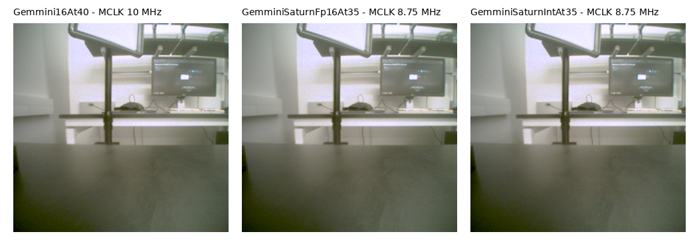

# The drone stack on the accelerator shells

Until this page the drone had run only on the plain Rocket shell,
`RocketArty200TDroneFullDDRConfig` at 50 MHz. This page covers the three
accelerator shells this branch supports, how to get their bitstreams and
devicetrees, what `rb` changes for them, and what was measured on the bench.
DroNet on these shells has its own page:
[`dronet-on-accel-socs.md`](dronet-on-accel-socs.md).

Evidence labels are the ones [`verification.md`](verification.md) defines:
**verified** means run here with the output quoted, **recorded** means taken
from another log (mostly the dev tree's 2026-09-23 bring-up), and **blocked**
means it cannot be checked yet, with the reason given.

| Shell | Accelerators | Scalar FPU | Clock | Timing | This branch |
| --- | --- | --- | --- | --- | --- |
| `RocketArty200TDroneGemmini16At40Config` | Gemmini 16x16 | full | 40 MHz | met, WNS 0.000 | **supported**: bootup_check, DroNet c |
| `RocketArty200TDroneGemminiSaturnFp16At35Config` | Gemmini + Saturn (fp16 vector) | FP16 only | 35 MHz | met, WNS +0.289 | **supported**: bootup_check, DroNet a1 |
| `RocketArty200TDroneGemminiSaturnIntAt35Config` | Gemmini + Saturn (integer vector, noPermute) | full | 35 MHz | met, WNS +0.201 | **supported**: bootup_check, DroNet b35 |
| `RocketArty200TDroneSaturn40Config` | Saturn V128D128 | full | 40 MHz | met, WNS +0.364 | not supported (flight controller faults, below) |
| `RocketArty200TDroneGemminiSaturnIntAt40Config` | as IntAt35 | full | 40 MHz | **not met**, WNS -0.067 | not supported |

"Supported" means: the image builds from this branch's committed files on a
fresh clone, and ran on the board with the published bitstream on
2026-09-24. **The flight controller is not supported on any of them** (see
[Known issues](#known-issues)).

## 1. Inputs: bitstreams and devicetrees

`rb` needs the elaborated DTS of a shell to build for it, and a bitstream to
program it. On a host without Chipyard both come from the side repositories of
[`setup.md`](setup.md) steps 2d and 3c:

```console
git clone git@github.com:lorenshung/dts.git ~/riskybird-dts
git clone git@github.com:lorenshung/bitstream.git ~/riskybird-bitstreams
source ./rb-env.sh          # picks both up
ls ~/riskybird-dts/arty200t/ | grep -E 'Gemmini16At40|Fp16At35|IntAt35'
```

Expect `arty200t.RocketArty200TDroneGemminiSaturnIntAt35Config.dts` among
them. A collection without it makes every IntAt35 build stop with
`elaborated DTS is missing`. The bitstreams to use are the 2026-09-23
post-route builds. Their sha256 prefixes are Gemmini16At40 `6e002a75`,
Fp16At35 `1c61194d` and IntAt35 `99a74956`, and `manifest.json` in the
bitstream repository carries the full hashes. Those files are the ones the
bench runs below loaded.

On a silicon-tier host, `backends/chipyard` at this branch's pin elaborates
all three (IntAt35 is `dd738706`). The recipe is in the dev tree's
`docs/accel-shells-bringup.md` §1: `rb area run --attrs dsp`, then
`make ... rb-impl`, with `RB_IMPL_DIRECTIVE=explore` for Gemmini16At40.

## 2. What `rb` does differently for these shells

All of this is automatic and printed in the build log. Each value below is read
from that build's `.config` (verified).

- **Clock.** `hardware/zephyr/fpga.conf` assumes 50 MHz. `rb` reads
  `timebase-frequency` from the shell's DTS and appends
  `.rb/generated/arty200t.<Config>.clock.conf` with
  `CONFIG_SYS_CLOCK_HW_CYCLES_PER_SEC=40000` or `35000`. Every SiFive divider
  derives from it: tick, UART baud, I2C, SPI, PWM, and the camera MCLK.
- **FPU.** Fp16At35's scalar FPU implements only Zfh, while its DTS still says
  `f`. `rb` appends `...fpu.conf` with `CONFIG_FPU=n`, so the image is
  soft-float. The list is `FP16_SCALAR_FPU_CONFIGS` in `tools/rb/boards.py`.
- **ISA contract.** After linking, `rb` disassembles every image built for
  an FP16 or noPermute shell and refuses it if it contains an instruction
  the shell decodes as illegal. On an FP16 shell that is any floating-point
  instruction, scalar or vector, because `mstatus.FS` stays Off. On the
  noPermute shell (IntAt35) it is vector FP, or
  `vslide*`/`vrgather*`/`vcompress`/`vmv<n>r.v`. A pass prints:

  ```
  rb: zephyr.elf: no instructions RocketArty200TDroneGemminiSaturnFp16At35Config decodes as illegal (scalar and vector FP checked)
  rb: zephyr.elf: no instructions RocketArty200TDroneGemminiSaturnIntAt35Config decodes as illegal (vector FP, permutes, vmv<n>r checked)
  ```
- **Camera MCLK.** MCLK is the fabric clock divided by `2*(div+1)`, so the
  fixed `div = 1` gives 10 MHz at 40 MHz and 8.75 MHz at 35 MHz, not 12.5.
  The capture prints the rate it programs. `RB_EXTRA_CFLAGS=-DCAM_MCLK_DIV=<n>`
  overrides the divider. The sensor answers at both new rates.

| Config | timebase | `CYCLES_PER_SEC` | FPU | UART divisor (recorded, 09-23) |
| --- | --- | --- | --- | --- |
| Gemmini16At40 | 40000 | 40000 | y | 346, 115,274 baud |
| GemminiSaturnFp16At35 | 35000 | 35000 | **n** (soft-float) | 302, 115,512 baud |
| GemminiSaturnIntAt35 | 35000 | 35000 | y | 302 |

## 3. Sensors and a camera frame: `bootup_check`

Keep the battery out. `bootup_check`'s default mode compiles no PWM driver:
`# CONFIG_PWM is not set`, and `nm` finds only the DT flag and an empty
`_pwm_driver_api_list`. Take `<bitstream-loc>`, its bus:dev, and `<debug-loc>`
from `rb probe-ftdi` (see setup.md 3d).

```console
# SRAM only. `rb program` writes the SPI flash as well.
openFPGALoader -b te0712_8 --busdev-num <bus:dev> --write-sram \
    --bitstream ~/riskybird-bitstreams/arty200t/arty200t.<Config>.bit

rb build bootup_check --target arty200t --config <Config> --ram-console --pristine always
timeout 300 rb debug bootup_check --target arty200t --config <Config> \
    --usb-location <debug-loc> --ram-console \
    --gdb-script hardware/ospi/bootup-capture-halt.gdb
python3 hardware/ospi/frame-to-png.py capture-frame.raw 326
python3 -c "d=open('capture-frame.raw','rb').read();W=326;n=len(d)//W;print([c for c in range(W) if sum(d[r*W+c] for r in range(n))/n<2])"
    # an aligned frame prints [0, 1]
```

`bootup-capture-halt.gdb` prints the RAM console, writes
`capture-frame.raw` and `capture-ramconsole.bin` in the repository root, and
leaves the hart halted at `camera_frame_ready`. There,
`rb debug ... --no-load --no-run --gdb-script hardware/bench/accel-regs.gdb`
reads the capture core, its DMA block and both UART divisors without popping
any FIFO.

**Verified 2026-09-24**, from a fresh clone of this branch, on the published
bitstreams, with this branch's camera stack. That stack is `integration/zephyr/camera`
as taken from main in 8d93b5e, plus the capture fix below. Every run ended in
`BOARD READY`, with 6 passed, 1 warned (the known 2-of-3 ToF fault) and 1
skipped (PWM).

| | Gemmini16At40 | Fp16At35 | IntAt35 |
| --- | --- | --- | --- |
| runs, `BOARD READY` | 2 / 2 | 4 / 4 | 3 / 3 |
| misa (OpenOCD) | `0x800000000094112d` | `0x8000000000b41105` (no F, no D) | `0x800000000094112d` (no V) |
| camera MCLK printed | 10000000 Hz | 8750000 Hz | 8750000 Hz |
| AE stopped at (of MAX_INTG 3900) | 2460 | 2160 | 2160 |
| IMU \|a\| (mm/s²) | 9713-9717 | 9704-9764 | 9734-9749 |
| PMW3901 SQUAL | 89-91 | 84-90 | 85 |

One run on Fp16At35:

```
[  OK  ] main memory (DDR3)   4 MiB at 0x82000000 verified address-in-address
[  OK  ] I2C inventory        5 answered; every fixed part present
[  OK  ] ADS7128 expander     SYSTEM_STATUS=0x81 (register framing accepted)
[ WARN ] ToF array (XSHUT)    2 up, 2 absent -- down sensor present
[  OK  ] BMI088 IMU           accel |a| = 9764 mm/s^2 within 5% of g; gyro reads
         MCLK 8750000 Hz = sysclk 35000000 Hz / (2*(div 1 + 1))
         AE stopped at integration 2160 of MAX_INTG 3900; analog gain 0x00 of MAX_AGAIN 0x02
[  OK  ] HM01B0 camera        102690-byte frame captured; reshape rows at 326
[  OK  ] PMW3901 flow         id 0x49/inv 0xb6; dx=+0 dy=+0 SQUAL=90 shutter=7918
[ SKIP ] PWM motors           built without PWM -- use --mode motors
0 stage(s) failed, 1 warned, 1 skipped, 6 passed.
BOARD READY
```



All three frames are aligned (dummy columns `[0, 1]`).

**A capture race, found and fixed here.** Before
`camera: re-read CAPCOUNT once the capture loop stops`, 2 of 4 runs on Fp16At35
failed with `[ FAIL ] HM01B0 camera  overflow -- the frame did not complete`.
Those runs used the camera library this branch had before 8d93b5e, whose
polling loop is the same as the current one. The core sets CAPCOUNT and
CAPSTAT.DONE in the same cycle. The loop read CAPCOUNT, then CAPSTAT, and
exited on DONE holding a stale count. In each failure CAPCOUNT read the full
102690 afterwards, and the failing runs streamed the same three frames as the
passing ones, so it was not a timeout. With the fix, all 20 runs passed:
11 on the earlier library (6 on Fp16At35, 3 on IntAt35, 2 on Gemmini16At40)
and the 9 above. `workloads/camera_photo` has its own copy of the loop and is not
fixed.

## Known issues

These come from the dev tree's 2026-09-23 bench (**recorded**). They are
the reason the flight controller is not part of this branch's support.

- **The flight controller faults on every Saturn-carrying shell.** The same
  FC ELF ran on Gemmini16At40 for 8,590 iterations with 0 faults. On
  Saturn40 it faulted 3 times in about 10,800 iterations, on the default and
  the explore bitstream alike. On IntAt35 it faulted on all 3 runs. Each
  mcause-2 fault resumes 2 bytes into a 4-byte instruction, usually a `flw`,
  inside the telemetry `printk`. The leading hypothesis is a lazy-FPU trap
  returning to the wrong halfword on the Saturn-attached Rocket. It is not
  diagnosed. Details and dumps are in the dev tree's
  `docs/accel-shells-bringup.md` §5.
- **The flight controller cannot fly Fp16At35.** Soft-float, its loop takes
  391 ms per iteration, 11x the 50 MHz loop and 3.3x the ESP's 120 ms receive
  failsafe. The period is host-timestamped: `tools/bench/tsreader.py` logs the
  console and `python3 tools/bench/fcstats.py <prefix>.ts.log` reduces it
  (390.9 ms/it on that run; the same reduction gives 43.0 ms/it on
  Gemmini16At40).
- **IntAt40 misses timing** (WNS -0.067 ns, even with the explore directive).
  IntAt35 is the same design at 35 MHz, and it closes.
- **Capture misalignment.** The first capture after programming usually comes
  out shifted, with flags `0x3f`/`0x3d`, and the dummy columns land anywhere
  from 4 to 320 instead of 0-1. On 2026-09-24 the shifts were: Fp16At35 at
  35-36 and 33-34, Gemmini16At40 at 318-319 and 4-5, IntAt35 at 319-320 and
  35-36. It is not always the first capture only. With the earlier camera
  library, Gemmini16At40's second capture (flags `0x3e`) wrapped vertically
  at row 280, which the column check above cannot see. `bootup_check` does
  not test alignment, so it still passes. Not root-caused.
- **DroNet hangs on its first run after a flight-controller run** (3/3 on
  Gemmini16At40). Reload SRAM between them. See
  [`dronet-on-accel-socs.md`](dronet-on-accel-socs.md).

## What this does not prove

- **No motor path was exercised** on any accelerator shell, and the ESP was not
  touched.
- **The UART divisors were not re-read on 2026-09-24.** The table's divisors
  are the dev tree's register dumps of the same bitstreams. A legible console
  at 115200 on the 35 and 40 MHz shells was also recorded there, not re-run
  here.
- **Reproducible sources are not reproducible bitstreams.** The published
  `.bit` files are the ones that were benched. A rebuild from the same Chipyard
  pin gives matching reports but a different file, because `USR_ACCESS` stamps
  the build time.
