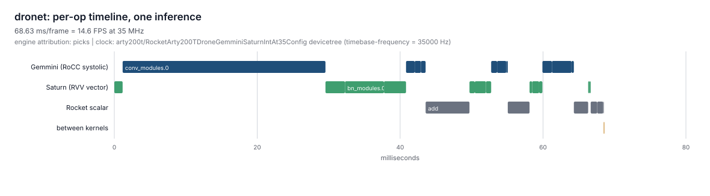
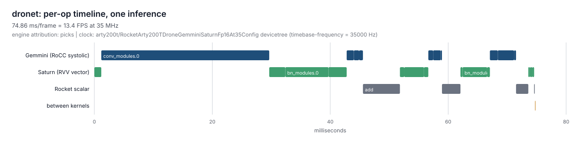
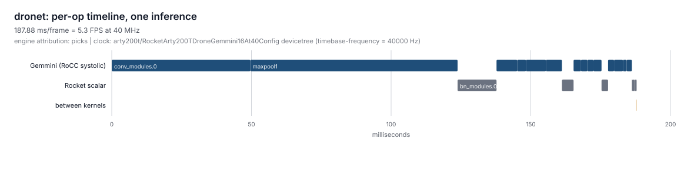

# DroNet on the accelerator shells

The integer DroNet ran on three arty200t accelerator shells, built from this
branch's committed files on a fresh clone, with the published bitstreams.
This page covers how to reproduce each image, how the two Gemmini+Saturn
images are generated, and what the board measured. The shells themselves are
covered in [`accel-shells-bringup.md`](accel-shells-bringup.md), and the
earlier single-shell write-up is
[`modelblaster-dronet-on-fpga.md`](modelblaster-dronet-on-fpga.md).

| id | Shell | Sources (`artifacts/modelblaster/dronet/int8/`) | Board, 2026-09-24 |
| --- | --- | --- | --- |
| **b35** | `RocketArty200TDroneGemminiSaturnIntAt35Config` | `gemmini_q31_rvv_zve64x-gray-nhwc` | **14.57 fps**, max_abs_err 3, `[114,127]`, 3/3 |
| **a1** | `RocketArty200TDroneGemminiSaturnFp16At35Config` | `gemmini_q31_rvv_softfp-gray-nhwc` | **13.36 fps**, max_abs_err 3, `[114,127]`, 3/3 |
| **c** | `RocketArty200TDroneGemmini16At40Config` | `gemmini_q31-drift2` | **5.32 fps**, max_abs_err 2, `[-58,127]`, 3/3 |

## Run one

You need the models tier ([`setup.md`](setup.md) step 5a) plus the shell's
DTS and bitstream ([`accel-shells-bringup.md`](accel-shells-bringup.md) §1).
You do not need Chipyard or spike, because the sources are already verified.

```console
CFG=RocketArty200TDroneGemminiSaturnIntAt35Config
GEN=artifacts/modelblaster/dronet/int8/gemmini_q31_rvv_zve64x-gray-nhwc
openFPGALoader -b te0712_8 --busdev-num <bus:dev> --write-sram \
    --bitstream ~/riskybird-bitstreams/arty200t/arty200t.$CFG.bit
rb modelblaster build --board arty200t --config $CFG --gen-dir $GEN --ram-console
timeout 240 rb debug dronet --target arty200t --config $CFG --ram-console \
    --usb-location <debug-loc> --gdb-script hardware/modelblaster/dronet-capture.gdb \
    2>&1 | tee b35.log
rb modelblaster report b35.log --model dronet --board arty200t --config $CFG --gen-dir $GEN
    # writes profile.csv and gantt.svg beside the log
```

Swap `CFG`/`GEN` for a1 or c from the table above. **Build right before
`debug`**: every DroNet image shares one build directory, and `rb debug`
rebuilds from whatever was built there last. `dronet-capture.gdb` breaks on
`sys_reboot` (the harness's last act) and on `k_sys_fatal_error_handler`,
prints the RAM console, and leaves the hart halted. If neither breakpoint is
hit, `hardware/bench/dronet-where.gdb` with `--no-load --no-run` reports where
the core is.

The images contain no PWM or motor code: `# CONFIG_PWM is not set`, an empty
PWM driver list, and no reference to the PWM blocks at `0x1005_0000`/`0x1005_1000`.
That was checked on each ELF before it ran.

## Board results (verified 2026-09-24)

All three were built from a fresh clone and loaded onto the published
bitstreams. Each ELF's hash was re-checked after every run.

| | b35 on IntAt35 | a1 on Fp16At35 | c on Gemmini16At40 |
| --- | --- | --- | --- |
| WALL ticks, 3 runs | 2402, 2402, 2401 | 2620, 2622, 2621 | 7515, 7526, 7515 |
| tick rate | 35 kHz | 35 kHz | 40 kHz |
| frames/s | **14.57** | **13.36** | **5.32** |
| max_abs_err / output | 3 / `[114,127]` | 3 / `[114,127]` | 2 / `[-58,127]` |
| profile rows | 28 | 28 | 21 |
| engine split (of kernel time) | Gemmini 55.3, Saturn 25.7, scalar 18.9% | Gemmini 50.9, Saturn 33.6, scalar 15.5% | Gemmini 88.3, scalar 11.7% |
| ELF sha256 (this clone) | `a0b122ea…` | `afa9afe8…` | `9b1fe222…` |

`rb modelblaster report` on b35, run 1:

```
cpu clock        35 MHz  (rdcycle, per-op)
tick clock       35 kHz  (mtime, wall; 0.0286 ms quantum)
clock evidence   arty200t/RocketArty200TDroneGemminiSaturnIntAt35Config devicetree (timebase-frequency = 35000 Hz)
ops profiled     28  (engine attribution: picks)
wall ticks       2,402 mtime ticks
inference        68.629 ms
frames/s         14.57
verify           max_abs_err=3 max_rel_err=0.025641 n=2
Gemmini (RoCC systolic)        1,324,992     37.86         55.3%
Saturn (RVV vector)              616,727     17.62         25.7%
Rocket scalar                    453,855     12.97         18.9%
```

- **b35 is the fastest DroNet on this board**, 8% under a1 at the same
  clock. The integer shell keeps the full scalar FPU.
- **a1 reproduces Dima's 10b50ba**, which recorded 2,629 ticks (13.31 fps).
  The dev tree's 09-23 build of a1 took 2613 ticks. Today's 2620-2622 is the
  same kernels with the harness's vector-enable block added. That block adds
  20 bytes to `.text` and is never taken on this shell. The 0.3% is the
  I-cache placement sensitivity 10b50ba also saw.
- **c** matches the recorded 7,536 ticks (5.31 fps) to within 0.3%.

The hash differs from the setup tree's reference ELFs only because the build
path is embedded in the debug info and symbol table. Every allocated section
matched, checked section by section with `objcopy`: b35 against `4965ac4f`,
the image benched on 09-23; a1 against `ac422353`; c against `7befbe21`.

Per-op timelines, one inference each. They are waterfalls because a single
hart issues every op in sequence. On c the unfused first conv and maxpool
take two thirds of the frame. On a1 and b35 they are one fused Gemmini call
of about 28 ms, and the batchnorms run on the vector unit. The per-op CSVs
sit beside each SVG.







## Reading the numbers: WALL is mtime, not CPU cycles

- Per-op `cycles` are `rdcycle` deltas at the CPU clock (35 or 40 MHz).
- `MODELBLASTER_WALL_CYCLES` is `k_cycle_get_64()`: raw mtime ticks. Chipyard
  runs mtime at fabric/1000, so **fps = tick_hz / WALL**, and WALL equals the
  frame time in kilocycles of the CPU clock.
- WALL is raw, so a wrong Kconfig timebase cannot inflate it. `report` reads
  both clocks from the DTS and prints them as `clock evidence`.

## How the two Gemmini+Saturn directories are made

They are Dima's 10b50ba recipe, which `rb modelblaster generate` cannot
express: grayscale input, conv0 and maxpool fused, NHWC islands
(`assign_layouts --policy islands`), and the `gemmini_q31_rvv` kernels
compiled for an **integer-only** vector unit.

- **`zve64x`, never `v`.** In GCC, `v` implies zve64d, which implies D and
  F. `rv64imacv` with `-mabi=lp64` still compiles a float multiply to
  hardware F/D instructions. `rv64imac_zve64x` implies nothing
  floating-point. The targets are `gemmini_q31_rvv_softfp` (Fp16At35,
  `rv64imac_zve64x`/lp64, image `CONFIG_FPU=n`) and `gemmini_q31_rvv_zve64x`
  (IntAt35, `rv64imafdc_zve64x`/lp64d), both in ModelBlaster's
  `pipeline/backends.py`.
- **noPermute.** IntAt35's Saturn has no permute unit, so `vmv<n>r.v`
  decodes as illegal, and GCC emits `vmv4r.v` for the RVV `linear_s8`. On
  that target `linear_s8` stays on the scalar reference, which costs about
  two dot products of 2048. rb's ISA scan finds 0 permutes in the b35 ELF.
- **Vector state on a Zve-only core.** Rocket sets misa.V only with vector
  float, so misa.V = 0 on IntAt35, and Zephyr never turns `mstatus.VS` on.
  The first build trapped at its first `vsetvli`. The harness now sets VS
  itself when misa.V is clear (ModelBlaster `1293334`). This is safe only
  because the harness runs one thread with IRQs locked. Zephyr's
  `HAS_V()` also skips vector save/restore when misa.V = 0.

To regenerate either directory (silicon tier: this needs Chipyard's spike):

```console
python3 tools/modelblaster/dronet_gray_nhwc.py --target gemmini_q31_rvv_zve64x
diff -r .rb/modelblaster/dronet-gray-nhwc/ir_gray_nhwc/gemmini_q31_rvv_zve64x \
        artifacts/modelblaster/dronet/int8/gemmini_q31_rvv_zve64x-gray-nhwc
```

**Verified 2026-09-24** on a fresh clone. For both targets the IR, the
skeleton and `kernels.c` came out byte-identical to the sources the 09-23
bench images were built from. Every curated kernel passed the gate at
max_abs_err 3, and the picks match 10b50ba's.
`RB_RISCV_TOOLS` pointed at another checkout's Chipyard `riscv-tools`, the
override `tools/rb/modelblaster.py` documents for a checkout without its own.

Two things in the script exist because the obvious way fails silently:

- **The gate needs a Q0.31 Gemmini spike model.** Chipyard pins libgemmini
  `ea8f7ed`, which has a float scale. With it, every Gemmini kernel fails at
  max_abs_err 111 and quietly falls back to the reference. The Q31 model is
  public source: `ucb-bar/libgemmini` `5b1254a`, built against ModelBlaster's
  `per_config/default16x16/gemmini_params.h`. That header is byte-identical to
  the one behind the hand-swapped library the earlier runs used. On the a1
  verify ELF, this build gives max_abs_err 3, as the hand-swapped one does,
  and Chipyard's gives 111. The script builds it and passes it with
  `--extlib`, because spike's RPATH beats `LD_LIBRARY_PATH`. It also sets
  `MODELBLASTER_GEMMINI_SPIKE`, because ModelBlaster otherwise falls back to a
  hardcoded spike path in another user's directory when that path exists.
- **The kernel pre-seed ignores `--algorithms`.** Without a curated directory
  that leaves them out, ModelBlaster seeds `gemmini_resadd` (an fp32 scale
  path) for `add_s8` and `gemmini_blocked_tb32` for the relayouts, and the
  picks follow. The script builds `kernels/` minus those files, and for the
  noPermute target minus the RVV `linear_s8`.

## Known issues

- **Not a flight configuration.** DroNet ran alone, as a single-thread,
  IRQ-locked harness. It has not shared a core with the flight controller,
  and the flight controller faults on the Saturn shells anyway
  ([`accel-shells-bringup.md`](accel-shells-bringup.md#known-issues)).
- **DroNet hangs on its first run after a flight-controller run.** This was
  recorded 3/3 on Gemmini16At40 in the dev tree and never otherwise (0/6). A
  second attempt succeeds. The cause is not identified. Reload SRAM (5 s)
  between them.
- **b on IntAt40** is not offered: that shell misses timing.
- **Spike is not cycle-accurate for Gemmini.** Spike WALL values and engine
  splits are not board predictions.
