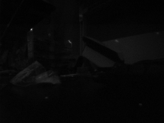

# HM01B0 camera bring-up — process and results

A minimal FPGA target that proves two independent things about the HM01B0 camera on the
Arty100T/TE0712 drone carrier:

1. the FPGA can talk to and configure the physical sensor (**control path**, I²C);
2. the Chisel capture RTL actually receives pixel data (**receive path**, PCLK/FVLD/LVLD/D[7:0]).

The only host interfaces are FTDI JTAG and FTDI UART. There is no Vivado ILA anywhere in this
flow, which is the constraint that shaped most of the design below.

---

## 1. What the existing "OSPI" RTL turned out to be

The first task was to find out what was already there, because the name is misleading.

**It is not Octal-SPI, and it is not command-driven.** `generators/chipyard/src/main/scala/ospi/`
already contained a correct HM01B0 *parallel-video* capture core. Its own source says so:

- `SensorIO` in `CapturePort.scala` is the camera interface — `pclk` as an input clock, `fvld`,
  `lvld`, `d[7:0]`, `intr` as inputs; `mclk` and `trig` as outputs.
- Its header comment states the control path explicitly: *"SCL/SDA (I2C) are intentionally NOT
  here: sensor configuration is done by Chipyard's existing `sifive.blocks.devices.i2c.TLI2C`."*

So the sensor's control path was already I²C and the data path was already a parallel camera
interface. The "OSPI" name is only a label on the shell extension used for pin plumbing.

What the core already did well, and was left alone:

| Concern | Existing implementation |
|---|---|
| PCLK-domain sampling | `CaptureFrontend`, one-cycle look-ahead for EOL/EOF |
| Multibit CDC | `AsyncFifo`, Gray-coded pointers, N-flop synchronizers — **not** per-bit 2-flop sync |
| MCLK generation | `sysclk / (2 * (mclkDiv + 1))` |
| Frame geometry | measured, not assumed; sticky `geomErr` against expected |
| Overflow | sticky, set when a beat is dropped into a full FIFO |

`CaptureParams` hard-requires `dataWidth == 8`, and the carrier wires D0–D7, so 8-bit mode is
correct here — **no 1-bit or 4-bit nibble assembly is needed or implemented** for this board.

What was missing was precisely the ILA-free observability: no PCLK edge counter, no FVLD/LVLD
edge counters, no captured-pixel count, no last-pixel register, no bounded "capture exactly N
pixels" mode, and a frame buffer sized for a whole 324×324 frame rather than one line.

---

## 2. Architecture

```text
HM01B0                          FPGA (xc7a100t / TE0712)
                                                    Rocket (rv64, 50 MHz)
  SCL/SDA  <--------------->  TLI2C @ 0x1004_0000  ----+
                                                       |  TileLink
  MCLK     <---------------  mclk divider              |
  TRIG     <---------------  trig                      |
                                                       |
  PCLK     --------------->  +-----------------+       |
  FVLD     --------------->  | CaptureFrontend |       |
  LVLD     --------------->  |   (PCLK domain) |       |
  D[7:0]   --------------->  +--------+--------+       |
  INT      --------------->           | PixelFlit      |
                              +--------v--------+      |
                              |   AsyncFifo     |  Gray-coded CDC
                              +--------+--------+      |
                                       | system clock  |
                              +--------v--------+      |
                              |   FrameBuffer   |  1024 beats (one line)
                              +--------+--------+      |
                                       |               |
                              OspiCapture regmap @ 0x1008_0000 ----+
                                                                    |
                                          UART @ 0x1002_0000 -> FTDI channel A (console)
                                          UART-TSI            -> FTDI channel B (loader)
```

The capture core drains the CDC FIFO continuously into the frame buffer. That is deliberate and
pre-existing: the core only commits a frame when its in-band EOF marker is accepted, so exposing
the CDC FIFO directly to software would deadlock "wait for frame, then drain".

### Bounded capture

Added to the capture core (not the MMIO wrapper, so the mill test suite covers it):

- `pixelTarget == 0` keeps the historical free-running behaviour — **every existing config and all
  17 pre-existing tests are unaffected**.
- A non-zero target makes the core present exactly that many pixel beats after `arm`, then stop.
- While stopped it still asserts `ready`, so the CDC FIFO keeps draining. Stopping therefore
  cannot manufacture a false overflow — which is tested.

### Diagnostic counters and their CDC

The PCLK-domain counters are binary in their own domain and launched as a **registered Gray code**,
then synchronized and converted back in the system domain. At most one bit changes per increment,
so a read always resolves to the value before or after an increment, never a mixture. Independent
per-bit synchronizers on a binary counter would not be safe and are not used.

If the sensor never drives PCLK, the counter never advances and reads zero — which is exactly the
"no camera clock" signature bring-up needs to tell apart from "clocked but never syncs".

---

## 3. MMIO register map

**Base `0x1008_0000`**, 4 KiB, device `ucbbar,ospi-hm01b0`, PLIC source 3.

Pre-existing registers:

| Offset | Name | Access | Meaning |
|---|---|---|---|
| `0x00` | `CTRL` | RW | `[0]`=enable `[1]`=continuous `[2]`=irqEnable; write-one pulses `[3]`=trigger `[4]`=clear `[5]`=flush `[6]`=**arm** |
| `0x04` | `GEOM` | RW | `[15:0]`=expWidth `[31:16]`=expHeight |
| `0x08` | `MCLKDIV` | RW | MCLK = sysclk / (2·(div+1)) |
| `0x0c` | `FIFOCOUNT` | RO | buffered beats (this is the usable FIFO level) |
| `0x10` | `FRAMECNT` | RO | completed frames |
| `0x14` | `LASTWIDTH` | RO | measured width of last frame |
| `0x18` | `LASTHEIGHT` | RO | measured height of last frame |
| `0x1c` | `FLAGS` | RO | `[0]`=dataValid `[1]`=overflow `[2]`=geomErr `[3]`=sensorInt `[4]`=busy `[5]`=irqPending `[6]`=bufferFull |
| `0x20` | `DATA` | RO | pop: `[31]`=valid `[10]`=eof `[9]`=eol `[8]`=sof `[7:0]`=pixel |
| `0x24` | `CAPACITY` | RO | frame-buffer capacity in beats |

Added for bring-up:

| Offset | Name | Access | Meaning |
|---|---|---|---|
| `0x28` | `PIXTARGET` | RW | pixels to capture after ARM; 0 = free-running |
| `0x2c` | `CAPCOUNT` | RO | pixel beats captured in the current/last bounded capture |
| `0x30` | `PCLKCNT` | RO | PCLK rising edges — **zero means no camera clock at all** |
| `0x34` | `FVLDCNT` | RO | FVLD rising edges — zero means no frame sync |
| `0x38` | `LVLDCNT` | RO | LVLD rising edges — zero means no line sync |
| `0x3c` | `LASTPIX` | RO | `[7:0]` most recent pixel value |
| `0x40` | `CAPSTAT` | RO | `[0]`=armed `[1]`=captureDone |

The CDC FIFO's own occupancy is **not** exposed: reading it safely from the system domain needs
another Gray crossing for a number that is only meaningful for a few cycles. `FIFOCOUNT` (the
frame-buffer level) is the useful one and is already there.

---

## 4. Pin mapping

All from the supplied TE0712 carrier list. Verified against the generated
`*.shell.xdc`: **26 `PACKAGE_PIN` constraints, all unique**.

| Function | Signal | Pin |
|---|---|---|
| I²C | `i2c_scl` / `i2c_sda` | **A15 / A16** |
| Camera data | `ospi_d[0..7]` | **H22, J22, K18, K19, L19, L20, J19, H19** (index 0 = D0 = LSB) |
| Camera sync | `ospi_pclk` / `ospi_fvld` / `ospi_lvld` | **H20 / K22 / G20** |
| Camera control | `ospi_mclk` / `ospi_trig` / `ospi_intr` | **K21 / U20 / V20** |
| Console UART | `uart_rxd` / `uart_txd` | E21 / D21 |
| UART-TSI | `uart_tsi_rxd` / `uart_tsi_txd` | P16 / U18 |
| JTAG | `TCK`/`TMS`/`TDI`/`TDO` | A19 / F19 / A18 / F20 |
| System clock | `sys_clock_p` / `sys_clock_n` | H4 / G4 (**untouched**, DIFF_SSTL15, 50 MHz) |

### Measured bank assignment

Read out of the device database rather than assumed
(`vivado -mode batch`, `link_design -part xc7a100tfgg484-2`, `get_package_pins`):

| Bank | Signals | Consequence |
|---|---|---|
| **15** | `ospi_d[0..7]`, `PCLK`, `FVLD`, `LVLD`, `MCLK` | the 12 camera signals here can move to 1.8 V **as a group** |
| **14** | `ospi_trig` U20, `ospi_intr` V20 — **plus `uart_tsi_rxd` P16 and `uart_tsi_txd` U18**, `MOTOR3` R17 | setting this bank to 1.8 V would take the UART-TSI loader with it |
| **16** | `uart_rxd`/`uart_txd`, all four JTAG, `i2c_scl`/`i2c_sda`, `RST`, MOTOR1/2/4, the four sensor interrupts | stays 3.3 V |
| **35** | `sys_clock_p`/`sys_clock_n` | DDR3 bank, 1.5 V, untouched |

> **Correction: the PMW3901 SPI pins are not the ones this table used to list.**
> It recorded `SCLK` L21, `MISO` M21, `MOSI` N20, `NCS` M20, `MOTION` L13 in
> bank 15. Those are J2_62/64/66/68/74 -- the wrong connector. The sensor is on
> **J1**: `SCLK` **F16** (J1_82), `MOSI` **E17** (J1_80), `MISO` **E16**
> (J1_78), `NCS` **D16** (J1_76), `MOTION` **B17** (J1_66).
>
> Measured, not assumed: a bitstream built with the old pins read an undriven
> MISO -- with a pulldown the chip ID came back a clean `0x00`, which a
> connected device cannot produce. The sensor was never at fault; it flies under
> the ESP32 on this same board. See `docs/drone-initial-bringup.md`.
>
> `NRESET` and `LED_N` have no net on either the FPGA or the ESP32, and the
> sensor is flown without them.

**The camera interface is not confined to one bank.** Twelve of its fourteen signals are in bank
15 and can be switched to `LVCMOS18` together by setting that bank's VCCO to 1.8 V. `TRIG` and
`INT` are in bank 14 alongside the UART-TSI loader pins, so they cannot follow by a bank change
without breaking the firmware load path.

For bring-up neither matters: capture runs free-running so `TRIG` is unused, and `INT` is only the
motion interrupt. Leave both disconnected unless a translator is present.

`WithArty100TOspi` takes an `ioStandard` parameter (default `LVCMOS33`) so the switch is one
argument once you have decided the bank voltage:

```scala
new WithArty100TOspi(ioStandard = "LVCMOS18")
```

---

## 5. Boot and communication path

The carrier's FTDI is a **Dual RS232-HS with two independent channels**, which resolves the
loader/console question without compromise:

- **Channel B → UART-TSI (P16/U18)**: loads the firmware image. This is the proven path `rb run`
  already uses on this board.
- **Channel A → console UART (E21/D21) @ 115200**: diagnostics only.

So neither channel has to be both loader and console. JTAG is available and the Rocket debug
module is present, but loading over UART-TSI was chosen because it is the path already exercised
by every working image on this board — preference order 2 in the brief, not 1, because 1 is not
independently proven here.

---

## 6. Files

**Added**

```
workloads/camera_bringup/CMakeLists.txt
workloads/camera_bringup/prj.conf
workloads/camera_bringup/src/main.c          bring-up program
workloads/camera_bringup/src/hm01b0.h        sensor registers, with provenance labels
hardware/ospi/test/src/ospi/CameraBringupSpec.scala   9 new tests
docs/hm01b0-camera-bringup.md                this file
```

**Modified**

```
hardware/ospi/src/ospi/Params.scala                   diagCountWidth
hardware/ospi/src/ospi/CapturePort.scala              arm/pixelTarget + diagnostic status
hardware/ospi/src/ospi/HM01B0Capture.scala            Gray-CDC counters, bounded capture
backends/chipyard/generators/chipyard/src/main/scala/ospi/{Params,CapturePort,HM01B0Capture}.scala
                                                      byte-identical mirror of the above
backends/chipyard/generators/chipyard/src/main/scala/ospi/OspiChipyard.scala
                                                      7 new registers, ARM bit, relaxed buffer floor
backends/chipyard/fpga/src/main/scala/arty100t/Configs.scala
                                                      CameraBringupConfig + bring-up periphery
backends/chipyard/fpga/src/main/scala/arty100t/HarnessBinders.scala
                                                      camera and I²C pins
tools/rb/boards.py                                    camera_bringup workload, scratchpad markers
```

The two RTL copies under `hardware/ospi/src/` and `backends/chipyard/.../ospi/` were byte-identical
before this work and are byte-identical after it. Keep them that way.

---

## 7. Commands

```console
# Simulation tests (chiseltest via mill) — 26 tests, ~9 s
cd hardware/ospi && ./mill ospi.test

# Bring-up firmware
./rb build camera_bringup --target arty100t --config CameraBringupConfig --pristine always

# FPGA bitstream
./rb chipyard build --board arty100t --config CameraBringupConfig

# Program, load firmware, open the console
./rb program --board arty100t --config CameraBringupConfig
./rb run camera_bringup --target arty100t --config CameraBringupConfig
```

`--pristine always` on the firmware build is **not optional** when switching between a DDR config
and a scratchpad config: the Zephyr output directory is shared across configs, so a cached CMake
configuration will silently relink against the previous config's memory size.

If serial auto-discovery is ambiguous, set `RB_TSI_PORT` and `RB_CONSOLE_PORT` explicitly.

---

## 8. Expected UART output on success

```text
=====================================================
RiskyBird HM01B0 camera bring-up
  shell   : CameraBringupConfig (arty100t / TE0712)
  capture : 0x10080000, I2C addr 0x24
  mclk    : sysclk/(2*(3+1)) = 6250000 Hz
  request : 324 pixels (one QVGA line)
=====================================================

[1/9] MMIO probe: CAPACITY = 1024 beats
[2/9] PCLK activity: 0 -> 312500 over 50 ms
[3/9] I2C probe: sensor ACKed at 0x24
[4/9] chip ID: 0x01b0 (expect 0x01b0)
[5/9] register r/w: TEST_PATTERN 0x00 -> wrote 0x01 -> read 0x01
[6/9] streaming enabled with the internal test pattern
[7/9] sync activity: FVLD rises = 3, LVLD rises = 732
[8/9] capture: 324/324 pixels in 20 ms, flags=0x00

first 64 pixels:
01 02 04 08 10 20 40 80 01 02 04 08 10 20 40 80
...

[9/9] drained 324 pixels: min=0x01 max=0x80 avg=63 checksum=0x...
       counters: pclk=... fvld=... lvld=... frames=... lastpix=0x...
       test pattern: matches walking-1s (unverified expectation, not gating)

RESULT: PASS
```

Failure output names the stage. The taxonomy is distinguishable by design:

| Printed stage | Meaning |
|---|---|
| `mmio` | capture peripheral did not answer — wrong config |
| `pclk` | **no camera clock** — `PCLKCNT` never advanced |
| `i2c-nack` | sensor did not ACK at 0x24 |
| `chip-id` | I²C works but model ID is wrong |
| `reg-write` / `reg-verify` | register write not acknowledged, or read-back mismatch |
| `fvld` | clocked, but no frame-valid activity |
| `lvld` | frames start, but no line-valid activity |
| `no-pixels` | sync present, zero pixels sampled |
| `overflow` | CDC FIFO overflowed |
| `timeout` | capture stalled part-way |
| `constant-data` | every pixel identical — data bus probably stuck |

---

## 9. Build results

Everything below was actually run. **No hardware was programmed and no camera was attached**, so
nothing here is evidence about the physical sensor — these are simulation, elaboration and
place-and-route results only.

| Check | Result |
|---|---|
| `./mill ospi.test` | **26 tests pass** (17 pre-existing + 9 new), ~9 s |
| Chisel elaboration, `CameraBringupConfig` | pass; DTS has 32 KiB at `0x80000000`, `i2c@10040000`, `ospi@10080000` IRQ 3, `serial@10020000` |
| Firmware build | pass, **24,880 B / 32 KB = 75.9 %** |
| Bitstream | pass, timing **met** |
| Regression: `RocketArty100TOspiConfig`, `RocketArty100TOspiSpadConfig`, `DualRocketArty100TOspiConfig` | all still elaborate |

`CameraBringupConfig` place-and-route on xc7a100tfgg484-2:

| Metric | Value |
|---|---|
| LUT | 38,718 / 63,400 (**61.1 %**) |
| FF | 18,048 / 126,800 (14.2 %) |
| BRAM36 | 24 |
| DSP | 25 |
| WNS | **+1.120 ns** |
| Achieved | 50 MHz declared → **53.0 MHz** |
| Bitstream | `3,825,900 B`, sha256 `6771d4576b78c874…` |

```
backends/chipyard/fpga/generated-src/chipyard.fpga.arty100t.Arty100THarness.CameraBringupConfig/obj/Arty100THarness.bit
```

The bring-up shell is 9 k LUT smaller than the plain DDR shell and has the most timing slack of
any target here, which is what a minimal bring-up target should look like. Sizing the capture
buffer for one line rather than a full frame is what holds BRAM at 24.

---

## 10. Hardware assumptions and what is still unverified

**Blocking, electrical.** `hardware/ospi/docs/README.md` records the HM01B0 module **IOVDD as
1.8 V** ("Arty requires level translation"). These camera pins are currently constrained
**LVCMOS33**. `MCLK` and `TRIG` are FPGA *outputs*, so without either a 1.8 V bank or a level
translator the FPGA would drive 3.3 V into a 1.8 V sensor input. In the other direction, a 1.8 V
sensor output may not meet the ~2.0 V V_IH of a 3.3 V LVCMOS input.

The bank table in section 4 is the constraint on fixing this: bank 15 can go to 1.8 V and carry
twelve of the fourteen camera signals, but `TRIG`/`INT` sit in bank 14 with the UART-TSI loader.

> **Do not connect the sensor until the level translator is confirmed present on the carrier.**
> Everything else in this target is safe to program and run without a camera attached — the
> firmware fails cleanly at stage `pclk` or `i2c-nack`.

**Not established, non-blocking:**

- **`H20` clock-capability.** `PCLK` is constrained with `CLOCK_DEDICATED_ROUTE FALSE`, which is
  what makes routing legal from a non-MRCC/SRCC pin at the HM01B0's low pixel rate. If a
  clock-capable pin is wired to PCLK on the carrier, move it.
- **No camera RESET or PWDN pin exists in the supplied list.** The sensor is therefore reset over
  I²C (`SW_RESET` 0x0103) only. If the carrier wires a hardware reset or power-down to the FPGA,
  it is currently unbound and must be added.
- **HM01B0 register constants.** Only the I²C address `0x24`, the 16-bit-address/8-bit-data
  convention and the 8-bit output mode are verified *inside this repository*
  (`hardware/ospi/docs/README.md`). `MODEL_ID`, `SW_RESET`, `MODE_SELECT` and `TEST_PATTERN_MODE`
  are standard datasheet addresses but are **not** confirmed against a datasheet copy in this
  tree; they are labelled as such in `hm01b0.h`.
- **Data-width mode is not programmed.** The sensor's reset default is assumed to be the 8-bit
  parallel output the core requires. If it is not, the sync counters will look healthy while the
  pixel values are wrong — which is what the per-pixel dump exists to catch.
- **Walking-1s pattern content** is reported but deliberately does **not** gate the PASS verdict,
  because the expected sequence is not established by any source here.
- **`RST` (D22) is not connected to anything** in this shell. `Arty100TShell` ties `resetPin` to
  a constant and drives reset from an internal power-on reset only.

**Simulation caveat.** `DividedPclkHarness` derives PCLK from the system clock, so the tests
exercise the Gray CDC across a real *frequency ratio* but not a genuinely *asynchronous*
relationship — chiseltest drives one simulation clock. Independent-clock CDC closure remains an
FPGA static-timing concern.

---

## 11. Staged hardware checklist

Run in order. Each stage has an unambiguous pass signal, and each depends on the one before.

| # | Stage | Pass signal | If it fails |
|---|---|---|---|
| 1 | **FPGA configuration** | `openFPGALoader`/Vivado reports done; no DRC errors | check FTDI permissions (`plugdev`) and the `te0712_8` board profile |
| 2 | **UART boot** | banner + `[1/9] MMIO probe: CAPACITY = 1024` | wrong console channel, wrong baud, or firmware not loaded over TSI |
| 3 | **Camera clock** | `[2/9]` PCLK count advances | MCLK not reaching the sensor; sensor unpowered; no level translator |
| 4 | **I²C ID** | `[4/9] chip ID: 0x01b0` | SDA/SCL swapped, missing pull-ups, wrong voltage |
| 5 | **Register read/write** | `[5/9]` read-back matches | control path marginal — check I²C timing at 100 kHz |
| 6 | **Sync activity** | `[7/9]` FVLD and LVLD both non-zero | streaming not enabled, or FVLD/LVLD pins swapped |
| 7 | **One-line capture** | `[8/9] 324/324` and `RESULT: PASS` | check D0–D7 order against the dump; `constant-data` means a stuck bus |

Stages 1–5 prove the **control path**. Only stages 6–7 prove the **receive path**.

---

## Taking a picture

`camera_bringup` above answers *does the camera work*. Once that is settled,
`camera_photo` does the one thing that follows: configure the sensor, capture a
full frame, stop. It needs a DDR-backed shell -- a frame is ~79 KB and a
scratchpad holds 32 KB -- which the workload's RAM floor enforces at build time.

```bash
rb debug camera_photo --target arty200t \
    --config RocketArty200TDroneFullDDRConfig --program \
    --program-usb-location <bitstream-loc> --usb-location <debug-loc> \
    --gdb-script hardware/ospi/capture-frame.gdb
```

The frame is never printed. It is left in `pixels[]`, and `capture-frame.gdb`
copies it out over the same JTAG link that loaded the image, then converts it:

```console
=== capture core ===
  measured   326 x 242    configured 324 x 244
  pclk=1068349 fvld=4 lvld=1296 frames=1
=== frame ===
  valid bytes in pixels[]: 78892
  wrote camera-frame.raw
camera-frame.raw: 78892 bytes -> 324x242 (cropped 2 columns)
  wrote camera-frame.png
```

Both files land in the directory you ran from.



Same frame with `--stretch`, which rescales to full black-to-white -- the
sensor's default exposure is dark indoors:


### Two things that look like broken hardware and are not

**Reshape at the MEASURED width, not the configured one.** The core reports
`measured 326` where `GEOM` is configured for 324, because each line carries two
dummy pixels ahead of the active window. Reshaping at 324 shears the picture one
pixel per row, which looks exactly like a corrupt capture.
`frame-to-png.py` takes the width as an argument for this reason and drops the
two leading columns by default.

**`OVERFLOW` alongside a complete capture is not a failure.** The CDC FIFO is
1024 beats and the sensor streams at several MHz, so it refills far faster than
a polling CPU drains it. Once `PIXTARGET` is reached the capture is already
satisfied and every further pixel is surplus -- the flag describes data nobody
wanted, not data that was lost. It is only fatal when the drained count also
came up short.

### If a capture comes back empty

Run it again before concluding anything. Captures on this bench are
intermittent: a run that returned zero pixels was followed immediately by one
that returned all 78892 with identical counters. The GDB script reports the
failing stage by reading `fail()`'s own arguments over JTAG, so a failed run
names its stage without needing the console.
