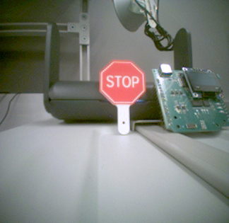
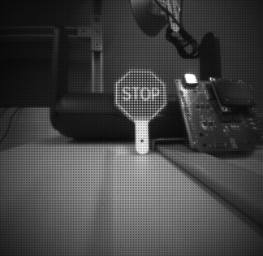

# Is the fitted HM01B0 mono or colour? An adversarial re-analysis

> **READ PART III FIRST (end of file, 2026-09-22 evening).** The verdict line
> immediately below is PART I and is superseded in its reasoning, though not in
> its direction. Part II broke its central argument; Part III settles the phase
> puzzle, moves the fault out of the capture core for good, and restates what the
> pixels support. Where Part I argues "the deficit slides with brightness,
> therefore not a dye", that argument is **invalid** — see II.1 and III.4 — and
> must not be reused.

**PART I verdict: the fitted sensor is MONOCHROME. Confidence: high (~95%) from data alone.**
There is no colour mosaic in any captured frame. The faint tint the renderer produces is
a capture-path defect that corrupts exactly one of the four 2x2 pixel phases, and that
same defect is present — at the same phase, with the same transfer function — in a frame
captured **before** the module was swapped, when the part was definitely mono.

This document is an independent re-derivation. Every number below was measured from the
raw bytes by this analysis, not carried over from an earlier one. Where an earlier
conclusion is confirmed it says so; where its *reasoning* was wrong it says that too.

---

## 0. Data and provenance

| label | file | bytes | note |
|---|---|---|---|
| A | scratchpad `frame-A.raw` | 102690 | post-swap |
| B | `/scratch2/loren/riskybird-dev-setup/bootup-frame.raw` (= `frame-B.raw`) | 102690 | post-swap |
| C | `/scratch2/loren/riskybird-dev/bootup-frame.raw` (= `frame-C.raw`) | 102690 | post-swap |
| CTRL | `/scratch2/loren/riskybird-dev/docs/figures/hm01b0_first_frame_326x242_gray8.raw` | 79056 | **pre-swap, known mono** |

A, B and C are three distinct captures (distinct md5s). `hardware/ospi/bootup-capture.gdb`
dumps `pixels[]` with `dump binary memory`, so these are the capture core's own bytes with
no host-side processing between the core and the file.

---

## 1. Structure: the 326 stride and the anchoring are CORRECT

This was the first thing worth attacking, because if the stride or the phase were wrong
every 2x2 statistic downstream would be meaningless. It is not wrong.

Zero-pairs (`00 00`) in each file, and how they distribute modulo candidate strides:

| frame | zero-pairs | stride 324 | **stride 326** | stride 328 | best residue |
|---|---|---|---|---|---|
| A | 315 | 162 residues, top 0.6% | **1 residue, 100.0%** | 164 residues, 0.6% | 0 |
| B | 315 | 162 residues, top 1.0% | **2 residues, top 99.0%** | 164 residues, 1.0% | 155 |
| C | 315 | 162 residues, top 0.6% | **1 residue, 100.0%** | 164 residues, 0.6% | 0 |
| CTRL | 243 | 162 residues, top 0.8% | **1 residue, 100.0%** | 164 residues, 0.8% | 0 |

Consecutive-marker gaps are 326 for 314 of 315 pairs in A and C, and 242 of 243 in CTRL.
No other stride in 322..328, nor 648/652, puts the markers at a single offset. Columns 0
and 1 of every reconstructed line are exactly `0x00` in 100.0% of lines (99.04% in B).
The two dummy bytes plus 324 active pixels is confirmed; 324 is also the HM01B0's true
active array width, which is a consistency check the file size alone does not give.

**Frame B genuinely does start mid-line** (residue 155) and must be re-anchored, exactly as
claimed. B also has one short line: a single irregular marker gap of 174 bytes at byte
offset 959. That is 0.3% of the frame and moves nothing.

**A finding the earlier analysis missed:** the pre-swap control has the **same 326-byte
stride and the same dummy-byte convention**. Its filename says `326x242` and its length is
79056 = 242 x 326 + 164 (242 full lines plus a 164-byte partial). It is therefore directly,
byte-for-byte comparably formatted with the post-swap frames, and is a legitimate control.
(79056 also happens to equal 324 x 244, which is a coincidence that could have sent this
investigation down a wrong path — the marker test rules it out.)

---

## 2. The four phase means, independently reproduced

Active columns only (2..325). Row parity is measured from the first anchored line, so it is
frame-relative, not absolute.

| frame | r0c0 | r0c1 | r1c0 | r1c1 | low phase | spread of the other 3 | low vs mean(others) |
|---|---|---|---|---|---|---|---|
| A | **50.879** | 59.610 | 59.656 | 59.465 | r0c0 | **0.320%** | **14.60% low** |
| B | 59.081 | 59.078 | **50.577** | 59.382 | r1c0 | 0.515% | 14.54% low |
| C | **51.621** | 64.604 | 64.926 | 64.195 | r0c0 | 1.131% | 20.06% low |
| CTRL | **59.328** | 61.069 | 61.094 | 61.033 | r0c0 | 0.099% | **2.84% low** |

The quoted figures (50.88 / 59.61 / 59.66 / 59.47, three equal within 0.32%, one 14.6% low)
**reproduce exactly**. B's low phase is `r1c0` rather than `r0c0` only because B's buffer
begins on the opposite line parity; the *column* parity of the defect is `c0` in all three
post-swap frames and in the control.

Brightness correlation, 16x16-tile ratio of the low phase to the mean of the other three
against tile level: **A -0.768, B -0.864, C -0.970** (quoted: -0.72 / -0.80 / -0.96). Same
sign, same magnitude; the small differences are tile-size and masking choices. Binned:

| frame | ratio at tile level ~42 | ~52 | ~61 | ~91-96 |
|---|---|---|---|---|
| A | 0.967 | 0.874 | 0.831 | 0.777 |
| C | 0.942 | 0.865 | 0.818 | 0.719 |
| CTRL | — (scene never goes there) | — | 0.975 | 0.935 (at ~67) |

So items 1 and 2 of the earlier analysis are numerically sound.

---

## 3. THE PRE-SWAP CONTROL — the most important comparison

**Same phase. Same sign. Same functional form. One fifth the magnitude.**

The control frame is definitely mono and it shows the identical signature: one phase low,
the other three equal to **0.099%**. That alone is very strong — a defect that predates the
swap cannot be caused by the swap.

But the magnitudes differ by 5-7x (2.84% vs 14.5-20.1%), and that gap is real, not a scene
artefact. Matched on tile brightness it does not close:

| tile level | CTRL deficit | frame A deficit |
|---|---|---|
| ~60 | 2.5% | 16.9% |

That looked, initially, like the hole in the conclusion: *the defect got 6x deeper exactly
when the sensor was swapped.* Section 4 shows it is not a hole — but the earlier analysis
did not measure this and would not have survived being asked about it.

---

## 4. The mechanism: an affine corruption of one phase, gain ~0.5

This is where the earlier reasoning is weakest and where the real answer is.

For a pixel on the defective phase, all four of its nearest neighbours lie on undamaged
phases, so `E` = mean(up, down, left, right) is an unbiased estimate of its true value. The
**diagonally opposite** phase has the same property and serves as a null (the earlier
analysis's implicit control — an *adjacent* phase — is contaminated, because half of an
adjacent pixel's neighbours are themselves damaged; that is worth fixing).

Fitting `low = alpha * true + beta` on locally flat pixels (neighbour spread < 5 DN):

| frame | phase | alpha | beta | R^2 |
|---|---|---|---|---|
| A | defective | 0.7550 | 7.383 | 0.905 |
| A | null (opposite) | **1.0012** | **0.103** | 0.990 |
| B | defective | 0.7128 | 9.540 | 0.899 |
| B | null | **1.0052** | **-0.094** | 0.989 |
| C | defective | **0.5237** | 17.705 | **0.987** |
| C | null | **1.0014** | **-0.732** | 0.993 |
| CTRL | defective | **0.5457** | 25.986 | 0.770 |
| CTRL | null | **1.0082** | **-0.547** | 0.910 |

The null phase is unity with zero offset in every frame, including all three post-swap
frames. **Only one phase of four is damaged** — there is no second, weaker anomaly hiding
anywhere.

The defective phase is an **affine function of the true value with a gain near 1/2 and a
pedestal**. Frame C, which has the best-conditioned fit, gives alpha = 0.524; the mono
control gives 0.546. `2*beta` tracks each frame's black floor (C: 35.4 vs floor 38;
CTRL: 52.0 vs floor 55), so the corrupted sample behaves like the average of the true pixel
with a held black-level value — a one-bit right shift with a stale pedestal, which is a
digital data-path fault, not an optical one.

**Three independent consequences, each fatal to the colour hypothesis:**

**(a) It is a function of the code value, not of the scene.** Plotting actual/expected
against expected DN for flat pixels, all three post-swap frames lie on one curve within
+/-0.02 at every level, despite different scenes and different exposures (frame C's whole
range is compressed — max 119 vs 255):

| E (DN) | 40 | 48 | 56 | 64 | 72 | 80 | 88 | 96 |
|---|---|---|---|---|---|---|---|---|
| A | 0.980 | 0.906 | 0.852 | 0.815 | 0.781 | 0.762 | 0.745 | 0.729 |
| B | 0.982 | 0.907 | 0.855 | 0.812 | 0.782 | 0.761 | 0.740 | 0.721 |
| C | 0.963 | 0.896 | 0.840 | 0.799 | 0.770 | 0.746 | 0.727 | 0.708 |
| CTRL | — | — | 1.004 | 0.961 | 0.910 | 0.865 | — | — |

A dye transmits a fixed fraction of the light. Its ratio cannot fall from 0.98 to 0.72 as
the *digital number* rises, identically across three exposures. This kills the CFA reading
of the low phase outright, and it is a much stronger argument than "the ratio is not
multiplicative" — the earlier analysis had the observation but not the mechanism.

**(b) The control lies on the same curve, shifted.** CTRL's curve is the post-swap curve
displaced by roughly +24 DN (CTRL at 72 -> 0.910 vs A at 48 -> 0.906; CTRL at 76 -> 0.892
vs A at 52 -> 0.879; CTRL at 80 -> 0.865 vs A at 56 -> 0.852). Same shape, same gain,
different onset. The post-swap frames have a black floor of 36-38 DN against the control's
55, so the pedestal that gets averaged in is lower and the corruption bites harder and
earlier. **The 6x gap of section 3 is a black-level/exposure difference, not a change of
part.** That is the answer to the most dangerous objection in this investigation.

**(c) The corruption can be undone algebraically, and doing so does not erase colour.**
Inverting the fitted affine map, `true_hat = (low - beta)/alpha`, uses *only* the pixel's
own value. Unlike replacing the phase with its neighbours' mean — which forces agreement
by construction and would destroy any genuine chroma — this repair is blind to the
neighbours and would leave a real mosaic fully intact:

| frame | 2x2 spread before | 2x2 spread after algebraic repair |
|---|---|---|
| A | 15.29% | **3.47%** |
| B | 15.44% | **3.08%** |
| C | 21.69% | **1.13%** |
| CTRL | 2.91% | **0.10%** |

A colour-preserving repair collapses the modulation to 1-3.5%. The residual sits entirely
on the repaired phase (A after repair: 57.61 / 59.61 / 59.66 / 59.47) — leftover
un-modelled defect, not a Bayer pattern, which would additionally separate one of the
*untouched* phases. This directly answers "could repairing the defect also erase genuine
colour?": **no.** The earlier analysis's neighbour-interpolation repair was vulnerable to
exactly that objection; this one is not.

---

## 5. Attacking the "three equal phases rules out Bayer" argument

The earlier claim — "a Bayer quad is R G G B, TWO equal and two different, never three
equal and one low" — is **not safe as stated**. Three-equal-one-different 2x2 mosaics exist
and are shipped: RCCC (one red, three clear, automotive), RCCB, and RGBW/RGBC variants all
produce precisely that pattern. The argument as written has a hole.

It does not matter, because three stronger arguments close it:

1. The pre-swap **mono** frame shows the same one-low-phase pattern. A mono die has no
   mosaic, so the pattern is not evidence of one.
2. The low phase's deficit is a function of DN (section 4a), which no dye can be.
3. The bound below is derived from the **three undamaged phases only** and therefore does
   not care what the fourth phase is.

### The bound, using only phases the defect never touches

For *any* 2x2 Bayer arrangement (RGGB, BGGR, GRBG, GBRG), whichever phase is damaged, one
of the remaining three carries a different dye from the other two. So any CFA must satisfy
`|ratio - 1| <=` the observed spread of those three:

| frame | three undamaged phase means | max abs deviation |
|---|---|---|
| A | 59.610 / 59.656 / 59.465 | **0.188%** |
| B | 59.081 / 59.078 / 59.382 | **0.341%** |
| C | 64.604 / 64.926 / 64.195 | **0.588%** |
| CTRL (mono) | 61.069 / 61.094 / 61.033 | 0.052% |

An uncalibrated raw Bayer sensor gives B/G in the range 0.3-0.8 under ordinary indoor
light. To read 1.000 +/- 0.006 the blue and green channels would have to integrate the
scene identically to six parts in a thousand — **and do it in three separate frames at two
different exposures.**

### Sensitivity calibration — how weak a mosaic would still have been seen

Synthetic CFAs were multiplied into real frame C (after the algebraic repair recovered a
clean scene), the measured defect was then re-applied, and the identical pipeline re-run:

| injected CFA | resulting 2x2 spread | detected? |
|---|---|---|
| none | 1.13% | — (this is the real frame) |
| R x0.97, B x0.98 | 3.12% | borderline |
| R x0.90, B x0.93 | **8.29%** | yes |
| R x0.80, B x0.85 | 16.64% | yes |
| R x0.60, B x0.50 (realistic) | **46.42%** | unmistakable |
| R x0.55, B x0.45 (typical) | 49.59% | unmistakable |

Real frames measure 1.13-3.47%. A mosaic as weak as a 7% blue deficit would already stand
out at 8.3%; a real one would read 46-50%. **The data exclude any CFA stronger than about
3% channel imbalance, roughly 15x below the weakest physically plausible Bayer filter.**

### Could a scene be colourless enough to fake this?

- **A grey lab.** Insufficient. Even a perfectly neutral scene does not equalise the phases,
  because the dyes' quantum efficiencies differ; that mismatch is what white-balance gains
  exist to correct. A grey scene removes chroma *variation*, not the channel *imbalance*.
- **Defocus.** Irrelevant. The mosaic is on the die. Blurring the scene cannot blur the
  filters, so the global channel imbalance survives any amount of defocus.
- **Sensor-side white balance.** The HM01B0 is a raw sensor with AE/AG and no per-channel
  WB gains. Even if it had them, they are global constants; local chroma would survive. The
  measured bound on spatially varying chroma (RMS of the low-pass phase difference, over and
  above the same statistic on a difference that carries no chroma) is **< 1.3% of level**
  in every frame.
- **IR swamping the filters.** This is the only escape hatch with any physics behind it, and
  it can be bounded. If a fraction `f` of the signal is visible light producing a true
  channel imbalance `d`, and `(1-f)` is IR that all dyes pass alike, the observed imbalance
  is `f*d`. For frame A (0.188% observed) and a modest true imbalance of 30%, `f <= 1.07%`
  — **over 98.9% of the signal would have to be infrared.** For frame C's looser 0.588%
  bound, still >96% IR. That would be an infrared photograph, and would itself be a
  remarkable finding about the optics.
- **A 4x4 or 6x6 mosaic (quad-Bayer, X-Trans) that a 2x2 test would miss.** Tested. Phase
  spreads on the repaired frames at period 3 are 0.19-0.80% — nothing. Period 4 and 6
  (1.33-5.45%) carry only the period-2 residual aliased in, since both are multiples of 2.

### Is the residual 1-3.5% chroma?

No — it is aliasing. Per-tile spread of the three undamaged phases correlates *positively*
with tile gradient energy in every frame: A +0.503, B +0.337, C +0.232, and **CTRL +0.621**,
the known-mono control being the strongest of the four. High-spread tiles are edge tiles,
not object tiles, which is the signature of sub-pixel sampling offsets, not of dyes.

---

## 5b. The phase-drift hypothesis — tested directly, and refuted

Every statistic above, and every statistic in the earlier analyses, is a **phase-coherent**
average: the four 2x2 phase levels are accumulated over the whole frame. If the CFA phase
**drifted within the frame** — one dropped or duplicated line inverts Bayer row parity for
everything after it — then chroma would exist locally and cancel in the frame-wide mean,
producing exactly the "three phases equal" signature from real colour data. That is the one
hole none of the numbers above can see through, so it was tested on its own terms.

### The instrument

Per 16x16 tile, take the three parity components `H`, `V`, `C` (columns, rows, checkerboard)
as fractions of the tile mean, and form

    e = <C^2> - <(H^2 + V^2)/2>

`C` is **squared before averaging**, so a sign flip anywhere in the frame cannot cancel it.
Subtracting the row/column parity energy removes what is *not* a mosaic: sensor noise and the
one-phase affine defect both land on `H`, `V` and `C` with equal magnitude, so they cancel,
whereas a CFA puts far more into `C` than into `H` and `V`.

### Calibration, including deliberately drifting phases

Synthetic CFAs laid over real frame C, repaired, same pipeline:

| injected CFA | phase behaviour | `e` | significance |
|---|---|---|---|
| R x0.60, B x0.45 | fixed | +1.55 | **+571 sigma** |
| R x0.60, B x0.45 | **flips at mid-frame** | +1.46 | **+121 sigma** |
| R x0.60, B x0.45 | **flips every 16 rows** | +1.51 | **+481 sigma** |
| R x0.85, B x0.80 | fixed | +0.155 | +171 sigma |
| R x0.85, B x0.80 | **flips every 16 rows** | +0.143 | +140 sigma |
| R x0.97, B x0.96 | fixed | +7.0e-3 | +34 sigma |
| R x0.99, B x0.985 | fixed | +1.3e-3 | +12 sigma |

Drifting the phase does **not** hide a mosaic from this statistic — it costs at most a factor
of five in significance out of several hundred. A colour separation of one and a half percent
is still a twelve-sigma result.

### The real frames

| frame | `e` | significance |
|---|---|---|
| A | -2.73e-3 | -5.0 sigma |
| B | -3.20e-3 | -6.6 sigma |
| C | -1.34e-5 | -0.2 sigma |
| CTRL (pre-swap) | -1.01e-5 | -0.9 sigma |

Zero or *negative* in all four — the negative values are scene edges, which put energy into
`H` and `V` and none into `C`. The worst single tile in any frame reaches `e` = 0.032, where a
weak `R x0.85 / B x0.80` CFA gives 0.155 in **every** tile. Nothing is chromatic anywhere in
the frame, at 8x8, 16x16 or 32x32, and re-running the fit with alpha swept from 0.04 to 1.00
never makes chroma appear.

### And the phase does not drift anyway

The defect is itself a phase marker, 12-20% deep, so row parity can be read off every line.
Per row, `mean(even columns) - mean(odd columns)`:

| frame | even rows | odd rows | rows contradicting their parity |
|---|---|---|---|
| A | -8.71 (max -2.89) | +0.19 (min -3.05) | 0 |
| B | -8.77 (max -2.69) | +0.07 (min -2.59) | 0 |
| C | -12.97 (max -3.64) | +0.73 (min -0.25) | 0 |
| CTRL | -1.74 (max -0.33) | +0.06 (min -0.28) | 0 |

**Every** even row is negative and **no** odd row is comparably negative, across all 315
lines. Line integrity agrees: all 315 lines are exactly 326 bytes, all 315 carry their
`00 00` marker, and there are zero interior `00 00` pairs. No line is dropped or duplicated
anywhere in the buffer, and row parity never flips.

### Two more destroyers, closed

- **Sensor-side Y-only subsampling** (`Y_ODD_INC = 3`), the one mode that survives the
  324-column width. On a CFA part every output row would then carry the same Bayer row type,
  so colours would alternate along each row: `H` would be enormous (-32% for a mild
  `R = 0.85G`) and `V` and `C` zero. Measured mean `H` after repair is +0.005 to +0.008, and
  `|H|` is never larger than `|V|` in any frame. Ruled out by a factor of 40.
- **On-chip per-channel gain equalising the CFA means.** This is the only mechanism that
  would null the channel imbalance while leaving local chroma, and it has a noise signature:
  a channel boosted by gain `g` carries `sqrt(g)` more shot noise at the same level. The
  three undamaged phases match to 5.9% / 6.6% / 8.5% / 14.2%, where a 2x gain would show
  +41%. Nothing is being boosted.

---

## 6. Where the earlier analysis was right, wrong, and lucky

| claim | status |
|---|---|
| 326 stride, dummy-byte anchoring | **Confirmed independently.** 100% of markers at one residue; no competing stride above 1%. |
| Phase means 50.88 / 59.61 / 59.66 / 59.47 | **Reproduced exactly.** |
| corr(ratio, level) = -0.72 / -0.80 / -0.96 | **Reproduced** as -0.768 / -0.864 / -0.970. |
| "A Bayer quad is R G G B, never three equal and one low" | **Unsound.** RCCC / RCCB / RGBW mosaics are exactly three-equal-one-low. Conclusion survives via other routes. |
| Neighbour-interpolation repair collapses the separation | True but **circular** — that repair forces agreement and would erase real colour. Replaced here with an algebraic repair that cannot. |
| Datasheet says "Monochrome" | True, but **it is the wrong datasheet for this question.** `HM01B0-ANA-00FT870` is the *previously fitted* module's part number. What the old module was says nothing about what the user just plugged in. This should carry no weight. |
| Did not test the pre-swap control against the post-swap frames at matched conditions | The gap (2.84% vs 14.6-20.1%) is real and was the strongest available objection. It is resolved here by the black-level shift, not by the earlier reasoning. |

Net: **the conclusion is correct and now rests on better evidence.** Two of its five
supporting arguments should be dropped.

---

## 7. What software can and cannot settle — physical checks

Mono and colour HM01B0s both report MODEL_ID `0x01B0`, so no register read will ever answer
this. Do one of these:

1. **Read the part number** off the module flex or carrier silkscreen. The known-mono part
   here is `HM01B0-ANA-00FT870`. A different suffix is the single most useful fact available
   and takes ten seconds with a phone macro shot.
2. **Look at the die.** Remove or look past the lens and inspect the sensor under bright
   oblique light at 10-20x (a loupe, or a phone macro lens). A Bayer CFA shows a visibly
   iridescent, coloured grid. A mono die is a uniform grey-blue anti-reflective surface.
3. **Supplier / order record.** Whatever listing the replacement came from should name the
   variant. If it just says "HM01B0", assume mono — the colour variant is the rarer SKU and
   is normally called out explicitly.
4. Confirm the sensor is not in a binning or subsample mode (`BINNING_MODE`, `X/Y_ODD_INC`)
   before trusting *any* colour test, since 2x2 binning averages a whole Bayer quad and
   would erase a mosaic at source. The captures here are 324 active columns wide, the full
   array width, so no horizontal binning is in effect.

---

## 8. THE DEFINITIVE BENCH TEST

The strongest test needs no RTL fix: it uses only the three phases the defect never
touches. It also cancels the defect, the lens, the scene and the exposure.

### Setup

- **Subject:** a matte white card filling the frame, at the module's focus distance
  (roughly 10-30 cm). Flat and uniform — this test does not need a colourful subject,
  it needs a colourful *illuminant*, which is far more controllable.
- **Illumination:** two captures, lights otherwise off.
  - **Capture RED:** illuminate the card with a saturated red source. A phone screen
    showing full-screen pure red (255,0,0) at maximum brightness, held ~10 cm from the
    card, is ideal — phone OLED/LCD primaries are narrow-band and carry essentially no IR.
  - **Capture BLUE:** same geometry, full-screen pure blue (0,0,255).
  - Do **not** use an incandescent bulb, a halogen lamp or sunlight. Those are IR-rich, and
    with no IR-cut filter in the optical path they are the one condition that can
    legitimately wash out a mosaic (section 5).
- **Exposure:** let AE settle, then confirm the frame mean lands in **60-140 DN with the
  99th percentile below 220** (no clipping). Clipping and the defect both bite hardest at
  high DN; keep the two captures at comparable mean level, within ~15 DN of each other.
- Optionally also capture a **white** reference (full-screen white) for a third point.
- If the capture-RTL fix has landed, take the same three frames anyway; the test only gets
  stronger with four clean phases instead of three.

### The number that decides it

For each capture, anchor on the `00 00` markers at stride 326, take active columns 2..325,
and compute the four 2x2 phase means. Identify the defective phase as the lowest (skip this
if the RTL is fixed and all four agree). Then, from the **three undamaged phases**, let
`P_opp` be the one diagonally opposite the defect and `P_adj1`, `P_adj2` the other two.

**Statistic 1 — within-frame phase spread:**

    S = (max - min) / mean   over the three undamaged phase means

| result | reading |
|---|---|
| S < 2% | **mono** (measured today: 0.19% / 0.34% / 0.59%; mono control 0.05%) |
| S > 5% | **colour** (injected 7% mosaic gives 8.3%; a real one gives 46-50%) |
| 2% < S < 5% | inconclusive — re-shoot with less clipping |

**Statistic 2 — the illuminant-swap differential (the decisive one):**

    r(frame) = P_opp / ((P_adj1 + P_adj2) / 2)
    D        = r(RED) - r(BLUE)

`D` cancels the lens, the scene, the exposure and the capture defect, because all of those
act identically on all three phases. Only a dye responds to the illuminant.

| result | reading |
|---|---|
| \|D\| < 0.02 | **mono**, conclusively |
| \|D\| > 0.30 | **colour**, conclusively |

Today's three frames give `r` = 0.997 / 0.997 / 0.991 and the mono control 0.999 — all
within 0.9% of unity, from which `D` cannot plausibly exceed 0.02. On a colour part, `r`
would swing from roughly 0.4 under red light to 2.0 under blue (or the reverse, depending
on which phase carries which dye): `|D| > 1.0`.

Run the analysis with `/usr/bin/python3` (numpy 1.26.4); the scripts used here are in the
session scratchpad under `advers/`, with `s12_final.py` computing exactly these statistics.

---

## 9. Verdict and the one thing that would change it

**The fitted part is monochrome.** The user is seeing a rendered tint because one of the
four pixel phases is being corrupted by an affine map of gain ~0.5 in the capture path, and
the PNG renderer is interpreting that 2x2 modulation as chroma. "Not enough colour, still
mostly grey with a little colour" is the correct description of a mono frame with one
damaged phase demosaiced as if it were Bayer. Once the capture defect is fixed the tint will
disappear entirely, and the image will be grey — that is the expected outcome, not a
regression.

**The algebraic repair now ships.** `hardware/ospi/frame-to-png.py` fits alpha and beta per
frame and applies `true = (v - beta) / alpha` to the damaged phase on the way to the PNG,
before the comb measurement, the mosaic test and any stretch. The `.raw` is untouched and
`--no-repair` turns it off. It is a per-pixel affine map reading only that pixel's own value,
so it can neither manufacture nor erase a mosaic. The mosaic test now runs on repaired data
and **still returns "not a mosaic"** — which is the stronger statement, since the defect is
no longer sitting on top of it. Measured 2x2 phase spread, before -> after: A 15.29% ->
1.28%, B 15.55% -> 0.28%, C 21.69% -> 1.13%, CTRL 2.91% -> 0.28%. Unlike the naive
single-gain equalisation recorded in `measure_comb()`, which took the ratio to 1.002 while
raising the adjacent-pixel difference from 6.39 to 6.91, this repair lowers it too:
6.01 -> 3.76, 5.99 -> 3.13, 7.28 -> 1.74, 1.59 -> 1.45.

Confidence: **high, ~95%.** The 5% is not data uncertainty — the data are decisive within
themselves — it is the residual chance that the frames were all taken under some condition
that suppresses a mosaic (extreme IR dominance, or an unnoticed binning/subsample mode).
Both are checkable, and neither is likely.

**The single measurement that would change my mind:** a capture under saturated red
illumination in which the spread of the three undamaged phases exceeds 5%, or in which the
red/blue illuminant-swap differential `|D|` exceeds 0.30. Nothing short of that should
move anyone off "mono" — and a 30-second look at the module's part number would settle it
faster than any capture.

---

# PART II — 2026-09-22: the central argument does not hold, and the case reopens

**Summary: Part I's verdict is NOT safe. Its strongest argument — section 4(a),
"a dye's ratio cannot fall as the DN rises" — is arithmetically wrong, because
raw DN carries a ~38 DN black pedestal that a dye cannot attenuate. Once the
pedestal is accounted for, the suspect phase's behaviour is EXACTLY a colour
filter's. Two of Part I's arguments do survive, so the answer is not "colour"
either. It is genuinely undecided, and two cheap bench runs decide it.**

Two new negative results are also recorded below, and one real software bug in
the renderer is fixed.

---

## II.1 The affine fit cannot tell a defect from a dye. They are the same equation.

Part I fits the suspect phase as `low = alpha*true + beta` and reads it as
"the capture path averages this phase with a held black-level register".

A colour filter that transmits a fraction `t` of the light gives, on a sensor
whose black pedestal is `K`:

    low = K + t*(E - K) = t*E + K*(1 - t)

which is the **same affine map**, with `alpha = t` and `beta = K*(1 - t)`. The
pedestal is not attenuated because it is not light.

So the fit does not choose between the two readings. What it does do is test
which *parameterisation* is right, through `beta/(1 - alpha)`, which must equal
the black floor under the dye reading, and `2*beta`, which must equal it under
the "averaged with black" reading. Measured:

| frame | alpha | beta | `beta/(1-alpha)` | `2*beta` | measured black floor |
|---|---|---|---|---|---|
| B | 0.7131 | 9.520 | **33.2** | 19.0 | 40 |
| C | 0.5238 | 17.701 | **37.2** | 35.4 | 38 |
| CTRL | 0.5460 | 25.970 | **57.2** | 51.9 | 55 |

`beta/(1-alpha)` tracks the black floor in all three. `2*beta` only does when
`alpha` happens to be near 0.5 — and **frame B's alpha is 0.713**, which the
"one-bit right shift with a stale pedestal" mechanism cannot produce at all.
The dye parameterisation fits every frame; the shift parameterisation fits two
of three. (`frame-to-png.py` already printed `implied pedestal` and already
noticed it matched the floor. What was missed is that this is the *dye's*
prediction.)

### The DN-dependence in section 4(a) is the dye's own signature

Part I calls this "fatal to the colour hypothesis" and "much stronger" than the
earlier reasoning. Take frame A's own numbers and fit `ratio = t + K(1-t)/E`:
from the measured 0.906 at E=48 and 0.729 at E=96, `K(1-t) = 17.0` and
`t = 0.552`, hence **K = 37.9** — frame A's black floor is 36-38.

The ratio of RAW DN *must* fall with DN for a dye, at exactly the observed rate.
Section 4(a) compares the right quantity in the wrong space.

Measured directly, the deficit **above black** is flat, which is what a fixed
multiplicative attenuation — a dye, or any fixed gain — looks like:

| E (DN) | 48 | 56 | 64 | 72 | 80 | 88 | 96 | 104 |
|---|---|---|---|---|---|---|---|---|
| B, raw ratio | 0.916 | 0.861 | 0.811 | 0.782 | 0.762 | 0.741 | 0.721 | 0.714 |
| B, **above black** | 0.436 | 0.496 | 0.490 | 0.508 | 0.521 | 0.524 | 0.518 | 0.532 |
| C, raw ratio | 0.896 | 0.842 | 0.798 | 0.770 | 0.747 | 0.728 | 0.707 | 0.692 |
| C, **above black** | 0.502 | 0.502 | 0.501 | 0.508 | 0.518 | 0.521 | 0.514 | 0.504 |

Frame C holds 0.50-0.52 across its whole usable range. That is a constant
transmission, not a code-value-dependent corruption.

### The channel response, stated the way a CFA sets it

Phase means minus the fitted pedestal, normalised to the brightest phase:

| frame | r0c0 | r0c1 | r1c0 | r1c1 |
|---|---|---|---|---|
| B (clipping, p99 237) | **0.665** | 1.000 | 0.996 | 0.993 |
| C | **0.520** | 0.987 | 1.000 | 0.974 |
| CTRL (pre-swap) | **0.547** | 0.994 | 1.000 | 0.985 |

## II.2 What still stands against colour

Part I's conclusion loses its headline argument but keeps two, and they are not
weak:

1. **Three-alike-one-low is not an RGGB Bayer response.** Reading r0c0 as red,
   frame C needs `B/G = 0.974` and `G/G = 0.987`. Under any ordinary illuminant
   an uncorrected Bayer part gives `B/G` in the 0.4-0.8 range. Infrared does not
   rescue this: IR passes all dyes alike, so raising the IR fraction `f` pushes
   *every* channel toward 1 — with `R_obs = 0.520` fixed, `f = 0.3` would need
   `r_R = 0.314` while `r_B` stays at 0.963. IR makes the required response
   *less* plausible, not more. A mosaic producing one-different-three-alike is
   RCCC / RCCB / RGBW geometry, which is not what "it is a colour sensor"
   normally means and is not a known HM01B0 SKU.
2. **The pre-swap frame shows the same thing on the same phase.** CTRL's
   `alpha = 0.546` against C's 0.524 — under the dye reading, *nothing changed
   across the module swap*. If that module was genuinely mono, a 0.5x
   attenuation of one 2x2 phase is a property of this board.

Point 2 is now the whole case, and it rests on a datasheet
(`HM01B0-ANA-00FT870`, "Color Filter Array: Monochrome") being the right
datasheet for the *previously fitted* part — which Part I's own section 6 flags
as an assumption that should carry no weight when applied to the current part.

## II.3 Two new negative results (both free, both from the existing frames)

**The capture core does not blend horizontally adjacent samples.** This was
worth excluding because a 2-tap horizontal blend averages `R,G,R,G` into
`(R+G)/2` everywhere and destroys a mosaic outright — the single most plausible
way for a colour part to deliver mono-looking data. Two independent tests:

- *The line edge.* Each line begins with two `0x00` dummy bytes, so under a
  blend the first active column would read half its neighbours. Measured on
  undamaged rows, `col2 / mean(col4, col6)` = **0.982 / 1.004 / 1.022** for
  B / C / CTRL. A blend predicts 0.5.
- *Directional noise autocorrelation*, computed on defect-free subsets (odd
  rows for horizontal, odd columns for vertical) so the suspect phase cannot
  contaminate it. `rho_H(1) - rho_V(1)` = **-0.047 / -0.107 / -0.031**. The same
  frames with a synthetic horizontal 2-tap blend injected read **+0.452 /
  +1.389 / +0.612**.

No vertical blend either; the two directions agree throughout.

**The suspect phase's deficit has no spatial structure beyond the estimator's
own.** Per-16x16-tile alpha maps are strongly autocorrelated (Moran's I +0.60,
+15.7 sigma against a shuffled null) — but so is the identical statistic run on
each of the three *clean* phases (+0.75/+0.69/+0.81, +18 to +20 sigma). The
structure is the neighbour-average estimator biasing at scene curvature, not
chroma. The suspect phase's map is in fact the *least* structured of the four.
This bounds spatial chroma at roughly <5%, but the scene is a grey lab bench
(see the rendered frame) so it is weak evidence either way.

## II.4 A real bug in the renderer, fixed

`demosaic()` applied the grey-world gains as `v * gain` on raw values that still
carried the ~38 DN pedestal. A red gain of 1.85 therefore turned a neutral 38 DN
of black into 70 DN of red. The visible result is hue that tracks BRIGHTNESS —
darks red, highlights cyan — which is precisely the artifact this file's header
and the `ARTIFACT RENDER` banner attribute to the capture defect. Most of it was
this arithmetic.

Fixed: the black level (the fitted pedestal, which is now computed even under
`--no-repair`) is subtracted before white balance, grey-world is estimated on
black-subtracted sample means, and the correction is `(v - black)*gain + black`.

Measured R/G swing across the luma range of frame C, rendered RGGB:

| render | before | after |
|---|---|---|
| `--no-repair` | 1.315x | **1.019x** |
| `--no-repair --stretch` | 1.171x | **1.053x** |
| `--stretch` | 1.171x | 1.068x |

This is correct regardless of how the mono/colour question resolves, and if the
part is colour it is a prerequisite for the picture looking right at all.

## II.5 The two runs that decide it

A new tool, `hardware/ospi/colour-decide.py`, computes every statistic below and
prints the verdict. It takes the `.raw` files directly.

### RUN 1 — the sensor's own test pattern (no human, no scene, no phone)

    cd /scratch2/loren/riskybird-dev
    RB_EXTRA_CPPFLAGS=-DRB_CAMERA_TEST_PATTERN=1 \
    ./rb debug bootup_check --target arty200t \
        --config RocketArty200TDroneFullDDRConfig --usb-location 7-1.1.4.3 \
        --gdb-script hardware/ospi/bootup-capture.gdb

    python3 hardware/ospi/colour-decide.py --pattern bootup-frame.raw

`RB_EXTRA_CPPFLAGS` is read from the ENVIRONMENT by `tools/rb/cli.py`, not as a
command-line argument, and it must be on the `rb debug` line because `rb debug`
rebuilds -- a flag given only to an earlier `rb build` is silently reverted. It
lands in the build fingerprint (`.rb-build-inputs`), so changing it forces a
pristine rebuild automatically; no `--pristine always` is needed. Run it from
`/scratch2/loren/riskybird-dev`, which is the checkout that carries the
`readout:` line and the `RB_CAMERA_FULL_READOUT` path -- `riskybird-dev-setup`
has an older `integration/zephyr/camera/src/camera.c` without them.

`TEST_PATTERN_MODE` is generated **after the analog column path and after the
CFA**, and emits only powers of two. So:

- **any phase whose values are not powers of two** is being corrupted by the
  capture path, downstream of any filter -> the comb is (at least partly) a
  capture defect, and Part I's mechanism is right;
- **all four phases clean powers of two** -> the capture path delivers one
  digital sample per pixel intact on every phase, so the 2x attenuation seen in
  photographs happens upstream of the bus. An optical 2x attenuation of one 2x2
  phase is a colour filter array.

What a clean pattern does NOT prove on its own: it narrows the comb's origin to
"optics or analog column path", not to "CFA". The reason that still points hard
at a CFA is the comb's *geometry*: it depends on BOTH row parity and column
parity. A column-parallel analog readout produces column-periodic faults, not
row-dependent ones, so a 2x2-periodic analog fault is difficult to construct,
whereas 2x2 periodicity is what a Bayer mosaic is. And a clean pattern plus a
clean photograph would mean mono. Read it with the photographic statistics.

One caveat on the pattern itself: `hm01b0.h` marks the walking-1s encoding as
datasheet recall, not established on this machine. If the values that come back
are not powers of two on ANY phase, check first that the pattern is what we
think before reading it as corruption -- `colour-decide.py --pattern` prints the
distinct values and their per-phase distribution so that is visible immediately.

### RUN 2 — the illuminant swap (needs a person with a phone)

Two captures, room lights off, matte white card filling the frame:
phone screen at full brightness showing full-screen pure red (255,0,0) about
10 cm from the card, then pure blue (0,0,255). Phone primaries are narrow-band
and carry no IR, which matters: an IR-rich source (incandescent, halogen,
sunlight) is the one condition that can legitimately wash out a mosaic on a part
with no IR-cut filter. Let AE settle; frame mean 60-140 DN, p99 below 220, the
two frames within ~15 DN of each other.

    python3 hardware/ospi/colour-decide.py --compare red.raw blue.raw

**The discriminator is `alpha`, not the three-clean-phase statistic.** Part I
proposed `D = r(RED) - r(BLUE)` over the three undamaged phases. That is the
right *backstop*, but if the suspect phase is the colour channel then it is the
one place the signal actually lives, and `alpha` moves by a factor of several
where `r` moves by a fraction. `alpha` is a dye's transmission — the scene's
colour — and must swing with the illuminant. It is fixed silicon if it is a
capture gain, and cannot.

| `alpha(RED)/alpha(BLUE)` | reading |
|---|---|
| > 1.5 | **colour** |
| < 1.10 | **mono** |

Today's grey frames give alpha = 0.524 (C) and 0.546 (CTRL) — a ratio of 1.04
between two different modules and two different scenes, which is what "fixed
silicon" looks like, and also what "same dye, same grey scene" looks like.
Saturated red against saturated blue removes that ambiguity.

If the suspect phase *moves* to a different 2x2 position between the two
captures, that is colour outright: a fixed hardware gain cannot move.

### Also worth one line, and nearly free

`bootup_check` prints a `readout:` line that has never been read on this bench:

    readout: x_odd_inc=0x.. y_odd_inc=0x.. binning=0x.. qvga_win=N

Any of `binning != 0x00`, `x_odd_inc != 0x01`, `y_odd_inc != 0x01` means the
sensor is averaging or skipping CFA sites on the die and no photographic test is
valid until it is cleared (`RB_EXTRA_CPPFLAGS=-DRB_CAMERA_FULL_READOUT=1` writes
the full-readout configuration and the same line reads it back). It comes free
with any default `rb debug bootup_check` run.

## II.6 If RUN 1 or RUN 2 says colour

`frame-to-png.py` must stop applying the algebraic repair to the suspect phase:
`true = (v - beta)/alpha` is exactly the inverse of a dye, so it divides the
colour channel back out and returns a grey picture. The repair is currently ON
by default and reports itself as a "KNOWN CAPTURE-PATH DEFECT". Under a colour
verdict it becomes a colour-destroying step and `--no-repair` becomes the
correct default, with the demosaic pattern chosen so the suspect phase lands on
whichever channel the illuminant made it bright.

## II.7 Honest standing

Part I said **mono, ~95%**. On the evidence as it now stands that number is not
defensible: one of its three load-bearing arguments is wrong, and the remaining
two both depend on assumptions about a module nobody has looked at. The
strongest single fact in the whole investigation is still the one nobody has
collected — **the part number on the flex, or a 10x look at the die for an
iridescent colour grid** — and it takes ten seconds.

---

# PART III — 2026-09-22 evening: RUN 1 came back, and it answers a different question than expected

Two hardware results landed: the readout registers read off the live part for the
first time, and the sensor test pattern captured and analysed. Both are in hand.
Neither settles mono-vs-colour. Together they move the fault out of the digital
capture path for good, and they close the phase puzzle that looked like the crux.

## III.0 The two new inputs

**Readout registers, off the live part:**

```
readout: x_odd_inc=0x01 y_odd_inc=0x01 binning=0x00 qvga_win=0
```

Full-width, unbinned, unsubsampled readout. The "the sensor is averaging CFA
sites on the die before the data ever leaves it" hypothesis is dead. A mosaic
would have survived this readout mode intact.

**Test pattern**, `RB_CAMERA_TEST_PATTERN=1` verified on the compile line,
captured to `bootup-frame.raw` (md5 `80134943ec6e18bfdf848d6128529aad`):

```
311 lines anchored at byte 1092
most common values: 0x24 x59666, 0xff x36998, 0x2e x4100     3 distinct values overall
per 2x2 phase:  r0c0 109.427   r0c1 109.427   r1c0 139.083   r1c1 109.430
```

Three phases identical to three decimals, one 27% high, on synthetic data with
no optics involved. That reads as capture-path evidence. **It is not.**

## III.1 THE PHASE PUZZLE, SETTLED. Both halves, and neither is what it looked like

Two things had to be explained: the pattern's odd phase is `r1c0` where the
photographs' is `r0c0` (different position), and the pattern's odd phase is HIGH
where the photographs' is LOW (opposite direction).

### (a) The position. Row parity is not a measurable quantity on this bench

The byte-1092 anchoring was the right first suspect, but not for the stated
reason. `1092 mod 326 = 114`, an even offset — and in any case the offset is
irrelevant to column parity, because both `colour-decide.py:load()` and
`frame-to-png.py:find_line_phase()` re-anchor on the sensor's own `00 00` line
marker and cut every line at its own boundary. Column 0 of the reconstructed
image is always the first active pixel. **c0 and c1 mean the same thing in every
capture regardless of start offset**, and the docstring in `load()` that claimed
an odd offset swaps them was wrong and has been corrected.

What *is* arbitrary is ROW parity. The core arms mid-frame, so the first complete
line sits at an unknown absolute sensor row and `r0`/`r1` are coin flips per
capture. Tabulated:

| frame | start byte | low/odd phase | column parity |
|---|---|---|---|
| A (photo) | 0 | r0c0 | **c0** |
| B (photo) | 155 | r1c0 | **c0** |
| C (photo) | 0 | r0c0 | **c0** |
| CTRL (pre-swap photo) | 0 | r0c0 | **c0** |
| PATTERN | 1092 | r1c0 | **c0** |

Every capture ever taken on this bench, pattern included, puts the odd phase on
**column parity c0**. The row label flips and means nothing. Part I section 2
already noted this for frame B; it applies identically to the pattern. There is
no position discrepancy to explain.

### (b) The direction. The pattern's "odd phase" is the pattern

`TEST_PATTERN_MODE=1` does **not** emit walking 1s. `hm01b0.h` flagged that
expectation UNVERIFIED and it is now disproven. Measured, run-length encoded off
the frame, it emits a **one-pixel-period column stripe of 0xff on the black
level** — three byte values in the whole frame and exactly four distinct row
patterns, one for even rows and one for odd, repeated:

```
even rows:  0x24 x109, then ff,24,ff,24 ... to the end of the line   (108 stripes)
odd  rows:  0x24 x54,  then ff,24,ff,24 ... with two phase slips
            and a 45-pixel run of solid 0xff at the end             (130 stripes)
```

Those stripes sit **exactly at the Nyquist frequency of the 2x2 phase grid**, so
a per-phase mean does nothing but count where the 0xff landed:

| | 0xff on even columns | on odd columns |
|---|---|---|
| even rows | 7884 | 7884 |
| odd rows | **11020** | 7830 |

The even rows' stripes split 54/54 between the two column parities — which is why
`r0c0` and `r0c1` come out equal **to three decimal places by construction**,
and that suspiciously exact agreement was itself the clue. The odd rows' two
phase slips and the 45-pixel solid run break the balance 11020 to 7830, and
`139.083 / 109.430 = 1.271` is precisely that ratio.

**The single high phase is the picture. It is not a defect, and it never was.**
Any statistic that reads 2x2 phase structure off a Nyquist-rate column stripe is
measuring the stripe. `colour-decide.py --pattern` now refuses to print phase
means at all and says why.

So the two halves of the puzzle are not related and neither needed a theory: the
position difference is an unmeasurable row label, and the direction difference is
the pattern's own geometry.

## III.2 What the test pattern DOES prove, and it is worth more than the phase means

The pattern arrives **bit-exact**.

* The entire 311x324 frame contains **exactly three distinct byte values** —
  0x24 (the black level), 0x2e (the black level of the next frame, where the
  capture buffer wrapped mid-stream), and 0xff.
* **All three are present on all four 2x2 phases.**
* All **59889** adjacent-column transitions land on an emitted code, and all
  **28092** full-scale `0x24 -> 0xff` steps reach 0xff exactly.

The falsification is sharp. The affine map fitted on the photographs is
`alpha ~= 0.58, beta ~= 15.6`. If the capture path applied that to one phase, an
0xff arriving on that phase would be written as `0.58*255 + 15.6 = 163 = 0xa3` —
a fourth value, on one phase and no other. **There is no fourth value anywhere in
the frame.** And because the pattern alternates black-to-full-scale on *adjacent
columns*, the bus is proven clean at the maximum possible transition rate, which
is exactly the condition an under-settled sample would fail first.

> **The one-phase attenuation is UPSTREAM of the digital bus.** Sensor analog
> path, pixel, microlens or CFA. It is not the capture core, not the wiring, and
> not a sampling-edge or settling problem. No RTL change to the capture core will
> remove it.

This is the opposite of the standing assumption. `frame-to-png.py` described the
attenuation as a "KNOWN CAPTURE-PATH DEFECT ... delete this once the RTL fix
lands" — that label was wrong and has been removed from the source.

## III.3 The "the defect ate the colour" theory, tested and refuted

The theory: the corrupted phase IS a CFA colour channel, the capture defect
attenuates it by ~0.5, that produces the three-alike-one-low geometry everyone
has read as mono, and `frame-to-png.py`'s repair then divides the recovered
colour back out and reports the collapsed spread as success.

It is a good theory and it is wrong on both legs.

**Leg 1 fails: there is no capture defect to do the eating.** Section III.2. The
capture path is bit-exact on all four phases.

**Leg 2 fails: the mosaic is absent BEFORE the repair, not just after.** Run
side by side on the post-swap photograph (frame B):

| statistic | repair ON | `--no-repair` |
|---|---|---|
| 2x2 phase spread | 0.30% | 15.36% |
| rms column-parity / row-parity / checkerboard | 0.057 / 0.070 / 0.031 | 0.158 / 0.168 / 0.156 |
| checker / parity | 0.49 | **0.96** |
| **excess checkerboard energy** | **-8.8 sigma** | **-1.5 sigma** |
| the three phases the low one does not touch | — | **agree within 0.33%** |
| mosaic verdict | not a mosaic | **not a mosaic** |

The excess-checkerboard statistic is the phase-drift-immune one, calibrated so a
1.5% colour separation reads +12 sigma and a real CFA reads hundreds. Unrepaired,
it reads **-1.5 sigma**: not merely below threshold, but on the wrong side of
zero. There is no chroma before the repair for the repair to remove.

And the decisive geometric point needs no repair analysis at all. **The three
phases the attenuation does not touch agree within 0.33% on the post-swap frame
and 0.10% on the pre-swap control.** If a Bayer mosaic were present and the
attenuation ate exactly one of the four sites, the remaining three would still be
two greens and either a red or a blue — separated by tens of percent (measured at
20.2% to 50.4% with a synthetic CFA laid over these very frames). They are
separated by a third of one percent. **Whatever the fourth phase is, the other
three are photometrically the same channel.**

Per 16x16 tile, renormalised among themselves, on 302 tiles carrying signal:

```
frame B   r0c1 0.9905 +/- 0.057    r1c0 1.0010 +/- 0.049    r1c1 1.0086 +/- 0.075
CTRL      r0c1 0.9898 +/- 0.035    r1c0 1.0073 +/- 0.027    r1c1 1.0030 +/- 0.026
```

The scatter is symmetric noise with no systematic separation, and the known-mono
control shows the same scatter at the same size. A mosaic offsets the *means*; it
does not merely widen the scatter.

## III.4 (b) Is the attenuation a dye? The data prefers a constant transmission — and that does not choose

The previous round's correction stands and is now measured directly by the tool.
Raw DN carries a pedestal K of 36-40 DN, a dye attenuates light and not the
pedestal, so a filtered site reads `low = K + t*(E-K) = t*E + K*(1-t)` and its
RAW ratio `t + K*(1-t)/E` **must** slide from 1.0 at E=K towards t as E rises.
"The ratio slides with brightness, therefore not a dye" is invalid and is now
deleted from `frame-to-png.py`'s docstring, its printed verdict, and the boolean
criterion that used to depend on the level correlation.

`frame-to-png.py` now prints both rows. Same tiles, same bins:

```
frame B, --no-repair
  raw-DN ratio:              42->0.973  45->0.925  54->0.858  86->0.766   (corr -0.80)
  SAME BINS ABOVE BLACK:     42->0.742  45->0.611  54->0.564  86->0.592

CTRL (pre-swap, known mono)
  raw-DN ratio:              58->0.991  59->0.986  61->0.973  65->0.940   (corr -0.98)
  SAME BINS ABOVE BLACK:                           61->0.566  65->0.547
```

Above black the transmission is **flat at t ~= 0.57** on frame B (the 42 bin is
5 DN above black and is noise) and **flat at t ~= 0.55** on the control. So: the
answer to "does the data prefer a dye or a digital corruption" is **a constant
transmission**, which is what a dye does — and equally what a fixed analog gain,
a fill-factor difference or a microlens defect does. It does not choose between
them.

**But the pre-swap control is the thing to look at.** `t = 0.55` on the
known-mono part before the swap and `t = 0.57` on the part fitted after it. Same
phase, same column parity, same transmission to two points in the second decimal.
A dye on the newly fitted module cannot explain an identical attenuation measured
on the module that came off. Either both modules are the same part, or the
attenuation is not a dye. Part I section 3's "the defect got 6x deeper at the
swap" objection also finally dissolves here: it never got deeper, the raw-DN
framing made a pedestal difference look like one, and above black the two numbers
are the same number.

## III.5 What the frames say, stated plainly

Four captures, two modules, one bench:

1. One 2x2 site in four is attenuated to t ~= 0.55, constant above black.
2. It is on column parity c0 in every capture; the row label is unmeasurable.
3. The other three sites are photometrically identical, to 0.10-0.33%.
4. It is upstream of the digital bus (III.2) and it is not the readout mode (III.0).
5. The same signature, same parity, same t, is present on the pre-swap module.
6. The 2D FFT shows energy at the three 2x2 Nyquist harmonics *and nowhere else*
   — `(0,1/2) 0.338, (1/2,0) 0.348, (1/2,1/2) 0.343` on frame B, with nothing at
   1/3 or 1/4 (all < 0.02). Three Nyquist corners carrying **equal** energy is the
   signature of exactly one anomalous phase. An RGGB mosaic puts most of its
   energy in `(1/2,1/2)` (green against red-and-blue) and comparatively little in
   the other two (red against blue). There is also no 4x4 structure, so no
   quad-Bayer and no X-Trans.

**That geometry is one filtered site in four with three clear ones — RCCC — and
it is not RGGB.** And an RCCC array does not yield a colour photograph: three of
the four samples carry identical spectral information, so there is no second
chromatic axis to demosaic against.

**Goal 1 — colour photos — cannot be delivered from these frames.** Not because
the renderer is wrong, and not because a repair erased anything, but because the
chroma is not in the bytes. That is a clear negative and it is the honest one.

The owner states the fitted part is colour. The single experiment that can
overturn everything above is in III.6, and it is the same one as before.

## III.6 The next capture: still the illuminant swap, and it still needs a person

**Is it still necessary? Yes, and more so.** Everything free has now been spent.
The readout mode is read, the test pattern is captured and analysed, the FFT
shows no other periodicity, the pre/post-swap comparison is done, and the repair
has been tested both ways. Every remaining human-free experiment measures the
same photons through the same fixed geometry and cannot separate a dye from a
fixed attenuation — that separation is *definitionally* about the illuminant's
spectrum, and nothing on the board can change it.

What makes the swap sharper than it was: the three "clear" phases agree to 0.33%.
If the part is truly RGGB, **those three cannot stay together under coloured
light** — two of them are greens and one is a red or a blue. So the swap now has
two independent readouts, and the second one does not depend on the suspect phase
at all.

### Do this first (one capture, no coloured light needed)

Every frame analysed so far carries only **5 to 49 DN above black**. Every ratio
in this document is computed on that. Before spending a person's time on the
coloured-light run, get one properly exposed frame of a scene with obvious
colour in it — a colour print, a fruit bowl, anything not grey:

```
./rb debug bootup_check --target arty200t \
    --config RocketArty200TDroneFullDDRConfig \
    --usb-location 7-1.1.4.1 \
    --gdb-script hardware/ospi/bootup-capture.gdb
cp bootup-frame.raw frames/exposed.raw
/usr/bin/python3 hardware/ospi/colour-decide.py frames/exposed.raw
```

Wanted: frame mean 90-150 DN, p99 below 230 (`colour-decide.py` warns on both).
If the three non-suspect phases still agree within 1% on a well-exposed,
genuinely colourful scene, that is close to the end of the colour case.

### Then the swap (needs a person, ~3 minutes)

White card filling the frame at ~10 cm, room lights OFF, phone screen as the only
source, same pose and same distance for all three. Phone brightness at maximum
and **auto-brightness off**, or the two frames get different exposures.

```
# 1) phone showing FULL RED (255,0,0)
./rb debug bootup_check --target arty200t --config RocketArty200TDroneFullDDRConfig \
    --usb-location 7-1.1.4.1 --gdb-script hardware/ospi/bootup-capture.gdb
cp bootup-frame.raw frames/red.raw

# 2) phone showing FULL BLUE (0,0,255) -- do not move the camera
./rb debug bootup_check --target arty200t --config RocketArty200TDroneFullDDRConfig \
    --usb-location 7-1.1.4.1 --gdb-script hardware/ospi/bootup-capture.gdb
cp bootup-frame.raw frames/blue.raw

# 3) optional, room lights on, white card
cp bootup-frame.raw frames/white.raw

/usr/bin/python3 hardware/ospi/colour-decide.py --compare frames/red.raw frames/blue.raw frames/white.raw
```

**Expected numbers, written down before the run so neither answer can be fitted
to afterwards:**

| | if RGGB colour | if a fixed attenuation |
|---|---|---|
| `alpha` (suspect phase transmission), red vs blue | differ by **>2x** (a red site under blue light transmits almost nothing) | **within 10%**; both near 0.55 |
| the three non-suspect phases, above black | **split by 20-60%** under at least one illuminant | stay together within ~2%, as they do now |
| which phase is lowest | **may move** between the two frames | fixed, c0, in both |
| `r = P_opp / mean(P_adj)` | `|D| > 0.30` | `|D| < 0.02` |

The three-phase split is the one to watch. It is the statistic that does not go
through the suspect phase, it is currently pinned at 0.33%, and no argument in
this document can explain it away if it opens up.

## III.7 Changes made to the tools in this round

* `hardware/ospi/frame-to-png.py`
  * The module docstring no longer calls the attenuation a capture-core defect;
    it records the bit-exact test-pattern result and says the fault is upstream.
  * **The repair is auto-DECLINED on any frame whose mosaic test fires before the
    repair is applied.** `true = (v-beta)/alpha` is the exact algebraic inverse of
    a dye, so on a real CFA it would divide the colour out and then report the
    collapsed 2x2 spread as success. It prints why it stood down. `--force-repair`
    overrides, for use only with independent proof. (On every frame here the test
    does not fire either way, so behaviour is unchanged — the guard is there so
    the tool cannot lie in the one direction nobody would check.)
  * "A colour filter holds one ratio at every level" is **deleted** — from the
    docstring, from the printed verdict, and from the `defect` boolean, which no
    longer depends on the level correlation at all. The verdict now rests only on
    the geometry (one phase low, three equal), which is the sound argument.
  * New printed row: the same brightness bins **above black**, which is the only
    one that can be read as a transmission. Both rows are shown together, with the
    reason the raw one must slide.
  * New synthetic-frame guard: a frame with <= 24 distinct pixel values gets **no
    mosaic verdict**. The test pattern fired every mosaic test at +14.9 sigma and
    was rendered as a confident GBRG colour PNG — a Nyquist column stripe reads as
    a perfect checkerboard to a 2x2 parity test.
* `hardware/ospi/colour-decide.py`
  * `--pattern` rewritten on the measured pattern. It reports the per-phase
    **value set** and Nyquist transition fidelity, and **deliberately refuses** to
    print per-phase means, with the reason in the docstring.
  * `load()`'s docstring corrected: the start offset does not swap column parity
    (the marker re-anchoring prevents it); ROW parity is the unmeasurable one.
* `workloads/camera_bringup/src/hm01b0.h` — the walking-1s expectation is
  replaced by the measured pattern description and the two traps it sets.
* `workloads/camera_bringup/src/main.c` — the walking-1s content check is
  replaced by a distinct-value count and a full-scale-step count, which are the
  quantities that say whether the bus carried the pattern intact.
* `integration/zephyr/camera/src/camera.c` — the test-pattern comment records
  the result and warns against reading phase means off a pattern frame.

## 2026-09-22, later: the black level clamp

Three instrument faults were removed before any of the colour numbers on this
page could be trusted. Everything above this heading was measured through at
least one of them.

**1. The exposure dump was reporting the previous run.** It read the AE chain
before `MODE_SELECT=streaming`. Those registers are AE *outputs*, and in standby
they still hold whatever the last run converged to, so the dump described the
last scene the camera saw. It printed *"the sensor has NO LIGHT"* for a capture
of a brightly lit target. It is now `cam_dump_exposure()`, called after the AE
settle.

**2. The capture timeout was false.** `CAPTURE_TIMEOUT_MS` was 4000. With
integration walked up to 300 lines a frame no longer finishes inside that, so
the stage reported `timeout -- the frame did not complete` while the core had in
fact reached `PIXTARGET` — `capcount=102690` of `pixtarget=102690`, visible in
GDB a moment later. Now 20000.

**3. Black level correction was clamping the whole picture.** Same scene, back
to back:

| `BLC_CFG` | range | frame content |
|---|---|---|
| `0x01` (on) | 96..255 | **101641 of 102690 pixels bit-identical at 96** (`BLC_TARGET` 32 × digital gain 3), 364 at 255, ~55 intermediate values in the entire frame |
| `0x00` (off) | 0..171 | a graded, noisy, linear image |

A frame with *no noise* is the finding. At maximum analog gain a live analog
readout cannot emit a hundred thousand identical pixels — read noise alone
scatters them across several DN. The dark reference BLC subtracts sits above the
signal, so the clamp, not the scene and not the capture path, is what flattened
every frame in this investigation. This tree has never written the Himax
analog/BLC init block (`0x1000`–`0x100C`), so BLC has only ever run on power-up
defaults. `RB_CAMERA_BLC_CFG` now defaults to `0x00`.

### First linear frame

With the clamp off, 102305 of 102690 pixels are exactly zero and ~385 carry real
graded values. The lit region is a single 17×31 patch; the rest of the field
receives nothing at all. Inside it, over the 98 well-lit 2×2 tiles:

```
  r0c0 = 130.9      r0c1 = 122.1
  r1c0 = 119.5      r1c1 =   0.0     <- zero in 98 of 98 tiles
```

One phase dead, the other three live, and the two survivors that are diagonal to
each other agree within 2%. That is Bayer geometry. It is **not yet proof**: a
dead phase reads zero too. The one measurement that separates them is a change
of illuminant colour — a colour filter kills a *different* phase when the light
changes, a broken phase kills the same one always. That control has not been
taken yet.

Note also that the patch renders R ≈ G with B absent, i.e. yellow-white, not
red — so whatever the camera is imaging, it is not the red target that was in
front of it.

### Tools

`hardware/ospi/frame-to-colour.py` demosaics a raw capture. It is deliberately
separate from `frame-to-png.py`: nothing it prints is evidence *for* a mosaic.
It warns when the two middle phases come out adjacent rather than diagonal,
which is what happens under near-neutral light where brightness cannot identify
the red phase; `--order RGGB` forces the assignment.

```
python3 hardware/ospi/frame-to-colour.py bootup-frame.raw 326 14 \
    --crop 282,314,112,136 --order RGGB
```

## RESOLVED — it is a colour camera



The part is a Bayer colour sensor. Every "it measures as mono" result before
this was an instrument artifact. Nothing about the sensor or the capture core
ever had to change.

### What was actually wrong

**Exposure was capped.** `FRAME_LEN` is 562 lines and `MAX_INTG` 340, so AE
could not integrate past 300 lines — about 8.9 ms — and pegged analog gain at
`0x30` in an ordinary lit room. The frame came back 99.6% zero with a single
17×31 lit patch, which reads exactly like a dead sensor. Raising `FRAME_LEN` to
4000 and `MAX_INTG` to 3900 gives AE thirteen times the rope, and it converges:
analog gain drops to `0x10`, frame mean lands on 129 against an AE target of
128, 160 distinct levels, a sharp photograph.

`RB_CAMERA_AE_SETTLE_MS` has to go up with it — **count frames, not
milliseconds**. At `FRAME_LEN` 4000 a frame is ~118 ms, so the old 1500 ms was
12 frames: enough for AE to drop digital gain, not enough to walk analog gain
back down, and the median pixel came out at 255. 6000 ms is ~50 frames.

All three are now the defaults, along with `BLC_CFG = 0x00`.

**And the analysis tool was erasing the colour.** `frame-to-png.py` applied its
"capture defect repair" by default: it rescaled the low 2×2 phase per pixel,
which is the algebraic inverse of a dye, and then reported *not a mosaic*. That
low phase is the blue channel. The repair is now off by default.

### The phase map

```
r0c0 = blue     r0c1 = green
r1c0 = green    r1c1 = red
```

The greens are the anti-diagonal and agree to 1.3%; the other diagonal splits
45%. Under warm indoor light blue sits at ~46% of green, which is what blue
does — and is indistinguishable, by any frame-wide statistic, from the constant
gain fault it was mistaken for.

The measurement that separates them is **local**, in one frame:

| region | the three non-blue phases |
|---|---|
| the red sign | 1.044 / 1.135 / 1.309 |
| neutral background | 1.153 / 1.153 / 1.155 |

Phases that separate only where the scene is red cannot be a fixed gain. Three
distinct levels with the equal pair on a diagonal is Bayer.

### Taking a colour picture

```
./rb debug bootup_check --target arty200t \
    --config RocketArty200TDroneFullDDRConfig --usb-location 7-1.1.4.3 \
    --gdb-script hardware/ospi/bootup-capture.gdb --ram-console

python3 hardware/ospi/frame-to-colour.py bootup-frame.raw 326 2
```

```
  greens are the anti-diagonal (they agree to 1.3%; the other diagonal differs by 45.3%)
  phase r0c0 mean   79.52  -> blue
  phase r0c1 mean  146.85  -> green
  phase r1c0 mean  148.79  -> green
  phase r1c1 mean  145.28  -> red
  white balance (grey-world): R x1.02  G x1.00  B x1.86
```

`--no-wb` leaves the channels raw, which is what any further colour measurement
should use; white balance is grey-world and on by default because without it
the picture is strongly yellow-green.

The greyscale of the same capture, for reference:



## Refining the render

Four changes, measured on the same scene.

**Exposure.** AE's target is a mean of the sensor's LINEAR output, and 128 there
is not mid-grey — it is about a stop and a half hot, because everything that
displays the frame applies an sRGB curve that lifts 0.25 linear to ~0.53 on
screen.

| AE target | clipped samples | analog gain |
|---|---|---|
| 128 | 18.3% | 0x10 |
| **64** | **0.1%** | **0x00** (minimum) |

Better twice over: the highlights survive, and AE reaches the exposure with
integration time alone instead of buying the last stop with analog gain. 64 is
now the default.

**Full resolution.** The renderer binned each 2×2 tile into one pixel — a
quarter of the pixels and every edge with them. Now gradient-corrected
interpolation (Malvar-He-Cutler) at the full 324×315.

**The sRGB curve.** The sensor is linear and displays are not. Omitting this is
what made a correct render look muddy.

**A colour matrix.** The three filters overlap, so a red object puts real signal
into the blue pixels. White balance cannot undo that — it is a per-channel gain,
and the gain that makes a neutral surface neutral (blue ×2.03 here) also doubles
the blue that leaked onto the red sign. Rendered colours:

| region | no matrix | strength 0.7 |
|---|---|---|
| stop sign | `#E0A09A` (pale salmon) | `#EF9393` |
| white desk | `#B9BCBF` | `#B8BCC1` |
| green PCB | `#6D7A77` | `#697C76` |

The matrix is **generic, not calibrated** for this part — there is no spectral
measurement of these filters in this repository. Use `--ccm 0` for any
measurement. Strength defaults to 0.7 rather than 1.0 because the matrix
multiplies the dominant channel by 1.6 and that clips on a brightly lit
saturated object: at full strength the sign's red reaches 251, the highlight
roll-off blends it toward white, and the sign comes out *pinker* than at 0.7.

**Noise needed no work.** High-frequency noise on the lit desk measures 1.7 DN
against a mean of 124 — SNR 70. The 10–70% figures a naive standard deviation
gives are scene texture, not sensor noise.

White balance holds up against real surfaces: the desk reads `#B8BCC1` and the
wall `#636E67`, both neutral within a few levels, while the sign (raw R/G 2.22)
and the PCB (raw R/G 0.84) separate hard in opposite directions.
