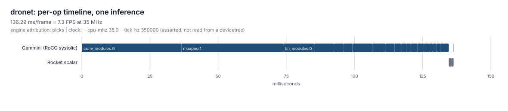

# DroNet on the XC7A200T, through ModelBlaster

> **Record (2026-09-16 to 2026-09-17)** of the first DroNet runs on one accelerator shell.
> Superseded by [`dronet-on-accel-socs.md`](dronet-on-accel-socs.md), which regenerates DroNet on
> all three supported shells from committed sources (14.57 fps on IntAt35), and
> [`accel-shells-bringup.md`](accel-shells-bringup.md) for the shells themselves. The commands below
> are corrected to the current `rb debug` syntax (the workload is positional).

How to take a PyTorch model to a RiskyBird FPGA shell and get a per-op timeline
and a frame rate out of it, and what is actually measured so far.

ModelBlaster's own stage-5 runners are all simulators — spike, Verilator,
FireSim. This page is about the board. The split is deliberate:

| Stage | Owned by | Command |
| --- | --- | --- |
| 1–3 extract → skeleton → kernels | ModelBlaster | `rb modelblaster generate` |
| 4 build | rb, because the image needs RiskyBird's overlays | `rb modelblaster build` |
| 5 run | rb: program, load, capture | `rb program` / `rb debug` / `rb capture` |
| analysis | rb | `rb modelblaster report` |

`rb modelblaster generate` runs ModelBlaster with `STAGE_ONLY=1`, so no
simulator is ever involved in the hardware path.

## Measured on the board

DroNet, `RocketArty200TDroneGemmini16At40Config` at 40 MHz, both kernel
selections run back to back in one session:

| | drift2 | bit-exact |
| --- | --- | --- |
| `MODELBLASTER_VERIFY` | max_abs_err **2** | max_abs_err **0** |
| inference | **188.4 ms** | 15,791.8 ms |
| frames/s | **5.31** | 0.06 |
| Gemmini share | 99.3% | 0.7% |

**83.9x**, isolating entirely to `conv2d_s8` (627,380,812 -> 3,241,262 cycles,
193.6x); every other op moves less than 1%. The 2 LSB is the bound the
verification gate accepted, and hardware landed exactly on it rather than above.

The difference between the two is one kernel: `conv2d_s8`'s
`gemmini_tiled_conv` misses bit-exact by 2 LSB, and the gate is exact by
default, so it is rejected and conv2d — ~99% of the network — runs as a scalar
triple loop. `--drift-atol 2` accepts that measured bound. It is not a way to
skip verification: the gate still runs, still measures, and still rejects the
kernels that are genuinely broken (`gemmini_im2col_full_C` and `linear_s8`'s
`gemmini_tiled_matmul`, both 56 LSB). `linear_s8` produces DroNet's two outputs
and stays on scalar reference in both variants.

See [`artifacts/modelblaster/README.md`](../artifacts/modelblaster/README.md)
for the per-kernel gate results and which directory to build from.

## Status

| | |
| --- | --- |
| Codegen for DroNet int8 / gemmini_q31 | **verified** — run here, output below |
| Capture → per-op table, FPS, timeline | **verified** — against a real spike capture |
| Clock derivation from the elaborated DTS | **verified** — against two real DTS files |
| The float-contract guard | **verified** — fires on the FP16 shell |
| `RocketArty200TDroneGemminiSaturnFp16At35Config` area and timing | **verified** — synthesized, placed, routed and a bitstream written here |
| Building the harness for a board | **verified** — a real ELF, built against the elaborated shell |
| Running on the drone | **verified** — both variants, one session, numbers above |

The frame rates at the top of this page ARE hardware measurements. The spike
figures further down are labelled as such and are not predictions of the board —
spike is a functional simulator, not cycle-accurate, and its scalar baseline for
conv2d differs from hardware by ~36%.

## The shells

Dima's `fpga/src/main/scala/arty200t/AccelConfigs.scala` carries the design
points. Two are timing-clean and signed off; the rest are recorded for the
design space.

| Config | Accelerators | Scalar FPU | Clock | Post-route |
| --- | --- | --- | --- | --- |
| `RocketArty200TDroneGemminiSaturnFp16At35Config` | Gemmini 16×16 + Saturn V128D64 fp16 | **FP16 only** | 35 MHz | WNS +0.150 ns, 92.8% LUT |
| `RocketArty200TDroneSaturn40Config` | Saturn V128D128 fp16 | full | 40 MHz | WNS +0.422 ns, 90.1% LUT |
| `RocketArty200TDroneGemmini16At40Config` | Gemmini 16×16 | full | 40 MHz | 70.34% LUT, WNS 0.000 ns |

Periphery on all three is byte-for-byte `RocketArty200TDroneFullDDRDmaUartConfig`
— DDR3, camera OSPI with capture DMA, I2C, PMW3901 SPI, control GPIO, both motor
PWM blocks, the ESP UART on E13/F14, and the memory→uart1 TX DMA — so the PLIC
source numbering `hardware/zephyr/fpga-drone.overlay` hardcodes is unchanged.
Gemmini is RoCC and Saturn is tile-internal; neither takes a PLIC source.

### The combined config's area, measured here

`rb area run --board arty200t --config RocketArty200TDroneGemminiSaturnFp16At35Config --attrs dsp`,
Vivado 2023.1, `xc7a200tfbg484-1`, **synthesis only**:

| Resource | Used | Available | % |
| --- | --- | --- | --- |
| Slice LUTs | 130,374 | 134,600 | **96.86** |
| — LUT as logic | 120,423 | 134,600 | 89.47 |
| — LUT as memory | 9,951 | 46,200 | 21.54 |
| Slice registers | 77,817 | 269,200 | 28.91 |
| Block RAM tiles | 244 | 365 | **66.85** |
| DSPs | 555 | 740 | **75.00** |

Then placed and routed from that checkpoint (`make … rb-impl`), which is where
the number people quote comes from:

| Resource | Used | Available | % |
| --- | --- | --- | --- |
| Slice LUTs | 124,577 | 133,800 | **93.11** |
| Slice registers | 77,732 | 269,200 | 28.88 |
| Block RAM tiles | 244 | 365 | 66.85 |
| DSPs | 555 | 740 | 75.00 |

> `All user specified timing constraints are met.`
> WNS **+0.289 ns**, WHS +0.049 ns, TNS 0.000 over 255,537 endpoints, THS 0.000
> over 255,534. DRC: 0 errors, 1,651 warnings, 2 advisories.
> Bitstream `obj/rb_impl.bit`, 9,730,764 bytes, SHA-256
> `92a773b3dae51a7b20967b2e45ba7fa1427f98b8de1e386f0d34c8d82a579526`.

So the design closes at 35 MHz with margin, at 93.11% of the device. That
reproduces the signed-off `92.8% LUT, WNS +0.150 ns` independently — same DSP
and BRAM to the slice, LUTs and slack within tool noise of a differently
resolved harness-binder merge.

Read `rb area`'s LUT number as an upper bound and never as the post-route
figure: 96.86% at synthesis became 93.11% routed, because `opt_design` and the
two `phys_opt_design` passes recover the difference. DSP and BRAM did not move
at all, which is why they are the better cross-check between the two stages.

**Build these with DSP injection or they do not fit.** `RB_ATTRS=dsp` injects
`use_dsp` into Gemmini's `MacUnit` and the hardfloat FMA multipliers before
synthesis; `rb area run --attrs dsp` and the `rb-impl` target that follows it
both do. Injection is a `gen-collateral` source edit, so the order is
elaborate → inject → synthesize, and re-running `make bitstream` would discard
it and route a different design.

Place-and-route from the injected checkpoint is a separate target, precisely
because re-elaborating would throw the injection away:

```console
make -C backends/chipyard/fpga SUB_PROJECT=arty200t \
     CONFIG=RocketArty200TDroneGemminiSaturnFp16At35Config rb-impl
```

It writes `obj/rb_post_route.dcp`, `obj/rb_impl.bit`, and timing/power/DRC
reports beside them.

### The DroNet deploy shell, measured here

`RocketArty200TDroneGemmini16At40Config`, `--attrs dsp`, `xc7a200tfbg484-1`:

| Resource | Synth | Post-route | of device |
| --- | --- | --- | --- |
| Slice LUTs | 99,002 | 124,577 → **94,260** | **70.45%** |
| Slice registers | 67,099 | 67,034 | 24.90% |
| Block RAM tiles | 276 | 276 | 75.62% |
| DSPs | 511 | 511 | 69.05% |

Area is comfortable and matches the ~70.8% the config comment projected. Timing
is the problem, and only just:

> **WNS −0.091 ns. `Timing constraints are not met.`**

Ninety-one picoseconds short of 40 MHz on a 25 ns period, on a design occupying
70% of the part. That is not a shell that needs a smaller accelerator or a
slower clock — it is a miss smaller than the spread between Vivado's own
implementation directives, on a run where nothing asked the placer to try
harder.

This is exactly the trap the flow is meant to catch. Vivado writes a bitstream
for a timing-failing design with only a warning, so without reading
`obj/report/timing.txt` this one would load, boot, run DroNet and produce a
frame rate — from a design that is not guaranteed to compute the right answer.
`tools/collect-bitstreams.py` records `wns_ns` and `timing_met` per bitstream and
refuses to let a failing one pass quietly into a published directory.

The remedy is effort, not redesign: `RB_IMPL_DIRECTIVE=explore` (or
`aggressive`) escalates opt/place/phys_opt/route together.

```console
RB_IMPL_DIRECTIVE=explore make -C backends/chipyard/fpga SUB_PROJECT=arty200t \
    CONFIG=RocketArty200TDroneGemmini16At40Config rb-impl
```

Unset is the default and reproduces the numbers above. When it is set, `rb-impl`
says so on the console, because a result obtained with extra effort is real but
is not comparable with one that was not.

**With `explore` it closes**: 94,117 LUT (70.34%), 511 DSP, 276 BRAM,
`All user specified timing constraints are met`, **WNS 0.000 ns**. That is the
published bitstream.

Read that slack for what it is. Zero is met-with-nothing-to-spare, and the same
design missed by 91 ps on default effort — a gap smaller than the spread between
directives. The honest summary is that this shell sits *exactly* at 40 MHz rather
than comfortably inside it. If margin matters more than the round number,
`RB_IMPL_DIRECTIVE=aggressive` or a lower fabric clock are the levers, and both
are cheaper than they sound because the synthesis checkpoint is reused.

## Two things that will bite, both found the hard way

### 1. The FP16 shell advertises an FP32 it does not have

`WithRocketFPU16` sets `fLen = 16`, so the scalar FPU implements Zfh and nothing
else. rocket-chip still writes `f` into `riscv,isa`. The two arty200t DTS files
side by side:

```
RocketArty200TDroneFullDDRDmaConfig               rv64imafdc…zfh…
RocketArty200TDroneGemminiSaturnFp16At35Config    rv64imafc…zvfh_zfh…
```

`d` is gone, `f` is not. And Zephyr's RISC-V CMake puts `f` into `-march`
whenever `CONFIG_FPU=y`, *independently of* `CONFIG_FLOAT_HARD`
(`cmake/compiler/gcc/target_riscv.cmake`). So the devicetree, Zephyr's `-march`
and ModelBlaster's own kernel flags — `gemmini_q31` compiles `kernels.c` with
`-march=rv64imafdc -mabi=lp64d` — all agree with each other and disagree with
the silicon. The image links, boots, and faults on the first `fadd.s`.

`rb modelblaster build` refuses rather than letting that through:

```console
$ rb modelblaster build --board arty200t \
    --config RocketArty200TDroneGemminiSaturnFp16At35Config --target gemmini_q31
rb: error: RocketArty200TDroneGemminiSaturnFp16At35Config has an FP16-only scalar FPU
(WithRocketFPU16: fLen = 16), and these kernel flags ask for hardware fp32/fp64:
-march=rv64imafdc -mabi=lp64d.

Nothing downstream would catch this. rocket-chip writes "f" into riscv,isa for any
FPU, so the DTS advertises rv64imafc while the hardware implements only Zfh; the
build succeeds and the first fp32 instruction inside a kernel faults.

Options, in the order worth trying:
  --config RocketArty200TDroneGemmini16At40Config   Gemmini 16x16, no Saturn, FULL
    scalar FPU, closes at 40 MHz with wide margin. The int8 DroNet path uses
    Gemmini, not vector FP, so this is the deployable target for this model.
  ...
```

The set is `FP16_SCALAR_FPU_CONFIGS` in `tools/rb/boards.py`, listed by name for
the same reason `SCRATCHPAD_CONFIG_NAMES` is: the devicetree cannot express it.

**So the combined 35 MHz shell is the area and timing result, and
`RocketArty200TDroneGemmini16At40Config` is the DroNet deploy target.** DroNet
int8 reaches Gemmini over RoCC and uses no vector FP, so it loses nothing.

This is closer to being solvable than it was. Dima's `riskybird-integer-dronet`
branch exists precisely to run on a machine with no hardware float — "scalar-int
residual add + integer NCHW batchnorm (FPGA misa.F=0)", plus integer fixed-point
requantize for `batchnorm2d_s8`, `add_s8` and `sigmoid_s8` — and the spike run
below confirms the int8 DroNet *math* is now integer end to end. What still
blocks the FP16 shell is not the kernels but the flag table: `gemmini_q31` and
`gemmini_q31_rvv` are both declared `-march=rv64imafdc -mabi=lp64d`, so GCC is
still free to emit fp32, and nothing in `pipeline/backends.py` yet offers a
soft-float variant. A `gemmini_q31_rvv` target at `-march=rv64imac_zve…
-mabi=lp64` is the missing piece, and it is a small one — that is the change
that would let the 93% combined shell run DroNet, with Saturn available for the
vector kernels as well.

### 2. Every clock constant in the firmware assumed 50 MHz

`hardware/zephyr/fpga.conf` hardcodes `CONFIG_SYS_CLOCK_HW_CYCLES_PER_SEC=50000`
— the 50 MHz shells' CLINT timebase. These configs run at 35 and 40 MHz.

That one symbol does more than the timer. The rocketchip SoC defines

```c
#define SIFIVE_PERIPHERAL_CLOCK_FREQUENCY \
    (CONFIG_SYS_CLOCK_HW_CYCLES_PER_SEC * CONFIG_RTC_CLOCK_DIVIDER_VALUE)
```

and every SiFive driver takes its clock from it. At 35 MHz with the 50 kHz value
the UART divides for 50 MHz and transmits 115200 × 35/50 = 80,640 baud, which on
a 115200 host is line noise — indistinguishable from the dead console this bench
has already chased once (`drone-initial-bringup.md`). The timer is wrong by the
same ratio, so `k_cycle_get_64` and the harness's `MODELBLASTER_WALL_CYCLES` are
inflated 43%, and any frame rate derived from them with them.

`rb` now derives it from the elaborated devicetree instead. `generated_clock_conf`
writes, for a shell whose `timebase-frequency` is not 50 kHz:

```
# GENERATED by rb from the elaborated devicetree. Do not edit.
# arty200t/RocketArty200TDroneGemminiSaturnFp16At35Config
# timebase-frequency = 35000 Hz (35 MHz fabric clock)
CONFIG_SYS_CLOCK_HW_CYCLES_PER_SEC=35000
```

and layers it after `fpga.conf`. A 50 MHz config produces no fragment at all, so
nothing about the existing shells changes.

## The harness reports in two different units

This is the one thing to get right before believing any number.

| | Source | Rate |
| --- | --- | --- |
| per-op `cycles` | `rdcycle()`, the mcycle CSR | the CPU clock — 35,000,000/s |
| `WALL_CYCLES` | `k_cycle_get_64()`, i.e. mtime | `CONFIG_SYS_CLOCK_HW_CYCLES_PER_SEC` — 35,000/s |

A thousand to one on the Chipyard shells. `modelblaster/pipeline/generate_skeleton.py`
says so at both call sites — rdcycle "high-res", `k_cycle_get_64` "lower
resolution … but cross-hart-correct" — and the spike run below measures the
ratio directly at ~100 on that machine, which is why `rb modelblaster report`
takes `--tick-hz` for captures that did not come from an FPGA shell.

FPS comes from the wall figure, because it is the only one that includes the
gaps between kernels. The per-op sum excludes them and would overstate.

## What was run here

### Codegen

```console
$ rb modelblaster generate --model dronet --quant int8 --target gemmini_q31
/…/modelblaster/examples/dronet/int8/generated/gemmini_q31
```

`kernel_picks.json` from that run is where the timeline's engine attribution
comes from — not a guess from op names:

```
add_s8 → gemmini    batchnorm2d_s8 → scalar    conv2d_s8 → gemmini
linear_s8 → scalar  maxpool2d_s8 → gemmini     relu_s8 → scalar
sigmoid_s8 → scalar
```

### A real capture, on spike

Run with ModelBlaster's own spike runner to exercise the whole analysis path on
genuine harness output:

```console
$ rb modelblaster report mb-spike.log --model dronet --quant int8 \
    --target gemmini_q31 --cpu-mhz 35 --tick-hz 350000
model            dronet
cpu clock        35 MHz  (rdcycle, per-op)
tick clock       350 kHz  (mtime, wall; 0.0029 ms quantum)
clock evidence   --cpu-mhz 35.0 --tick-hz 350000 (asserted, not read from a devicetree)
ops profiled     24  (engine attribution: picks)
wall ticks       47,700 mtime ticks
kernel time      136.367 ms (4,772,860 cpu cycles)
inference        136.286 ms
frames/s         7.34
outside kernels  0.000 ms (0.0% of the frame: marshalling, buffer setup, misses between dispatches)
verify           max_abs_err=0 max_rel_err=0 n=2

engine                            cycles        ms  % of kernels
----------------------------------------------------------------
Gemmini (RoCC systolic)        4,711,199    134.61         98.7%
Rocket scalar                     61,661      1.76          1.3%
```



Per-op table: [`figures/dronet_gemmini_q31_spike_profile.csv`](figures/dronet_gemmini_q31_spike_profile.csv).

**Read none of this as the board's performance.** The clock was asserted, not
measured; spike is functional, not cycle-accurate; and `7.34 FPS` is what those
spike cycle counts would mean *if* a 35 MHz Rocket took the same number, which
is not a claim anyone has evidence for. What this run does establish is that the
marker parsing, the engine attribution, the two-clock arithmetic, the CSV and
the timeline all work on real harness output.

What it also establishes is that the ModelBlaster pin matters. The same command
against the previous pin (`lorenshung/ModelBlaster` main, 18619ca) reported
**14,382,306 cycles, 82.2% Gemmini, and `MODELBLASTER_VERIFY` FAILING at
max_abs_err=72 / max_rel_err=1.29** — a wrong answer, three times slower. On
`riskybird-integer-dronet` it verifies bit-exact and 98.7% of the kernel time is
on Gemmini, because Dima's integer requantize and integer NCHW batchnorm moved
`batchnorm2d_s8`, `add_s8` and `sigmoid_s8` off the scalar soft-float path.
That is the branch worth being on, and it is why this repo pins it.

## The ModelBlaster pin

`backends/modelblaster` is a backend in its own right, alongside `chipyard` and
`zephyr-chipyard-sw`: `https://github.com/lorenshung/ModelBlaster.git`, branch
`riskybird-integer-dronet`. It is its own setup tier (`docs/setup.md` step 5),
because every workload but `dronet` builds without it and it is the only backend
whose codegen wants torch.

That branch is this fork's merge of two lines: Dima's
`ucb-bar/ModelBlaster riskybird-integer-dronet` (10b50ba — integer DroNet
kernels for `misa.F=0`, NHWC + conv0-pool fusion, the `gemmini_q31_rvv` backend)
and the four commits this fork already carried (the Verilator per-op profiling
runner, the single-hart U250 target, the single-scalar core entry, and the
per-config Gemmini header mechanism).

### The per-config Gemmini header, and why it is load-bearing

`cores/gemmini/include/gemmini_params.h` describes the accelerator to the
software: mesh width, scratchpad geometry, accumulator rows, and whether a mvin
scale unit exists at all. It is **generated by Chipyard elaboration**, and it
has to match the config that was elaborated. A mismatch is not a build error —
it is a binary that drives Gemmini with the wrong parameters.

So the header is a symlink into
`cores/gemmini/include/per_config/<ChipyardConfig>/`, and `rb modelblaster
build` selects the directory by passing `MODELBLASTER_GEMMINI_CONFIG`. The
build's own `compile_commands.json` shows which one it used:

```
-isystem …/cores/gemmini/include/per_config/RocketArty200TDroneGemmini16At40Config
```

Two things had to be fixed for that to be true rather than nominal.

**The include path did not resolve.** `resolved_kernel_cflags` substitutes one
`<repo_root>` into every entry of the gemmini flag table, and the per-config
entry carried an extra `modelblaster/` segment the others do not. No single
value satisfied both spellings, so with the one that makes `gemmini.h` findable
at all, the per-config path expanded to `…/modelblaster/modelblaster/…`. GCC
ignores a nonexistent `-isystem` silently, so `MODELBLASTER_GEMMINI_CONFIG`
selected nothing and every gemmini build used whatever header happened to be
checked in. Fixed on the fork branch; `rb` additionally refuses any flag set
naming an include directory that does not exist, because that failure is
otherwise invisible.

**The checked-in header did not match these shells.** Dima's branch has a 16×16
header — correct mesh — but with `HAS_MVIN_SCALE`, `scale_t = float` and a
floating-point `MVIN_SCALE` macro. The arty200t configs set
`mvin_scale_args = None`, so they elaborate no mvin scale unit and their header
is `scale_t = int32_t`, `MVIN_SCALE(x, scale) (x)`. Building the float variant
against that hardware drives a scale unit that does not exist, and puts floating
point back into the very int8 path the branch exists to make integer-only. The
elaborated headers for both arty200t configs are captured under `per_config/`;
Dima's is preserved as `per_config/default16x16/`.

To capture one for a new config: elaborate it, then immediately copy
`backends/chipyard/generators/gemmini/software/gemmini-rocc-tests/include/gemmini_params_q31.h`
into `per_config/<ConfigName>/gemmini_params.h`. Every elaboration overwrites
that file, so "immediately" is the operative word.

## What is blocked, and on whom

The TACIT trace variants in `TacitAccelConfigs.scala` and `TacitDropConfigs.scala`
compile but must not be built, because of one commit:

| Submodule | Commit | Status |
| --- | --- | --- |
| `generators/rocket-chip` | `15190c09` — 4 KB trace-encoder-controller regnode | **not published** |

The reachable pin is held instead, so the tree checks out and everything else
builds — but a TACIT bitstream from it has a 256-byte encoder-controller
regnode, which does not satisfy Saturn's `PipelinedFaultCheck` page alignment.

The tacit half of that pair is resolved: `8af13a74` (widen `collect_counter` to
the full 128-bit beat, 4 KB regnode) is published on
`CobbledSteel/tacit`, branch `optional-branch-predictor`, and the submodule now
points there and is bumped to that branch's tip.

Both rocket-chip commits worth having sit on the same upstream base,
`8f1e33b25`, as single patches — `ac3066c9` (FP-stripping) and `a174f3e5b`
(free-run mcycle, on `CobbledSteel/rocket-chip` `tacit-mcycle-free-run`) — so a
branch carrying all three is three cherry-picks onto that base rather than a
merge.

> **A URL, not a missing commit.** `generators/rocket-chip` was declared as
> `chipsalliance/rocket-chip` while pinned at `ac3066c9`, which is Dima's
> FP-stripping commit and exists only as the tip of `CobbledSteel/rocket-chip`'s
> `xpurt` branch. `git submodule update` on a fresh clone could not resolve the
> pin, so the FP16 configs — the 93% shell included — were unbuildable by anyone
> who did not already have the object locally. The URL now points at the fork;
> the pinned commit never changed.

## Runbook: DroNet on the board

**Target shell: `RocketArty200TDroneGemmini16At40Config`** — Gemmini 16×16, no
Saturn, full scalar FPU, 40 MHz. Not the 93% combined shell: DroNet int8 reaches
Gemmini over RoCC and uses no vector FP, and this one runs a stock hard-float
image (see the FP16 trap above).

Steps 1–2 are done and their outputs are on disk; 3–5 need the board.

### 1. The bitstream

```console
rb area run --board arty200t --config RocketArty200TDroneGemmini16At40Config --attrs dsp
make -C backends/chipyard/fpga SUB_PROJECT=arty200t \
     CONFIG=RocketArty200TDroneGemmini16At40Config rb-impl
```

`--attrs dsp` first, `rb-impl` second, and in that order: injection is a
gen-collateral source edit and `rb-impl` deliberately starts from
`obj/post_synth.dcp` so it routes the netlist that was measured. Running
`make bitstream` instead re-elaborates and throws the injection away.

Output: `obj/rb_impl.bit`, plus `obj/report/timing.txt`. **Read the timing report
before loading anything** — Vivado emits a bitstream for a design that misses
timing with only a warning.

### 2. The image

```console
rb modelblaster generate --model dronet --quant int8 --target gemmini_q31
rb modelblaster build --board arty200t \
     --config RocketArty200TDroneGemmini16At40Config \
     --model dronet --quant int8 --target gemmini_q31
```

### 3. Power and link

The TE0712 needs a real supply, not USB alone: 3.3 V at 1 A browns out the DDR3
banks, and the symptom is a JTAG link that reads exactly like a broken cable
(`te0712-drone-carrier-ddr-bringup.md`). DroNet's weights and activations live in
DDR, so this is not optional for this workload.

Check the link before anything else:

```console
rb probe-ftdi --idcode
```

An xc7a200t answers `0x13636093` (the value `docs/setup.md` records from a real probe of this bench). `all ones (nothing driving TDO)` means no
board, no power, or the wrong JTAG pinout — not a software problem.

### 4. Program and run

```console
rb program --board arty200t --config RocketArty200TDroneGemmini16At40Config
```

These shells are built `uartTsi = false`, so there is no UART-TSI and `rb load`
cannot be used. The ELF goes in over JTAG:

```console
rb debug dronet --target arty200t \
     --config RocketArty200TDroneGemmini16At40Config
```

That is less costly than the ELF's size suggests. `zephyr.elf` is ~5.9 MB of
memory image but a single LOAD segment of **405,128 bytes**; the rest is `.bss`
and the harness's 4 MB `.noinit` stack, neither of which is transferred.

**Use `--ram-console` for anything short, and that is not a workaround for a
sick UART.** `rb debug` starts the program the instant it runs, while the console
is a different channel opened by a different command in another shell — so
whatever the workload prints before you attach is gone. You lose that race on a
fast workload and win it on a slow one, which is exactly what the bench saw and
first read as a failing UART:

| run | UART yield |
| --- | --- |
| 15.79 s bit-exact | 978 B, lossy but readable |
| 188 ms drift2 | 15 B — the reset glitch, and none of the program's output |

The 188 ms program demonstrably completed: its halted PC symbolized to
`arch_cpu_idle`, and the RAM console held the whole profile. Nobody was
listening yet, that is all. `rb debug --no-run` then `continue` is the
alternative if you want the live UART; `rb debug` now warns before it starts
anything. `--ram-console` puts output in a RAM ring buffer read back over the
same JTAG link that loaded the image:

```console
rb debug dronet --target arty200t \
     --config RocketArty200TDroneGemmini16At40Config --ram-console
```

The harness ends by calling `sys_reboot()`, which these shells do not implement,
so a completed run prints `Failed to reboot: spinning endlessly...` and idles.
That is the expected end state, not a fault — the markers are already out by then.

### 5. The numbers

```console
rb modelblaster report <capture> --model dronet \
     --board arty200t --config RocketArty200TDroneGemmini16At40Config
```

No `--cpu-mhz`: naming the config reads both clocks from that shell's
devicetree, and the `clock evidence` line says so. Writes `profile.csv` and
`gantt.svg` beside the capture.

Sanity-check the output before believing it. `outside kernels` above 50% or a
kernel sum larger than the frame both mean the clocks do not describe the machine
the capture came from, and `rb` says so in a warning rather than leaving it to be
noticed.
