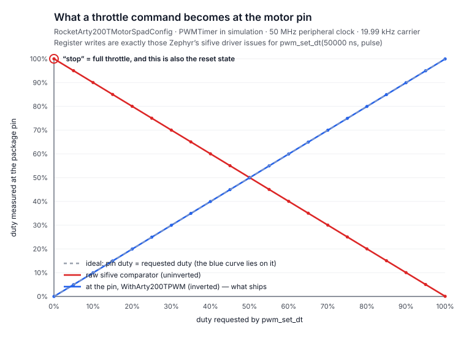
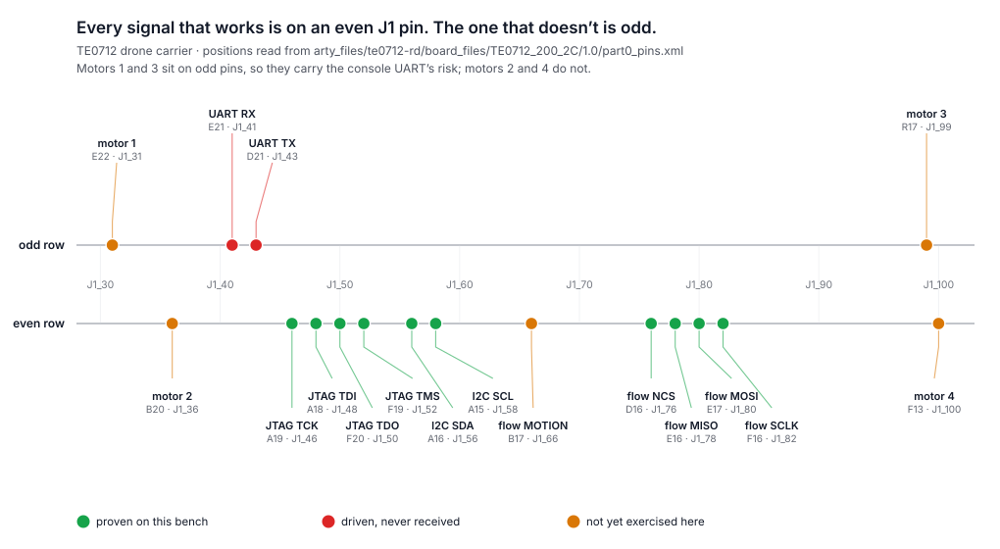

# Motor PWM bring-up

Four ESC/motor drive outputs on the TE0712 drone carrier, from the two sifive
PWM blocks the drone periphery already elaborated.

The bitstream is built, loaded, and measured on the real board. Nobody was in
the room and no motors are attached, which shaped the work rather than limiting
it: the interesting failure on this path is invisible on a bench anyway until
something spins, and it turned out to be present.

## What was actually wrong

`RocketArty200TDroneLogicConfig` and every other Arty config elaborates
`pwm@10050000` and `pwm@10051000` and binds neither to a package pin. That is
recorded in `Configs.scala` as deliberate, and it is worse than it sounds: with
no consumer above the controller, `firtool` deletes the whole output path. In
those builds the generated `TLPWM` has **no `gpio` port at all**, and neither
does the `PWMTimer` inside it:

```console
$ D=backends/chipyard/fpga/generated-src/chipyard.fpga.arty200t.Arty200THarness.RocketArty200TDroneLogicConfig
$ grep -c gpio "$D/gen-collateral/TLPWM.sv"
0
$ sed -n '/^module PWMTimer/,/^);/p' "$D/gen-collateral/PWMTimer.sv" | grep -c gpio
0
```

The comparators still count, the registers still map, and software still reads
back exactly what it wrote. Nothing reports a problem.

The second thing is the one that matters. The sifive comparator drives its
output **high once the scaled counter has passed the comparator value**:

```scala
protected val elapsed = VecInit.tabulate(ncmp){i => ... s >= cmp(i)}
io.gpio := ((ipU & ~(gangU & Cat(ipU(0), ipU >> 1))) ^ invert).asTypeOf(io.gpio)
```

Zephyr's driver writes the requested pulse width straight into that comparator:

```c
/* Set the duty cycle by setting pwmcmpX */
sys_write32((pulse_cycles >> pwmscale), PWM_REG(config, REG_PWMCMP(channel)));
```

The two conventions are opposites. A request for duty *D* arrives at the pin as
*1 − D*. And `pwmcmp = 0` — which is Zephyr's "stop", *and* the reset state of
the register — makes `s >= 0` permanently true, so the pin sits at a constant
logic high. On this board that is four motors at full throttle from the cycle
after configuration releases, before a single instruction has run.



`WithArty200TPWM` inverts at the harness, which fixes both at once and fixes the
dangerous one in hardware rather than in software that has to boot first:

| | uninverted | inverted (what ships) |
| --- | --- | --- |
| reset, before software runs | **100%** | 0% |
| `pwm_set_dt(period, 0)` | **100%** | 0% |
| `pwm_set_dt(period, 10%)` | 90% | 10% |
| `pwm_set_dt(period, 100%)` | 0% | ~100% |

The RTL's own invert bits (`pwmcfg[20+n]`, which `rocket-chip-blocks` names
`pwminvert`) would do the same job from software, but only once software has
written them, which leaves the entire power-on window uncovered. Because the
correction is in hardware, **software must leave those bits alone** — setting
them inverts a second time and puts the motors back at full throttle on a stop
command. Nothing in Zephyr's driver touches them, and `tests/test_pwm.py`
asserts that it stays that way.

## The configuration

`RocketArty200TMotorSpadConfig`.

| | |
| --- | --- |
| Core | one huge Rocket, RV64GC + Zb\*/Zfh, FPU and MulDiv |
| L2 | none (`WithBroadcastManager`) |
| Main memory | 32 KiB mbus scratchpad at `0x8000_0000`, no MIG |
| Periphery | identical to `RocketArty200TFlowSpadConfig`: I2C, OSPI camera, PMW3901 SPI + 3-bit GPIO, two PWM blocks, sifive UART, JTAG |
| New | `chipyard.iobinders.WithPWMPunchthrough` and `WithArty200TPWM` |
| Clock | 50 MHz on every bus |
| Part | `xc7a200tfbg484-1` (Trenz TE0712) |

The periphery set is deliberately unchanged from the flow-sensor config. The
PLIC source numbering that `hardware/zephyr/fpga-drone.overlay` hardcodes — I2C
1, pwm0 2–5, pwm1 6–9, UART 10, GPIO 11–13, SPI 14, OSPI 15 — depends on which
controllers elaborate, and adding or dropping one silently shifts every source
above it. That is the failure that cost this bench its console UART. Keeping the
set fixed keeps the overlay valid, which the elaborated DTS confirms:

```console
$ grep -A6 'pwm@1005' generated-src/.../RocketArty200TMotorSpadConfig.dts | grep interrupts
			interrupts = <2 3 4 5>;
			interrupts = <6 7 8 9>;
```

## Pins

Zephyr's driver uses comparator 0 of each block to set the shared period and
refuses to drive it (`"PWM channel 0 cannot be configured"`), so a
four-comparator block yields three usable outputs and four motors need two
blocks.

| Motor | Block | Comparator | Pin | J1 | Row |
| --- | --- | --- | --- | --- | --- |
| `motor1` | `pwm@10050000` | 1 | E22 | J1_31 | odd |
| `motor2` | `pwm@10050000` | 2 | B20 | J1_36 | even |
| `motor3` | `pwm@10050000` | 3 | R17 | J1_99 | odd |
| `motor4` | `pwm@10051000` | 1 | F13 | J1_100 | even |

All four are `LVCMOS33` with `PULLDOWN TRUE`, which covers the window before the
design is live at all and the fabric is high-Z.

The J1 positions come from the Trenz board file and carry a warning:



Every signal proven on this bench — JTAG, I2C, the PMW3901 SPI — is on an
**even** J1 pin. The one dead signal, the console UART, is on J1_41 and J1_43,
both **odd**. The board file shows odd pins are ordinary user I/O (35 of them
are assigned), so the split is not a property of the module; it is a property of
this ribbon or this carrier. Motors 1 and 3 inherit that risk and motors 2 and 4
do not, which makes the first bench test a discriminating experiment rather than
a pass/fail: **if exactly motors 1 and 3 are dead, the answer is the ribbon, not
the PWM.**

## How this was verified, with nobody looking at the board

Six layers, in increasing cost. Each catches a different class of mistake. The
first two found the defects above. The last one needs the board -- and still
needs nobody to look at it.

### 1. The package pins are real, and where they are claimed to be

Read out of the Trenz board file rather than trusted:

```console
$ P=arty_files/te0712-rd/board_files/TE0712_200_2C/1.0/part0_pins.xml
$ for pin in E22 B20 R17 F13; do grep "loc=\"$pin\"" "$P"; done
    <pin index="41" name="J1_31" loc="E22"/>
    <pin index="63" name="J1_36" loc="B20"/>
    <pin index="27" name="J1_99" iostandard="LVCMOS33" loc="R17"/>
    <pin index="88" name="J1_100" loc="F13"/>
```

### 2. The register contract, four ways

Zephyr's `#define`s, the register map chipyard emitted, the harness binder and
the devicetree overlay all describe the same four signals and none of them can
see the others. A disagreement between any two is silent on the bench, so
`tests/test_pwm.py` checks them against each other: offsets, `pwmcfg` bit
positions, the comparator stride, the `pwminvert` bits, which comparator is
which motor, and which pin each one reaches.

```console
$ python3 -m unittest tests.test_pwm -q
Ran 22 tests in 2.7s

OK
```

### 3. Simulate the RTL and measure the pin

The decisive one. `hardware/pwm/tb_motor_pwm.cpp` Verilates the `PWMTimer` that
`RocketArty200TMotorSpadConfig` actually elaborated — the same RTL the bitstream
is built from, not a model of it — drives it with exactly the register writes
Zephyr's driver performs, and measures the waveform at the pin.

```console
$ hardware/pwm/run.sh
PWMTimer from RocketArty200TMotorSpadConfig
  f_sys 50000000 Hz, period 50000 ns = 2500 cycles, cmpwidth 16

PASS   power-on: pin is low before software runs            raw comparator 100% high, pin 0% high
PASS   after pwm_sifive_init: pin is low                    raw comparator 100% high, pin 0% high
PASS   pwm_set_dt(period, 0): pin is low                    pin 0.0% high
PASS   pwm_set_dt 5% duty reaches the pin as 5%             scale 0, 124 high / 2500 cycles = 4.96% at 20.00 kHz
PASS   pwm_set_dt 10% duty reaches the pin as 10%           scale 0, 249 high / 2500 cycles = 9.96% at 20.00 kHz
PASS   pwm_set_dt 25% duty reaches the pin as 25%           scale 0, 624 high / 2500 cycles = 24.96% at 20.00 kHz
PASS   pwm_set_dt 50% duty reaches the pin as 50%           scale 0, 1249 high / 2500 cycles = 49.96% at 20.00 kHz
PASS   pwm_set_dt 75% duty reaches the pin as 75%           scale 0, 1874 high / 2500 cycles = 74.96% at 20.00 kHz
PASS   pwm_set_dt 100% duty reaches the pin as 100%         scale 0, 2499 high / 2500 cycles = 99.96% at 20.00 kHz

Without the harness inversion, for comparison:
       requested   5% -> pin  95.00%
       requested  10% -> pin  90.00%
       requested  25% -> pin  75.01%
       requested  50% -> pin  50.02%
       requested  75% -> pin  25.03%
       requested 100% -> pin   0.04%
       requested   0% -> pin 100.00%  (full throttle)
PASS   three channels hold three different duties           cmp1 10.00%, cmp2 19.99%, cmp3 0.00%
PASS   Zephyr refuses comparator 0 as an output             returns -ENOTSUP

OK: 0 failure(s)
```

The 0.04% shortfall is one count in 2500: `pwmzerocmp` resets the counter on the
match, so the period is `pwmcmp0` counts and a pulse of *p* counts lands within
1/2500 of *p*/`pwmcmp0`. At 20 kHz that is 20 ns of pulse width.

### 4. The image builds and the devicetree resolves

```console
$ ./rb chipyard elaborate --board arty200t --config RocketArty200TMotorSpadConfig
$ grep motor generated-src/.../RocketArty200TMotorSpadConfig.shell.xdc
set_property PACKAGE_PIN {E22} [get_ports {motor1}]
set_property IOSTANDARD {LVCMOS33} [get_ports {motor1}]
set_property PULLDOWN {TRUE} [get_ports {motor1}]
...
$ grep 'assign motor' generated-src/.../gen-collateral/Arty200THarness.sv
  assign motor1 = ~_chiptop0_pwm_0_gpio_1;
  assign motor2 = ~_chiptop0_pwm_0_gpio_2;
  assign motor3 = ~_chiptop0_pwm_0_gpio_3;
  assign motor4 = ~_chiptop0_pwm_1_gpio_1;

$ ./rb zephyr build motor_4 --target arty200t --config RocketArty200TMotorSpadConfig
Memory region         Used Size  Region Size  %age Used
             RAM:       22272 B        32 KB     67.97%
```

### 5. Place, route and close timing

```console
$ ./rb chipyard build --board arty200t --config RocketArty200TMotorSpadConfig
```

Timing closed with **WNS +1.156 ns** and **WHS +0.036 ns**, zero failing
endpoints of 59,051, on a 50 MHz `sys_clock`. All four pins placed as outputs in
high-range banks, which is what makes `LVCMOS33` legal on them:

```console
$ grep -i motor generated-src/.../obj/report/io.txt
| B20 | motor2 | High Range | IO_L16P_T2_16         | OUTPUT | LVCMOS33 | 16 | 12 | SLOW | FIXED | PULLDOWN |
| E22 | motor1 | High Range | IO_L22P_T3_16         | OUTPUT | LVCMOS33 | 16 | 12 | SLOW | FIXED | PULLDOWN |
| F13 | motor4 | High Range | IO_L1P_T0_16          | OUTPUT | LVCMOS33 | 16 | 12 | SLOW | FIXED | PULLDOWN |
| R17 | motor3 | High Range | IO_L24N_T3_A00_D16_14 | OUTPUT | LVCMOS33 | 14 | 12 | SLOW | FIXED | PULLDOWN |
```

Motor 3 is in bank 14 and the other three are in bank 16. Both are HR banks, so
both are fine at 3.3 V, but it is worth knowing that motor 3 shares neither a
bank nor a `VCCO` with its neighbours.

### 6. Run it on the board and measure the live waveform

This is the layer that needs the board. It does not need anyone to look at it.

The sifive block exposes the two things that turn a register readback into a
measurement:

| | | |
| --- | --- | --- |
| `pwms` | `+0x10` | the live scaled counter, i.e. the phase |
| `pwmcfg[28+n]` | `pwmcmpXip` | the live comparator output for channel *n* |

`pwmcmpXip` is not a copy of what was written. It is the signal the harness
inverts to drive the package pin. `workloads/motor_4/` samples (phase,
comparator) pairs from the CPU and bins by the measured phase, which
reconstructs one whole period of the real waveform on real silicon, readable
over JTAG.

```console
$ openFPGALoader -c ft2232 --busdev-num 7:13 --write-sram \
      --bitstream generated-src/.../obj/Arty200THarness.bit
Load SRAM: [==================================================] 100.00%
Done

$ ./rb debug motor_4 --board arty200t --config RocketArty200TMotorSpadConfig \
      --usb-location 7-1.1.4.1 --gdb-script hardware/pwm/probe.gdb
```

```console
--- is the peripheral alive at all ---
phase span over 2000 reads: block0=2500 block1=2499 (0 = counter stopped)
observed wraps:              block0=19 block1=18 (0 = counter stopped)
phase range:                 block0=0..2500 block1=0..2499
pwmcfg:  block0=0xe0001200 block1=0xe0001200
pwmcmp0: block0=2500 block1=2500 (period in counts)
mean phase advance across one comparator read: 27 counts

--- measured duty at the pin, stopped (expect 0) ---
motor1=0  motor2=0  motor3=0  motor4=0  per mille
cmp readback: 0 0 0 0

--- armed at 10% ---
motor_state=0xa5a5a5a5  applied=10%  last_error=0  updates=2
measured duty at the pin: 101 101 101 101 per mille (expect ~100)
comparator rises at bin: 3 3 3 3 of 32 (expect ~3)
phase bins sampled:      32 32 32 32 of 32
cmp readback: 250 250 250 250 (expect ~250)

--- reconstructed waveform, motor1, by phase bin ---
bin  samples  comparator-high  pin-high-permille
  0      263                4                984
  1      276                0               1000
  2      239                0               1000
  3      274              206                248
  4      273              273                  0
  5      253              253                  0
  ...
 31      275              275                  0

after disarm, duty: 0 0 0 0 per mille (expect 0)
motor_state=0x2eadd1e5  applied=0%
```

Reading that out:

- **The blocks are counting.** The phase covers 0..2500 and wraps 19 times in
  2000 reads. Sampling `pwmcount` across a delay would have proved nothing --
  `pwmzerocmp` resets it every period, so the difference between two reads
  20 ms apart is the difference of two numbers in [0, period]. That was a bug
  in the first version of this probe.
- **`pwmcfg = 0xe0001200`** is bit 9 (`pwmzerocmp`) and bit 12 (`pwmenalways`)
  set, scale 0, and `pwmip1..3` high with `pwmip0` low -- exactly what Zephyr's
  init leaves behind, and exactly what comparators of 0 and 2500 produce.
- **Stopped is stopped.** 0 per mille on all four, before anything was armed and
  again after disarming. This is the case an uninverted build gets wrong, and on
  this board it is right.
- **10% comes out as 10%.** 101 per mille on all four motors, from a full
  32-of-32 bin reconstruction. The waveform is flat high for bins 0-2, crosses
  in bin 3, and is flat low for bins 4-31, which is a 250-count pulse in a
  2500-count period.

The 984 rather than 1000 in bin 0 is the wrap: four samples of 263 straddled the
counter reset, where the comparator is briefly high.

### What is still unverified

- **The last inverter and the pad.** The probe reads `pwmcmpXip`, which is one
  gate upstream of the pin. The inversion between them is verified in the
  generated Verilog (`assign motor1 = ~_chiptop0_pwm_0_gpio_1;`) and the
  placement in the post-route I/O report, but nothing has put a meter on E22.
- **The ribbon.** Everything above proves the FPGA drives the right waveform on
  the right ball. Whether that ball reaches the ESC connector is exactly what
  the odd/even split above puts in doubt.
- **The ESCs.** 20 kHz with a 0-100% duty is a brushed-motor/MOSFET signal, not
  a 1000-2000 us servo-pulse ESC protocol. If these motors are brushless with
  conventional ESCs, the period and the mapping both change -- the RTL and the
  binder do not, only `MOTOR_PERIOD_NSEC` and the throttle mapping in the
  workload.

### Two ways the probe itself was wrong first

Both were caught by the probe's own self-reporting, which is why it reports
coverage rather than just an answer.

**Aliasing.** The first hardware run measured 153 per mille for a 100 per mille
request. The bin table said why: a fixed-length sampling loop landed on a
near-integer fraction of the PWM period, so consecutive bins held 615 and 1
samples and three bins were never visited at all. Pooling every sample then
weights whichever phases the loop happened to like. Two fixes -- average the
per-bin duty instead of pooling, which is correct under any bin distribution,
and jitter the sampling interval, which restores coverage to 32 of 32.

**Dropped wrap samples.** Found in simulation before it ever reached the board.
The midpoint of a straddled read sits half a read-window ahead of the first
phase sample, so the phases just after zero are only reachable from `before`
values just before the wrap -- exactly the samples a naive "discard if it
wrapped" throws away. Bin 0 then collects half the samples of every other bin,
and bin 0 is where the pin is high at low duty. Simulation put 10% at 86 per
mille that way; unwrapping instead of discarding puts it at 98.7.

## The workload

`workloads/motor_4/`. It has two ways in, because the console UART on this
carrier has never emitted a character and a workload that can only be armed over
the console cannot be run on this bench at all.

Three independent things must be true before any output moves: the request word
must carry `MOTOR_ARM_MAGIC`, so a stray write cannot arm the machine; the
throttle is clamped to `MOTOR_MAX_PCT` (25% by default); and an armed run
expires after `MOTOR_ARM_TIMEOUT_MS` unless it is renewed. The timeout matters
most on the debugger path — if the GDB session dies while the motors are
spinning, there is otherwise nothing left to stop them.

```console
$ ./rb chipyard build --board arty200t --config RocketArty200TMotorSpadConfig
$ ./rb program --board arty200t --config RocketArty200TMotorSpadConfig
$ ./rb zephyr build motor_4 --target arty200t --config RocketArty200TMotorSpadConfig
$ ./rb debug motor_4 --board arty200t --config RocketArty200TMotorSpadConfig
```

Over the console, if it is alive: `10` then `s` to arm at 10%, `x` to stop.

Over the debugger, which is the path that works here:

```gdb
(gdb) p motor_state              # 0x2eadd1e5 = ready, outputs stopped
(gdb) set var motor_throttle_pct = 10
(gdb) set var motor_arm_request = 0xA5A5C0DE
(gdb) p motor_applied_pct
(gdb) p motor_last_error         # 0 = every pwm_set_dt returned 0
(gdb) set var motor_arm_request = 0     # stop
```

`motor_updates` counts output changes, which separates a wedged main loop from a
quiet one, and `break motor_outputs_changed` catches the moment a new duty is
committed.

## Ready to run, once motors are installed

Everything is built and archived. Two things to know before the first spin.

**The bitstream is in SRAM, so it is gone after a power cycle.** Installing
motors almost certainly means one. Reload first:

```console
$ openFPGALoader -c ft2232 --busdev-num 7:13 --write-sram \
      --bitstream bitstreams/arty200t/arty200t.RocketArty200TMotorSpadConfig.bit
```

Confirm the adapter numbering with `./rb probe-ftdi --idcode` if the USB tree
has changed: `7-1.1.4.3` is the xc7a200t config TAP, `7-1.1.4.1` is the Rocket
debug TAP.

**Use `spin.gdb`, not `probe.gdb`, with motors on.** `probe.gdb` stops on a
breakpoint to read the waveform, and a halted CPU stops the main loop that
enforces the arm window while the PWM block -- independent hardware -- keeps
driving the pins. `spin.gdb` arms, resumes the core and detaches, so the
workload stops the motors by itself.

```console
# Propellers off. Spins all four at 10% for 8 s, then stops on its own.
$ ./rb debug motor_4 --board arty200t --config RocketArty200TMotorSpadConfig \
      --usb-location 7-1.1.4.1 --gdb-script hardware/pwm/spin.gdb

# What happened while nothing was attached.
$ ./rb debug motor_4 --board arty200t --config RocketArty200TMotorSpadConfig \
      --usb-location 7-1.1.4.1 --no-load --gdb-script hardware/pwm/readback.gdb
--- state ---
motor_state=0x2eadd1e5  applied=0%  last_error=0
output changes: 3   probes run: 1   arm windows expired: 1
duty at the pin: 0 0 0 0 per mille
arm request word: 0x00000000  (0 = disarmed)
```

`arm windows expired: 1` is the one to check: the workload stopped the motors
by itself. Adjust the spin length with `set var motor_arm_window_ms = <ms>` in
`spin.gdb` (clamped to 30 s), and the throttle with `motor_throttle_pct`
(clamped to `MOTOR_MAX_PCT`, 25).

### Two hardware-only bugs this flow already found

Neither was visible in simulation, and both would have mattered with motors on.

**`rb debug` leaves the core halted on exit.** A plain `detach` is not enough:
measured on the board, output changes stayed at 1 and probes run at 0, meaning
the CPU never moved after detaching. With motors armed that is four motors
spinning and no software able to stop them. `spin.gdb` issues `monitor resume`
before detaching.

**A standing arm request renewed itself forever.** The first design treated a
request word that was still present as a renewal and pushed the deadline out
again. That reads like a watchdog and is the reverse of one: the word is plain
RAM and outlives whatever wrote it, so a detached debugger left the magic value
sitting there and the window renewed every 10 ms. Measured: armed at 10%, still
armed twelve seconds later, zero expiries. The workload now consumes the
request, so a renewal has to be an actual write.

## Bench procedure, for whoever is next in the room

Steps 1 and 2 are the only ones left that need a person present. Everything else
in this document has already been done remotely and can be re-run at any time
with `hardware/pwm/probe.gdb`. Propellers off throughout.

1. **A meter on the four pins, nothing else attached.** This is the one link the
   probe cannot close: it reads the comparator, one gate upstream of the pad.
   With `motor_4` running and stopped, all four should read 0 V. Then arm at
   10% over GDB -- at 20 kHz a meter averages the waveform, so 10% of 3.3 V is
   ~0.33 V. It does not take a scope to tell 10% from 90%, which is the failure
   this is looking for.
2. **Expect motors 1 and 3 to be the ones at risk.** They are on odd J1 pins,
   like the dead console UART. If exactly those two read 0 V while 2 and 4
   track the command, it is the ribbon; re-pin onto even J1 positions rather
   than touching the RTL.
3. **ESCs powered, motors unbolted or propellers removed.** Only then, and only
   after confirming the ESC protocol -- see the ESC note under "What is still
   unverified".

## Files

| | |
| --- | --- |
| `chipyard.iobinders.WithPWMPunchthrough` | brings the comparator outputs out of `DigitalTop` |
| `WithArty200TPWM` | comparator → package pin, and the inversion |
| `RocketArty200TMotorSpadConfig` | the shell |
| `hardware/zephyr/fpga-drone.overlay` | the two PWM nodes, unchanged |
| `hardware/zephyr/targets/fpga/workloads/motor_4.overlay` | comparator → motor alias |
| `workloads/motor_4/` | the diagnostic |
| `hardware/pwm/tb_motor_pwm.cpp` | the Verilator check, and the offline model of the on-chip probe |
| `hardware/pwm/probe.gdb` | the batch readback that measures the live board |
| `tests/test_pwm.py` | the four-way contract |
| `dse/scripts/plot_motor_pwm_duty.py` | the duty figure |
| `dse/scripts/plot_te0712_j1_signal_map.py` | the J1 figure |
