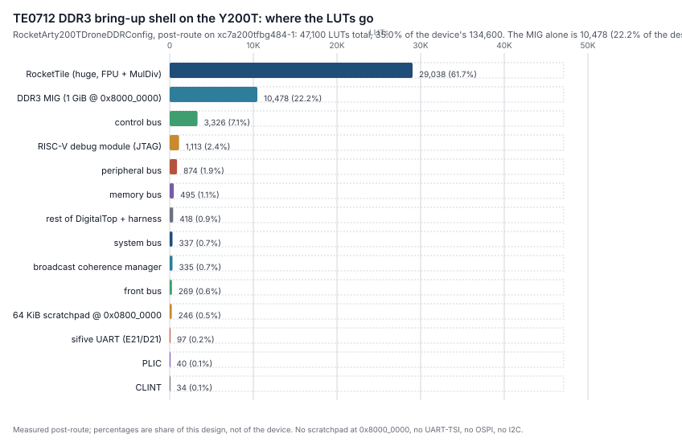

# TE0712 drone-carrier DDR3 bring-up

The DDR3 configuration for the bench in [`drone-initial-bringup.md`](drone-initial-bringup.md):
the same TE0712 SOM and the same J1 pinout that already runs Zephyr out of a
32 KiB scratchpad, with the module's 1 GiB of DDR3 behind the MIG instead.

**It works.** Measured 2026-09-03 on the drone carrier's own J1 pinout:
`RocketArty200TDroneDDRConfig` configures, the Rocket debug TAP answers,
`hello_world` runs out of DDR3 and prints on the console UART, and `ddr_stress`
passes **960 MiB with zero errors** at throughput matching the other carrier to
a fraction of a percent. See [Measured on hardware](#measured-on-hardware).

That closes the two questions this document was opened to answer. The design was
already proven elsewhere -- on 2026-09-01 the same design on the *other*
carrier's pinout (`RocketArty200TFtdiDDRConfig`, J2 and bank 14) ran on this same
200T module and passed `ddr_stress` over 960 MiB, recorded in
[`te0712-ftdi-carrier-ddr-bringup.md`](te0712-ftdi-carrier-ddr-bringup.md#measured-on-hardware)
-- and what remained was whether this carrier's J1 connector lands the six signal
pins, and why no MIG-bearing bitstream would finish configuration here. Both are
now answered: J1 lands them, and whatever stopped configuration was not in the
design. The recorded cause is the supply, carried forward from the 2026-09-02
investigation rather than re-measured on 2026-09-03.

Two earlier conclusions in this document are **superseded**, and both are kept
below with the reasoning that produced them, because the way each failed is the
transferable part:

- "The FPGA never finishes configuration with a MIG present" -- retracted
  2026-09-02 when the known-good scratchpad shell was seen to produce the same
  status value.
- "The drone carrier does not configure a MIG-bearing bitstream, and the carrier
  is the variable" -- correct as an observation on 2026-09-02, wrong as a
  property of the carrier. See
  [The carrier would not configure a MIG bitstream, and now does](#the-carrier-would-not-configure-a-mig-bitstream-and-now-does).

## The configuration

`RocketArty200TDroneDDRConfig`, in
`backends/chipyard/fpga/src/main/scala/arty200t/Configs.scala`.

| | |
| --- | --- |
| Config | `RocketArty200TDroneDDRConfig` |
| Core | one huge Rocket (`WithNHugeCores(1)`), RV64GC, FPU and MMU |
| L2 | none (`WithBroadcastManager`) |
| Main memory | **1 GiB DDR3 at `0x8000_0000`**, one `MT41J256M16XX-125` pair at 32-bit width behind the Xilinx MIG |
| Also present | a 64 KiB scratchpad at `0x0800_0000` from `chipyard.config.AbstractConfig`, in every Chipyard design |
| Periphery | sifive UART, JTAG. **No UART-TSI** |
| Clock | 50 MHz on every bus, from the on-module 50 MHz LVDS pair on H4/G4 |
| Part | `xc7a200tfbg484-1` |

It is deliberately the DDR3 half of a pair with `RocketArty200TSpadConfig`:
identical core, identical periphery, identical pinout, and main memory the only
variable. That is what makes it a bring-up target -- the scratchpad build is
known good on this bench, so anything that breaks here is the memory path.

### Why there is no UART-TSI

Same reason as the FTDI carrier in
[`te0712-ftdi-carrier-ddr-bringup.md`](te0712-ftdi-carrier-ddr-bringup.md): the
config carries no UART-TSI client, so `rb load` cannot work and programs go in
over JTAG. The TSI pair (P16/U18, J1_92/J1_85) has never answered on this bench
in either direction, so there is nothing to gain by carrying it.

The **console** pair is a different matter and no longer an obstacle: it works.
`uart_rxd`/`uart_txd` on E21/D21 reach channel B of the debug FT2232H, and every
result below was read there at 115200 rather than through `--ram-console`. An
earlier revision of this document and of
[`drone-initial-bringup.md`](drone-initial-bringup.md) recorded the console as
unwired; that is superseded.

### Pins

Unchanged from the scratchpad shell, and that is the point. Read out of the
post-route `report_io` of the completed build, so this is the bitstream rather
than the intent:

| Signal | Pin | J1 | Bank | Direction |
| --- | --- | --- | --- | --- |
| `jtag_TCK` | A19 | J1_46 | 16 | in |
| `jtag_TDI` | A18 | J1_48 | 16 | in |
| `jtag_TDO` | F20 | J1_50 | 16 | out |
| `jtag_TMS` | F19 | J1_52 | 16 | in |
| `uart_rxd` | E21 | J1_41 | 16 | in |
| `uart_txd` | D21 | J1_43 | 16 | out |

Plus the on-module 50 MHz LVDS clock pair on H4/G4 and the DDR3 bus in banks 34
and 35.

**Do not confuse this with `RocketArty200TFtdiDDRConfig`**, which is the same
design on the *other* carrier's J2 block in bank 14. Loading that one on this
bench puts JTAG on balls nothing is connected to, and the all-ones scan that
follows is genuine.

## The part is `-1`

`xilinx/arty_a7_200/tcl/board.tcl` carried `xc7a200tfbg484-2` until 2026-08-31,
copied from the 100T board's commercial `-2` and marked in its own comment as a
placeholder. Trenz's board files settle it:
`arty_files/te0712-rd/board_files/TE0712_board_files.csv` maps `TE0712-02-200-1I`
to `xc7a200tfbg484-1`, and `TE0712_200_1I/2.0/board.xml` declares the same
`part_name` and describes the module as "speed grade -1 and industrial
temperature grade".

**This is a signoff correction, not a fix for anything observed on the bench** --
`-1` and `-2` builds behave alike there. It matters anyway, because `-2` signs
timing off against a faster die than the silicon, and the MIG bakes the grade
into its generated PHY as `FPGA_SPEED_GRADE`. The cost is visible:

| | WNS | design |
| --- | ---: | --- |
| built as `-2` | +0.242 ns | `RocketArty200TConfig` |
| built as `-1` | **+0.071 ns** | `RocketArty200TDroneDDRConfig` |

Roughly a third of the margin the old build claimed. Both meet every constraint;
only one of them is telling the truth about this die.

## Building and running

```console
rb chipyard build --board arty200t --config RocketArty200TDroneDDRConfig
rb program --board arty200t --config RocketArty200TDroneDDRConfig --usb-location 5-5.3
rb debug hello_world --target arty200t --config RocketArty200TDroneDDRConfig \
    --usb-location 7-1.1
```

`rb chipyard path --board arty200t --config RocketArty200TDroneDDRConfig` prints
the bitstream path and exits non-zero if it is absent.

**Re-derive the two USB locations before using them.** They are bus-port paths,
they change whenever a cable moves, and the bitstream and debug adapters have
swapped positions more than once on this bench. `rb probe-ftdi --idcode` is the
only thing that says which is which; the values above are what they were on
2026-09-03. The bitstream adapter must be the one whose IDCODE is the xc7a200t
config TAP (`0x13636093`), and the debug adapter the one that reads
`0x00000001`.

### Measured, post-route

Vivado 2023.1 on `xc7a200tfbg484-1`. `All user specified timing constraints are
met.`; 113 DRC violations, all severity Warning, no errors and no critical
warnings.

| Resource | Used | of device |
| --- | ---: | ---: |
| LUTs | 47,100 | 35.0% of 134,600 |
| Registers | 26,933 | 10.0% |
| RAMB36 / RAMB18 | 16 / 96 | |
| DSP48E1 | 25 | |



RocketTile is 29,038 LUTs (61.7% of the design) and **the MIG is 10,478
(22.3%)** -- together 84% of everything. Regenerate with

```console
dse/scripts/plot_te0712_ddr_bringup_area.py --board arty200t \
    --config RocketArty200TDroneDDRConfig
```

which parses the post-route report at render time, so the figure cannot drift
from the bitstream.

## Measured on hardware

2026-09-03, on the drone carrier, over its own J1 pinout. Every number below is
from that session; the raw console captures are `docs/logs/hello-world-drone-ddr.log`,
`docs/logs/ddr-stress-drone-64mib.log` and `docs/logs/ddr-stress-drone-960mib.log` at the repository
root.

**The bench.** Both FT2232Hs now sit one hub deep rather than three, and their
locations are not the ones earlier revisions of this document used -- re-probe
rather than copying these:

| Location | Link | IDCODE | Reaches |
| --- | --- | --- | --- |
| `5-5.3` | bitstream | `0x13636093` | xc7a200t config TAP |
| `7-1.1` | debug | `0x00000001` | Rocket debug TAP; console on channel B |

The debug link reads `0x00000001` only **after** the part is configured; before
that it scans all ones, which is correct behaviour and not a fault. Probe the two
adapters with a Rocket bitstream already loaded, or the debug link looks dead.

The console is interface 1 of the debug adapter, addressed through
`/dev/serial/by-path/pci-0000:29:00.3-usb-0:1.1:1.1-port0` at 115200. The
`ttyUSB` number moved twice during this session, so the by-path node is the only
stable handle.

**The bitstream** was `bitstreams/arty200t/arty200t.RocketArty200TDroneDDRConfig.bit`,
built 2026/08/31 18:37:49, SRAM-loaded with
`openFPGALoader --board te0712_8 --write-sram`. Note that `rb program` does
**not** resolve to that file -- it uses
`generated-src/.../obj/Arty200THarness.bit`, which at the time of writing is a
different and later build of the same config.

### The debug TAP answers

The thing that never happened on this carrier before:

```console
Info : JTAG tap: riscv.cpu tap/device found: 0x00000001 (mfg: 0x000 (<invalid>), part: 0x0000, ver: 0x0)
Info : datacount=8 progbufsize=16
Info : Examined RISC-V core; found 1 harts
Info :  hart 0: XLEN=64, misa=0x800000000094112d
RiskyBird Arty200T is ready for GDB
```

`misa=0x800000000094112d` is RV64 IMAFDC with S and U modes, FPU and MMU -- the
same core the scratchpad shell presents, now with the MIG behind it.

### `hello_world` runs out of DDR3

```bash
rb build hello_world --target arty200t --config RocketArty200TDroneDDRConfig
rb debug hello_world --target arty200t --config RocketArty200TDroneDDRConfig \
    --usb-location 7-1.1
```

It links against the full region rather than a scratchpad, which is the first
check that the config took:

```console
Memory region         Used Size  Region Size  %age Used
             RAM:       19424 B         1 GB      0.00%
```

All twelve sections verify byte-for-byte over JTAG after `load`, and the program
prints on the console UART:

```console
hello world from RiskyBird
board   chipyard_riscv64
arch    riscv, 64-bit
tick 0  uptime 6 ms
tick 1  uptime 259 ms
...
tick 39  uptime 9835 ms
hello world complete after 40 ticks
```

The tick deltas are 252 ms against a `k_msleep(250)`, so the CLINT timebase is
right, and the program reaches its own end rather than hanging.

### `ddr_stress` passes 960 MiB

```bash
RB_EXTRA_CFLAGS=-DDDR_STRESS_MIB=960 rb debug ddr_stress --target arty200t \
    --config RocketArty200TDroneDDRConfig --usb-location 7-1.1
```

```console
DDR stress: 960 MiB at 0x82000000, 125829120 x 64-bit words
  address-in-address      54352 ms  37041 KB/s (rw)  errors: 0
  0x55/0xAA alternating   74661 ms  26965 KB/s (rw)  errors: 0
  inverted address        62372 ms  32278 KB/s (rw)  errors: 0
  LFSR pseudorandom      107553 ms  18718 KB/s (rw)  errors: 0

DDR stress PASSED -- 0 total errors over 960 MiB x 4 passes
```

64 MiB was run first and also passed with zero errors. The window starts at
`0x8200_0000`, 32 MiB above the image, and 960 MiB is close to the ceiling: the
region ends at `0xC000_0000`, so the largest window that fits is 992 MiB.

**The throughput is the corroborating measurement**, not the error count. Against
the FTDI carrier's 960 MiB run from 2026-09-01 -- a different carrier, a
different pinout, the same SOM and the same design:

| Pass | FTDI carrier | Drone carrier | Δ |
| --- | ---: | ---: | ---: |
| address-in-address | 37041 KB/s | 37041 KB/s | 0.00% |
| 0x55/0xAA alternating | 26971 KB/s | 26965 KB/s | -0.02% |
| inverted address | 32017 KB/s | 32278 KB/s | +0.82% |
| LFSR pseudorandom | 18718 KB/s | 18718 KB/s | 0.00% |

Two passes are identical to the digit and the other two differ by under a
percent. A marginal link, a partially-calibrated PHY or a narrower bus would all
show up here long before they showed up as a bit error, so this says the memory
path is the same one that already passed on the other carrier.

### A trap in the run flow

`rb debug` **builds before it loads**. A per-run knob passed only to `rb build`
is silently undone by that rebuild:

```bash
RB_EXTRA_CFLAGS=-DDDR_STRESS_MIB=960 rb build ddr_stress ...   # 960 MiB image
rb debug ddr_stress ...                                        # rebuilds at 64
```

The first 960 MiB attempt of this session ran at 64 MiB for exactly that reason,
and the only symptom was the window size in the workload's own banner. Pass
`RB_EXTRA_CFLAGS` to `rb debug`, or to both.

## The carrier would not configure a MIG bitstream, and now does

**Kept because the investigation is reusable, not because the conclusion
stands.** On 2026-09-02 every MIG-bearing bitstream failed to start on this
carrier and every scratchpad bitstream succeeded, measured with the known-good
scratchpad shell re-run as a control after each experiment:

| Bitstream | MIG | STATUS | DONE (bit 3) | Rocket debug TAP |
| --- | --- | --- | --- | --- |
| `RocketArty200TSpadConfig` (control) | no | `0x501079fc` | **1** | **found**, `XLEN=64` |
| `RocketArty200TMotorSpadConfig` (control) | no | -- | -- | **found**, `XLEN=64` |
| `RocketArty200TDroneDDRConfig` | yes | `0x5000190c` | **1** | all ones, no TAP |
| `RocketArty200TConfig` | yes | `0x5000190c` | **1** | all ones, no TAP |
| `RocketArty200TFtdiDDRConfig` | yes | `0x5000190c` | **1** | all ones, no TAP |

The control passed four times out of four, so this was not the contaminated A/B
that produced the earlier retracted conclusion. `EOS` and `DCI_MATCH` read 0 on
every MIG row: the part configured and then did not run. `jtag_TDO` carries a
`PULLUP`, so an all-ones scan is what an *undriven* TDO looks like -- a design
held in reset, not a broken wire. `ResetWrangler` ORs every clock-group reset
together, so a MIG whose `init_calib_complete` never asserts holds the whole SoC,
including the debug logic, in reset.

Every one of those observations was accurate. The conclusion drawn from them --
that the carrier cannot configure a MIG bitstream -- was not, because the
variable was never the carrier's wiring.

### Why it works now

The recorded cause is the **supply**. On a 3.3 V / 1 A bench PSU the measured
draw sat at 0.4 A and never moved, identical for MIG and scratchpad shells and
never near the limit. A supply being clamped would show the MIG shell pulling
more, at least transiently, and would be flaky rather than perfectly
reproducible; constant current across both instead says banks 34 and 35 were
never energised at all. Powered the way the drone powers it, the same bitstream
configures and calibrates.

**This session did not re-run that A/B.** The supply account is carried forward,
not re-measured here, and `VCCO_34`/`VCCO_35` have still never been put on a
meter. What 2026-09-03 establishes is the outcome, not the mechanism.

One other thing changed between the two sessions, and it should not be silently
credited: the two FT2232Hs moved from three cascaded hubs deep (`7-1.1.4.x`) to
one (`5-5.3`, `7-1.1`). That improves link *reliability* and is why every JTAG
operation in this session worked on its first attempt with no replug. It cannot
explain configuration itself -- a design held in reset reads all ones through a
perfectly healthy adapter, and the 2026-09-02 result reproduced across twelve
OpenOCD variants with the control passing between them.

### A colleague's report was right

An earlier revision dismissed a colleague's report of running `hello_world` on
this carrier, on the grounds that their flow does not configure the FPGA and that
`hello_world` is small enough to fit the 32 KiB scratchpad, so it proved nothing
about the MIG. That reasoning was sound and the caution was correct -- but the
report was right anyway. The document named the experiment that would settle it:
"`ddr_stress`, which needs a window at `0x8200_0000`, is the ELF that would have
distinguished them; it was not run." It has now been run, and it passes.

### The DONE bit was being read from the wrong place

A real bug, and it stands. `tools/rb/cli.py` had `CONFIG_STATUS_DONE = 1 << 14`
and `CONFIG_STATUS_EOS = 1 << 4`. UG470 Table 5-27 puts DONE at bit 3 and EOS at
bit 13; bit 14 is `DCI_MATCH` and bit 4 is `RELEASE_DONE`. The check therefore
passed scratchpad shells and aborted `rb program` on every MIG shell before
`rb debug` could run, with a message asserting the part "cannot boot from it".
Fixed to gate on bit 3 and report EOS and DCI_MATCH for diagnosis only.

This is worth keeping in mind whenever a MIG shell is involved: **`DONE=1` alone
does not mean the design started.** `EOS` (bit 13) is the bit that says it did.

### Ruled out during the investigation, and still ruled out

Each of these was tested with the scratchpad control passing on the same cables,
and none of them was the cause:

- **The programming flow.** SRAM load and flash boot via a PROGRAM_B pulse give
  identical status.
- **The OpenOCD configuration.** Twelve variants -- `ft-link.cfg`'s
  `layout_init 0x0B00 0x0B0B` and the standard `0x0008 0x000b`, crossed with
  `tdo_sample_edge rising`/`falling` and 2000/1000/100 kHz -- all scanned all
  ones.
- **A BSCAN-tunnelled debug module.** The design has none: tunnelling through the
  config TAP reports `Unsupported DTM version 14 (dtmcontrol=0xe)`.
- **An unpulsed reset.** Asserting and releasing nSRST before the scan changes
  nothing.
- **The startup cycle settings.** COR0 is `0x02303fe5` (scratchpad) and
  `0x02003fe5` (DDR); both carry `LOCK_CYCLE=NoWait` and `MATCH_CYCLE=NoWait`,
  so startup is not configured to wait on MMCM lock or DCI match. The two differ
  only in `OSCFSEL`, the configuration clock rate.
- **A pin conflict on J1.** The DDR3 occupies 112 balls in banks 34 and 35, and
  **no `J1_*` net in Trenz's `part0_pins.xml` lands on any of them**. The only
  board-file nets on those balls are the on-module clock pair (H4/G4), `RESET`
  (T3) and `PLL_INT` (B2).

### What was sound all along, from the build products

These never depended on the board, and the hardware run has now confirmed each
of them:

- **The pinout.** Every signal the DDR and scratchpad shells share is on the same
  ball: `jtag_TCK` A19, `jtag_TDI` A18, `jtag_TDO` F20, `jtag_TMS` F19,
  `uart_rxd` E21, `uart_txd` D21, `sys_clock_p/n` H4/G4. No ball is assigned
  twice, and no DDR3 signal lands in bank 14 or bank 16.
- **The constraints.** Diffing the two generated `*.shell.xdc` files over every
  JTAG, UART, clock and pull constraint yields only the four UART-TSI lines this
  config drops deliberately.
- **UART-TSI is not the variable.** `RocketArty200TConfig` carries it and is a
  DDR shell; `RocketArty200TSpadConfig` carries it and is a scratchpad shell.
- **The bitstream startup options.** The configuration command headers of a
  working and a failing bitstream are byte-identical for the first 50 words,
  covering COR0/COR1/CTL and the whole startup sequence.
- **The MIG project.** The embedded `mig.prj` is byte-for-byte Trenz's own
  `TE0712_200_1I/2.0/mig.prj` apart from `<ModuleName>`, `<SystemClock>` and
  `<C0_S_AXI_DATA_WIDTH>`.
- **The speed grade.** `-1` and `-2` builds behave alike on the bench.

### The 1.5 V hypothesis

The asymmetry that drove it is real and is in the build reports: a MIG shell
requires `VCCO_34` and `VCCO_35` at 1.50 V where a scratchpad shell requires
nothing of those banks.

| Bank | `RocketArty200TSpadConfig` | `RocketArty200TDroneDDRConfig` |
| --- | --- | --- |
| VCCO_16 | 3.30 | 3.30 |
| VCCO_14 | 3.30 | any |
| **VCCO_34** | **any** | **1.50** |
| **VCCO_35** | **any** | **1.50** |

That asymmetry is exactly why the failure split along MIG versus scratchpad and
looked for a long time like a bitstream problem. It is consistent with the supply
account -- a bank whose VCCO is absent stalls startup, and DCI cannot match
without a correct bank supply -- but it was never confirmed with a meter, and it
still has not been. It is recorded as a hypothesis that fits, and nothing more.

## The dirty-MPSSE trap

**Only the first OpenOCD run after an enumeration is trustworthy.** OpenOCD
detaches `ftdi_sio` and drives the MPSSE engine directly; on exit it neither
resets the engine nor rebinds the driver, so the next run's `ftdi layout_init`
starts from whatever state the last one left. A dirty engine clocks garbage and
reports `all ones`, `all zeroes` or an IR capture error -- indistinguishable at
the prompt from a real fault.

This produced a clean-looking A/B/A whose *control* failed in third position with
the same bitstream that passed in first position. Any comparison here must
re-run the control after the experiment and be discarded if the control does not
pass.

Separately, the two adapters used to log real bus drops -- `usb 7-1.1.4.1: USB
disconnect` followed by re-enumeration -- in pairs one second apart, both at
once, from three cascaded USB 2.0 hubs deep (`7-1 -> 7-1.1 -> 7-1.1.4`) with each
declaring itself bus-powered and requesting 500 mA. One adapter cannot take its
sibling down, so the fault was the shared hub or the rail feeding it.

**They have since been moved one hub deep** (`5-5.3` and `7-1.1`), and on
2026-09-03 no drop occurred and every JTAG operation succeeded on its first
attempt with no replug and no `USBDEVFS_RESET`. Keep the triage below anyway:
the depth is a property of how the bench is cabled on the day, not of the
hardware.

Triage: after any failure, `dmesg | tail`. A `USB disconnect` line means the bus
dropped; no line means the MPSSE is dirty and the adapter needs a physical
replug. `USBDEVFS_RESET` re-enumerates without reliably clearing MPSSE state.

## What this establishes

- **`RocketArty200TDroneDDRConfig` runs on the drone carrier.** It configures,
  presents a Rocket debug TAP, boots Zephyr out of DDR3 and prints on the
  console UART.
- **The J1 connector lands the six signal pins this config uses.** That was the
  question the document was opened for, and it is answered by the shell running
  at all: JTAG on A19/F19/A18/F20 carried the load and the console on E21/D21
  carried the output.
- **The DDR3 is good through this pinout.** 960 MiB, four patterns, zero errors,
  at throughput within 0.82% of the same design on the other carrier on every
  pass and identical to the digit on two of them.
- **The console UART works on this carrier**, contradicting every earlier
  revision of this document and of `drone-initial-bringup.md`.
- A DDR3 configuration for this pinout builds, meets timing on the correct `-1`
  die, and produces a bitstream; the `arty200t` part string was wrong and is now
  correct, with the true timing margin recorded.
- Its pinout and constraints are identical to the known-good scratchpad shell
  everywhere the two overlap, verified against the build products and now
  corroborated on hardware.
- **The 2026-09-02 conclusion that this carrier cannot configure a MIG bitstream
  is superseded.** The observations behind it were accurate and reproducible;
  the inference that the carrier's wiring was the variable was wrong.

## What this does not establish

- **Why it works now, measured in this session.** The supply account is carried
  forward from 2026-09-02, not re-measured on 2026-09-03. Nothing here is a
  voltage measurement, and `VCCO_34`/`VCCO_35` have still never been put on a
  meter.
- **That the DDR3 is exercised above 960 MiB.** The region is 1 GiB and the
  window starts 32 MiB up, so 992 MiB is the ceiling; the top 32 MiB and the
  32 MiB below the window have not been walked by `ddr_stress`.
- **Sustained or thermal behaviour.** The longest run here is about five minutes
  of continuous traffic from a cold start. Nothing has been soaked.
- **Booting without a debugger.** The bitstream was SRAM-loaded and every image
  went in over JTAG. `rb program` also writes SPI flash, but no power-cycle boot
  was attempted in this session.
- **Which bitstream is canonical.** The build used here is the collected copy
  from 2026-08-31; `rb program` resolves to a later build of the same config in
  `generated-src`, and the two have not been compared on hardware.
- **The UART-TSI pair.** P16/U18 on J1_92/J1_85 remain unexercised in either
  direction, and this config carries no TSI client.

---

## Resolved: a MIG shell that stalls at `EOS=0` is an input-voltage problem

Recorded 2026-09-04/05. This is the section to read when a DDR-backed shell
refuses to come up.

### The symptom

`openFPGALoader` reports `Done`, the FPGA's configuration `STATUS` register
reads `DONE=1`, and yet the design never starts. The Rocket debug TAP scans all
ones and the board looks like a broken JTAG cable.

The distinguishing read is the configuration `STATUS` register (UG470
Table 5-27 — **DONE = bit 3, EOS = bit 13, DCI_MATCH = bit 14**):

| value | meaning |
| --- | --- |
| `0x501079fc` | `EOS=1`, `DCI_MATCH=1` — fully started |
| `0x5000190c` | `DONE=1`, **`EOS=0`, `DCI_MATCH=0`** — configured, startup stalled |

`EOS=0` with `DONE=1` means the part loaded its bitstream and then failed to
finish start-up. On this carrier that is a **power** result, not a JTAG one.

### What actually fixes it

Measured on one board across two supply arrangements, same bitstreams:

| shell | bench PSU @ 3.3 V | battery + on-board USB-C |
| --- | --- | --- |
| `RocketArty200TFlowSpadConfig` (no MIG) | `0x501079fc` | `0x501079fc` |
| `RocketArty200TDroneDDRConfig` (MIG) | `0x5000190c` | **`0x501079fc`** |
| `RocketArty200TDroneFullDDRConfig` (MIG) | `0x5000190c` | **`0x501079fc`** |

With the battery in, all three configure fully and the Rocket debug TAP answers
on every one.

### Why — and why it is not "3.3 V is too low"

The board makes its 3.3 V rail with a **step-down** converter (`U15`,
TPS552882Q). A buck cannot produce its output from an equal input: it would need
100% duty, and a real part tops out around 90–95%, so it needs roughly **≥3.5 V**
in to make 3.3 V out.

- **Vin = 3.7 V** → duty ≈ 3.3/3.7 = **89%**. Comfortable.
- **Vin = 3.3 V** → duty = **100%**. Impossible; the rail sits *below* 3.3 V.

The scratchpad shells do not care because they never bring the SOM's DDR3 rails
up. A MIG shell does, and those rails are what fail — which is exactly the split
the table shows.

So the fix is **headroom, not more volts on the 3.3 V rail**. A 1S LiPo
(3.7–4.2 V) or USB-C VBUS (5 V) entering through the board's designed input is
correct. Injecting a higher voltage directly onto `+3V3` is not — that rail is
downstream of every protection device on the board.

### Two things this is not

- **Not a broken cable.** An all-ones scan on the debug TAP is the correct
  reading for a part that has not finished start-up. Read `STATUS` before
  suspecting the adapter.
- **Not a current limit.** It reproduces inside a 1 A cap at 3.7 V, where it
  works; the binding constraint is the converter's dropout, not the supply's
  ceiling.

### Related failure, different cause

A board that is *hot* and drawing far more than usual is a separate problem. On
one board the ESP32-C6 fried into a **10.1 Ω** short from `+3V3` to ground —
measured with the board off, while `+BATT` and 2.8 V stayed in the megaohms.
3.3 V / 10.1 Ω = 330 mA, matching the observed current rise exactly, and a fresh
board drew 0.04 A where that one drew 0.38 A.

**Measure rail-to-ground resistance with the board off before drawing any
conclusion about voltage margins.** Tens of ohms or less is a damaged die, and
re-energising spreads the damage. Note the voltage sensitivity above is real and
*independent* of that fault: it reproduces on a healthy board with no short
anywhere.
