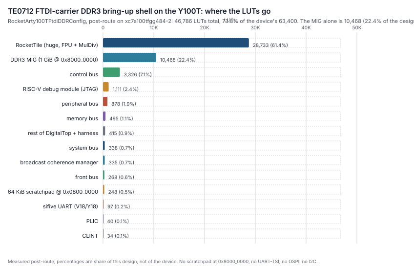

# TE0712 FTDI-carrier DDR3 bring-up

The smallest bitstream that answers one question: **does the DDR3 configuration
work on this carrier?**

One Rocket, 1 GiB of real DDR3 behind the MIG, JTAG, and one UART. No
scratchpad at `0x8000_0000`, no UART-TSI, no camera, no I2C, no accelerator.

The point of removing the scratchpad is diagnostic, not area. Every other Arty
bring-up config in this repository can be built with `ddr = false`, which puts a
32 KiB mbus scratchpad at `0x8000_0000` and instantiates no MIG at all -- so a
program that loads and runs there proves nothing about the DDR3. Here `ddr =
true` leaves `ExtTLMem` defined, the harness places the MIG, and the only thing
answering at `0x8000_0000` is the physical DDR3. A failure cannot be masked.

## Configurations

Two, one per TE0712 module. They are the same design on different die.

| | |
| --- | --- |
| Config | `RocketArty100TFtdiDDRConfig` / `RocketArty200TFtdiDDRConfig` |
| Core | one huge Rocket (`WithNHugeCores(1)` via `chipyard.RocketConfig`), RV64GC + Zb\*/Zfh, FPU and MulDiv |
| L2 | none (`WithBroadcastManager`) |
| Main memory | **1 GiB DDR3 at `0x8000_0000`**, one `MT41J256M16XX-125` pair at 32-bit data width behind the Xilinx MIG |
| Also present | a 64 KiB scratchpad at `0x0800_0000` from `chipyard.config.AbstractConfig`, in every Chipyard design and not specific to this one |
| Periphery | sifive UART, JTAG. **No UART-TSI** |
| Clock | 50 MHz on every bus, from the on-module 50 MHz LVDS pair on H4/G4 (`DIFF_SSTL15`) |
| Parts | `xc7a100tfgg484-2` / `xc7a200tfbg484-1` |

Defined in `backends/chipyard/fpga/src/main/scala/arty{100,200}t/Configs.scala`.

### Why there is no UART-TSI

This carrier brings out one RX/TX pair, and it is the FTDI console channel. The
adapter is one FT2232H (`0403:6010`): `hardware/openocd/ft-link.cfg` takes
channel A for JTAG, and the UART is channel B of the same chip. There is no
second pair for the serial program loader.

UART-TSI could not simply be repinned onto other balls, because
`testchipip.tsi.WithUARTTSIClient` *creates* the port -- a later harness binder
can move a port's pins but cannot remove the port. So `WithArty100TTweaks` and
`WithArty200TTweaks` gained a `uartTsi` knob, default `true`, and these two
configs pass `false`. That drops the client and its binder together.

The consequence is that **`rb load` does not work on these bitstreams.** It
drives `pyuartsi` over the TSI port, which is not present. Programs go in over
JTAG instead, which is the same choice the KU040 bring-up notes on `main` record for
the KU040, where the UART-TSI pins are likewise not wired to anything.

## Pins

Six signal pins, all in **bank 14**, all `LVCMOS33`. Read out of the post-route
`report_io` of the completed `xc7a100t` build, so this table is the bitstream
rather than the intent. The `xc7a200t` build's `report_io` gives the same six
balls with the same site types and directions.

| Signal | Pin | SOM net | Site type | Direction | Extra |
| --- | --- | --- | --- | --- | --- |
| `jtag_TDI` | W20 | J2_24 | `IO_L12N_T1_MRCC_14` | in | `PULLUP` |
| `jtag_TMS` | V20 | J2_28 | `IO_L11N_T1_SRCC_14` | in | `PULLUP` |
| `jtag_TCK` | W19 | J2_22 | `IO_L12P_T1_MRCC_14` | in | `PULLUP`, `CLOCK_DEDICATED_ROUTE FALSE` |
| `jtag_TDO` | U20 | J2_26 | `IO_L11P_T1_SRCC_14` | out | `PULLUP`, drive 12, SLOW |
| `uart_rxd` | V18 | J2_21 | `IO_L14P_T2_SRCC_14` | in | `IOB TRUE` |
| `uart_txd` | Y18 | J2_25 | `IO_L13P_T2_MRCC_14` | out | `IOB TRUE`, drive 12, SLOW |

Plus the two on-module clock balls, H4/G4, and the DDR3 bus. Nothing else: the
whole top-level port list of `Arty100THarness` is `sys_clock_p/n`, the DDR3
signals, and those six.

`TCK` lands on an MRCC pin, so the `CLOCK_DEDICATED_ROUTE FALSE` the JTAG binder
applies is unnecessary here rather than wrong. It is left in place because it
costs nothing and lets one binder serve both carriers.

### Why the pinout moved

The SOM-net column is the whole explanation. These six are on the TE0712's **J2**
connector; every default in `HarnessBinders.scala` is on **J1** (`A19` = J1_46,
`E21` = J1_41, and so on). Same module, different carrier, so a different
connector is brought out. That is also why the DDR3 and the clock did not move --
both are on the module.

3.3 V on bank 14 is the board's documented level, not an assumption. Trenz's own
board file declares all six pins `iostandard="LVCMOS33"`:

```console
$ grep -oE '<pin[^>]*loc="(W20|V20|W19|U20|V18|Y18)"[^>]*>' \
    arty_files/te0712-rd/board_files/TE0712_100_2C/2.0/part0_pins.xml
<pin index="104" name="J2_24"  iostandard="LVCMOS33" loc="W20"/>
<pin index="106" name="J2_28"  iostandard="LVCMOS33" loc="V20"/>
<pin index="103" name="J2_22"  iostandard="LVCMOS33" loc="W19"/>
<pin index="105" name="J2_26"  iostandard="LVCMOS33" loc="U20"/>
<pin index="93"  name="J2_21"  iostandard="LVCMOS33" loc="V18"/>
<pin index="95"  name="J2_25"  iostandard="LVCMOS33" loc="Y18"/>
```

and the post-route `report_io` of every completed arty100t build already requires
`VCCO_14` = 3.30 V.

The pins are all general-purpose and none is shared with the SPI-flash
configuration interface. **One collision to know about:** `WithArty100TOspi` and
`WithArty200TOspi` still default the camera's `INT` to V20 and `TRIG` to U20,
which are TMS and TDO here. A camera config on this carrier must override them.

## The 100T and the 200T are interchangeable

Verified rather than assumed, which matters because the parts have different
package codes -- `fgg484` and `fbg484`.

**Pinout: identical.** Trenz ships both on the same 484-ball module, and their
two board files match across all 183 declared nets -- same net name, same ball,
same `iostandard`:

```console
$ diff <(grep -oE '<pin [^>]*/>' arty_files/te0712-rd/board_files/TE0712_100_2C/2.0/part0_pins.xml | sed -E 's/index="[0-9]+" *//' | sort) \
       <(grep -oE '<pin [^>]*/>' arty_files/te0712-rd/board_files/TE0712_200_1I/2.0/part0_pins.xml | sed -E 's/index="[0-9]+" *//' | sort)
$ echo $?
0
```

**Memory: identical.** The generated MIG projects differ in exactly two lines:

| | 100T | 200T |
| --- | --- | --- |
| `<ModuleName>` | `arty100tmig` | `arty200tmig` |
| `<TargetFPGA>` | `xc7a100t-fgg484/-2` | `xc7a200t-fbg484/-1` |

Every other line matches, including all 77 pin-map lines: one
`DDR3_SDRAM/Components/MT41J256m16XX-125` pair, `<DataWidth>32`,
`<InputClkFreq>50`, `<TimePeriod>2500`. Same 1 GiB at the same address off the
same pins. The DDR3 is on the module, not the carrier.

**Clock: identical.** `Arty200TShell` drives the same on-module 50 MHz LVDS pair
on H4/G4 at `DIFF_SSTL15`.

The headroom difference is large -- the same design fills 74% of the `xc7a100t`
and 35% of the `xc7a200t` -- and it is the reason to prefer the 200T when one is
available. It is not, however, the only difference that showed up in practice:
the 200T closed timing more tightly than the 100T, not less. See the timing table
below before reading its spare LUTs as spare margin.

## Building

```console
rb chipyard build --board arty100t --config RocketArty100TFtdiDDRConfig
rb chipyard build --board arty200t --config RocketArty200TFtdiDDRConfig
```

The bitstreams land at

```text
backends/chipyard/fpga/generated-src/
  chipyard.fpga.arty100t.Arty100THarness.RocketArty100TFtdiDDRConfig/obj/Arty100THarness.bit
  chipyard.fpga.arty200t.Arty200THarness.RocketArty200TFtdiDDRConfig/obj/Arty200THarness.bit
```

`rb chipyard path --board <board> --config <config>` prints that path and exits
non-zero if the file is absent. Published copies are in the bitstream
repository as `arty100t/arty100t.RocketArty100TFtdiDDRConfig.bit` and
`arty200t/arty200t.RocketArty200TFtdiDDRConfig.bit`.

## Programming, and how to actually test the DDR3

```console
rb program --board arty100t --config RocketArty100TFtdiDDRConfig
```

On the 100T this uses openFPGALoader; on the 200T `tools/rb/boards.py` records no
openFPGALoader board definition, so `program_fpga` falls back to Vivado
automatically.

Then bring up the debug module. `rb debug` composes it, or by hand:

```console
openocd -f hardware/openocd/ft-link.cfg -f hardware/openocd/arty100t.cfg
riscv64-zephyr-elf-gdb -ex 'target extended-remote localhost:3333' -ex 'monitor halt'
```

Note that both `hardware/openocd/arty100t.cfg` and `arty200t.cfg` already place
their OpenOCD work area at `0x8000_1000` -- inside the DDR3. On a board where the
DDR3 does not calibrate, OpenOCD's own scratch accesses fail, so this is an early
signal rather than a later one.

Three tests, cheapest first. All of them go through the debug module's system-bus
access, so they exercise the real DDR3 read/write path.

**1. A single word.** The narrowest possible check that the MIG answers:

```gdb
(gdb) set *(unsigned int *) 0x80000000 = 0xdeadbeef
(gdb) x/1xw 0x80000000
0x80000000:     0xdeadbeef
```

If this reads back `0x00000000`, `0xffffffff`, or the same value at every address,
the controller is not calibrated and nothing further is worth trying.

**2. Walk the span.** One word near each end and in the middle confirms the full
1 GiB is decoded rather than a small window aliasing:

```gdb
(gdb) set *(unsigned int *) 0x80000000 = 0x11111111
(gdb) set *(unsigned int *) 0xa0000000 = 0x22222222
(gdb) set *(unsigned int *) 0xbffffffc = 0x33333333
(gdb) x/1xw 0x80000000
(gdb) x/1xw 0xa0000000
(gdb) x/1xw 0xbffffffc
```

Aliasing shows up as an earlier address having been overwritten by a later write.

**3. Load a real image and verify every byte.** `load` writes the ELF into DDR3
over JTAG; `compare-sections` reads it all back and checks it against the host
copy, which is a bulk memory test with a known-good reference:

```gdb
(gdb) load
(gdb) compare-sections
```

`MIS-MATCHED` on any section means the DDR3 is returning wrong data under bulk
traffic even if the single-word test passed. Because the config has no scratchpad
at `0x8000_0000`, a clean `compare-sections` here cannot be anything but working
DDR3.

Any Zephyr image built for `arty100t` runs on these bitstreams unchanged -- the
hardware contract is unaltered from the baseline:

```console
$ rb # (validate_hardware_contract, RocketArty100TFtdiDDRConfig)
config RocketArty100TFtdiDDRConfig
RAM 0x80000000+0x40000000
UART 0x10020000 irq 1
```

which is the same UART address and IRQ as `RocketArty100TConfig`.

## Measured results

**The 200T numbers below were measured against `xc7a200tfbg484-2`, which is the
wrong die.** The part string was a placeholder copied from the 100T and was
corrected to `-1` on 2026-08-31; see
[`te0712-drone-carrier-ddr-bringup.md`](te0712-drone-carrier-ddr-bringup.md#the-part-is--1)
for the provenance. Utilization barely moves, but the timing column does: the
same design reports +0.242 ns at `-2` and +0.071 ns at `-1`. Treat every 200T
timing figure here as superseded until this config is rebuilt.

Vivado 2023.1, 100T at speed grade -2 and 200T as originally built at -2. Synthesis through bitstream took
8m30s on the 100T (synth 3m24, opt 8s, place 1m38, phys-opt 5s, route 2m41,
phys-opt 10s, bitgen 24s) and 8m07s on the 200T (synth 3m25, place 1m37, route
2m38, bitgen 27s). Chisel elaboration and FIRRTL run before that.

### Utilization, post-route

The two builds are the same design, and the numbers say so: 15 LUTs apart out of
46,800, and identical register, BRAM and DSP counts.

| Resource | 100T | of 63,400 | 200T | of 134,600 |
| --- | ---: | ---: | ---: | ---: |
| LUTs | 46,786 | **73.8%** | 46,801 | **34.8%** |
| Registers | 26,908 | 21.2% | 26,908 | 10.0% |
| RAMB36 / RAMB18 | 16 / 96 | | 16 / 96 | |
| DSP48E1 | 25 | | 25 | |
| Bitstream size | 3,825,900 B | | 9,730,764 B | |



RocketTile is 28,733 LUTs (61.4% of the design) and **the MIG is 10,468
(22.4%)** -- together 84% of everything. The remaining rows are buses and small
peripherals: the control bus 3,326, the debug module 1,111, and the sifive UART
just 97. On the 200T the same rows come out within 15 LUTs (RocketTile 28,747,
MIG 10,473), which is placement noise, not a design difference.


Regenerate either with `dse/scripts/plot_te0712_ddr_bringup_area.py --board
arty{100,200}t`, which parses the post-route report at render time so the figure
cannot drift from the bitstream.

That ~10,470 LUT MIG figure is the number to weigh against a scratchpad build,
and the 73.8% vs 34.8% column is the practical argument for the 200T: the same
bring-up leaves 16,600 LUTs free on the 100T and 87,800 on the 200T.

### Timing

`All user specified timing constraints are met.` on both.

| Clock | Period | 100T WNS | 200T WNS | Endpoints (100T) |
| --- | --- | ---: | ---: | ---: |
| `clk_out1_harnessSysPLLNode` (50 MHz, the SoC) | 20.000 ns | +0.978 ns | +0.242 ns | 59,914 |
| `clk_pll_i` (MIG) | -- | +1.408 ns | +2.606 ns | 26,178 |
| `JTCK` (10 MHz) | 100.000 ns | +42.575 ns | +42.638 ns | 549 |
| `sys_clock` (50 MHz in) | 20.000 ns | pulse width only | pulse width only | 3 |

Design WNS is **+0.574 ns** on the 100T and **+0.242 ns** on the 200T, with hold
slack +0.042 ns and +0.014 ns. On the 100T the critical path is not the SoC
clock: it is a two-endpoint inter-clock path from the unconstrained default
domain into `clk_pll_i` inside the MIG, and the SoC clock itself has +0.978 ns.
On the 200T the SoC clock *is* the binding constraint at +0.242 ns.

**The larger part closed timing more tightly, not less.** That is the opposite of
what the utilization column suggests, and it is a real effect rather than a
measurement artifact: the same logic spread over a bigger die routes longer, and
at 34.8% fill the placer has no density pressure pushing it to stay compact. Both
meet every constraint at 50 MHz, so this changes nothing operationally -- but it
does mean the 200T's spare LUTs should not be read as spare timing margin.

For the same reason, treat the 100T's 0.978 ns as no invitation to raise the
clock: the MIG's `<InputClkFreq>` is 50 and the shell requires the DDR clock to
equal it, so a faster bus means regenerating the MIG, not just changing
`freqMHz`.

### Area cost of dropping UART-TSI

| | LUTs | FFs |
| --- | ---: | ---: |
| `RocketArty100TConfig` (baseline, with UART-TSI) | 47,629 | 27,249 |
| `RocketArty100TFtdiDDRConfig` | 46,786 | 26,908 |
| difference | **-843** | **-341** |

Same core, same MIG, same everything else; the delta is the UART-TSI client and
its second UART.

### DRC

101 violations, all severity **Warning**. No errors and no critical warnings.
Identical rule-for-rule and count-for-count on both parts.

| Count | Rules | What it is |
| --- | --- | --- |
| 52 | `PLIO-6` (26), `REQP-1617` (20), `REQP-1618` (6) | `addIOB` in the harness binders resolves through `all_fanout -flat -endpoints_only`, so `IOB=TRUE` lands on the UART `rxm` debounce/prescaler chain instead of only the input flop. Vivado drops the constraint on the non-IO registers; the real `uart_rxd`/`uart_txd` IOB packing still happens. Pre-existing in every arty100t build, including the known-good ones. |
| 42 | `DPIP-1` (11), `DPOP-1` (15), `DPOP-2` (16) | DSP pipelining suggestions inside Rocket's divider and the FPU's FMA. Advisory; stock rocket-chip. |
| 4 | `BUFC-1` | Input buffer connections in the MIG. |
| 1 | `IOSR-1` | IOB set/reset sharing. |
| 1 | `REQP-1709` | Clock output buffering. |
| 1 | `CFGBVS-1` | Neither `CFGBVS` nor `CONFIG_VOLTAGE` is set on the design. The block that would set them is **commented out** in `fpga/fpga-shells/xilinx/arty_a7_100/constraints/arty-config.xdc`, so this is inherited from the shell, not introduced here. It affects bank 0 I/O voltage support only. Also unresolved on the KU040; see the KU040 bring-up notes on `main`. |
## Measured on hardware

**The DDR3 works.** `RocketArty200TFtdiDDRConfig` was run on the 200T module on
this carrier on 2026-09-01 and passed every test in the section above, including
`ddr_stress` over a 960 MiB window with zero errors. Everything this document
used to list as unproven is now measured; the retracted paragraph that stood here
is at the end of this section.

### The bench

| | |
| --- | --- |
| Config FTDI (bitstream) | on-carrier `Xilinx / Trenz USB Device`, serial `TE0000991897`, USB `7-1.3` |
| Debug FTDI (JTAG + console) | FT2232H breakout on **J5**, blank EEPROM, USB `7-1.1.4.3` |
| Console | channel B of the breakout, `/dev/ttyUSB8` at 115200 |
| Loader | `openFPGALoader -b te0712_8`, then GDB over OpenOCD |

Channel A of the breakout drives the six bank-14 signals in the [Pins](#pins)
table; channel B is the console pair. One chip does both, which is why there is
no UART-TSI.

### What answered, in order

1. **The config chain, before any bitstream.** `openFPGALoader -b te0712_8
   --ftdi-serial TE0000991897 --detect` returns `idcode 0x3636093`, `family artix
   a7 200t`. This is worth running first: it separates a carrier or SOM fault
   from anything about the design.
2. **FPGA configuration.** The DDR shell loads and configures. `rb program
   --board arty200t --config RocketArty200TFtdiDDRConfig --usb-location 7-1.3`
   writes flash; `--write-sram` loads directly. Note that after a flash write the
   SRAM holds openFPGALoader's `spiOverJtag` bridge, not the design, until the
   FPGA reloads.

   **The SOM's SPI flash now holds this bitstream**, so the module powers up
   into the J2/bank-14 pinout wherever it is plugged. On the drone carrier that
   puts JTAG on balls nothing is connected to, and the all-ones scan that
   follows reads exactly like a broken wire. Load
   `RocketArty200TDroneDDRConfig` to SRAM there, or reflash, before concluding
   anything about that bench.
3. **The debug module.** OpenOCD found the Rocket on the **first** attempt:
   `JTAG tap: riscv.cpu tap/device found`, `hart 0: XLEN=64,
   misa=0x800000000094112d`. So the FT2232H chain does enumerate on the J2 pins
   at `ft-link.cfg`'s 2000 kHz, which was listed here as specifically untested.
4. **Single word, then the span.** Through the debug module:

   | address | wrote | read back |
   | --- | --- | --- |
   | `0x80000000` | `0xdeadbeef` | `0xdeadbeef` |
   | `0x80000000` | `0x11111111` | `0x11111111` |
   | `0xa0000000` | `0x22222222` | `0x22222222` |
   | `0xbffffffc` | `0x33333333` | `0x33333333` |

   All three span addresses hold distinct values simultaneously, so the full
   1 GiB is decoded rather than a small window aliasing.
5. **Bulk, against a known-good reference.** `load` followed by
   `compare-sections` reports all 12 sections `matched`, 0 `MIS-MATCHED`, on
   every run. With no scratchpad at `0x8000_0000` this cannot be anything but
   working DDR3.
6. **The console.** The carrier does wire J2_21/J2_25 to the FTDI channel-B UART
   in the polarity assumed here -- `uart_rxd` an FPGA input on V18, `uart_txd` an
   FPGA output on Y18. Zephyr's output arrives at 115200 with no swap. This was
   the other item listed as specifically untested.

### `ddr_stress`

Four patterns, each written across the whole window and read back. Logs are
`ddr-stress-arty200t-{64,512,960}mib.log` at the repository root; the 960 MiB
window at `0x8200_0000` reaches `0xbe00_0000`, which is as much of the 1 GiB as
fits above the image.

| Pattern | 64 MiB | 512 MiB | 960 MiB | errors |
| --- | ---: | ---: | ---: | ---: |
| address-in-address | 37,046 KB/s | 37,040 KB/s | 37,041 KB/s | 0 |
| 0x55/0xAA alternating | 26,973 KB/s | 26,971 KB/s | 26,971 KB/s | 0 |
| inverted address | 32,017 KB/s | 32,017 KB/s | 32,017 KB/s | 0 |
| LFSR pseudorandom | 18,719 KB/s | 18,718 KB/s | 18,718 KB/s | 0 |

`DDR stress PASSED -- 0 total errors` at all three sizes. The rates are flat from
64 MiB to 960 MiB, which is the point of running three windows: a result that
came from a cache rather than the DDR3 would fall off as the window outgrew it.
64 MiB reproduced to the millisecond across two independent loads.

Throughput is a fair bit below the KU040's 41,026 KB/s on the same workload, as
expected -- this is a 50 MHz Rocket with no L2 behind a 32-bit DDR3 interface.
The address-in-address pass is the one to compare, since it is the least
arithmetic per word.

### The link was reliable here, unlike the drone bench

OpenOCD ran repeatedly against `7-1.1.4.3` with no physical replug between runs
and no dirty-MPSSE failures, and every JTAG operation succeeded on its first
attempt. That was a sharp contrast with the drone bench's roughly 1-in-4 success
rate documented at the time in
[`te0712-drone-carrier-ddr-bringup.md`](te0712-drone-carrier-ddr-bringup.md), and
it located that problem on the drone bench rather than in the DDR design, the
FT2232H, or OpenOCD. That reading held up: the drone bench's adapters were three
cascaded hubs deep, and once they were moved one hub deep its JTAG operations
also began succeeding on the first attempt.

Two hazards did show up, both in the harness rather than the hardware. A second
OpenOCD started while the first still holds the adapter fails with
`LIBUSB_ERROR_BUSY` and GDB then silently connects to the *old* session on port
3333; and two readers on `/dev/ttyUSB8` split the console bytes between them at
random. Kill both before each run.

### The retracted paragraph

This section previously read: "**Neither bitstream has been run on hardware**,
and a related configuration has since failed on the drone carrier for a reason
that would apply here too: a DDR3 shell on this module does not finish FPGA
configuration, apparently because it requires 1.5 V on VCCO_34/35 where a
scratchpad shell does not." That claim was already retracted in the drone-carrier
document before this run, and this run disproves it directly: the DDR shell
configures and its DDR3 calibrates.

## What this still does not establish

- **The 100T.** `RocketArty100TFtdiDDRConfig` has not been run; only the 200T
  module was on the carrier. The two are the same design and the same pinout, so
  the expectation is strong, but it is an expectation.
- ~~**The drone carrier.**~~ **Closed 2026-09-03.** `RocketArty200TDroneDDRConfig`
  -- the same design on J1/bank 16 -- has since run on the drone carrier and
  passed `ddr_stress` over 960 MiB with zero errors, at throughput within 0.82%
  of the numbers above on every pass. See
  [`te0712-drone-carrier-ddr-bringup.md`](te0712-drone-carrier-ddr-bringup.md#measured-on-hardware).
  These results remain specific to the J2/bank-14 pinout on this carrier.
- **Sustained or thermal behaviour.** The longest run was the 960 MiB pass at a
  few minutes. Nothing here speaks to hours.
